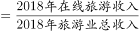
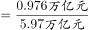

# 现期比重计算（分项加总+亿元与万亿元单位换算）

考点：[[20-考点/资料分析/比重/现期比重计算（分项加总+亿元与万亿元单位换算）|比重 / 现期比重计算（分项加总+亿元与万亿元单位换算）]]
材料：[[15-材料/资料分析/247099 2013～2018年中国旅游业总收入|247099 2013～2018年中国旅游业总收入]]

**问法模型**：题干出现'2018年在线旅游收入占旅游业总收入的'且选项为百分数 → 现期比重=在线旅游收入三项合计÷旅游业总收入，先跨列加总、再统一单位后直除

## 推理链
1. 第1步：题干'2018年……占……的'且选项为百分数，判定为现期比重问题；定位表格2018年行：旅游业总收入5.97万亿元，交通预订6820.95亿元、住宿预订1881.49亿元、度假游预订1051.81亿元
2. 第2步：表中无'在线旅游收入合计'列，需三项跨列加总：6820.95+1881.49+1051.81=9754.25亿元
3. 第3步：统一单位（1万亿元=10000亿元）：9754.25亿元÷10000=0.975425万亿元
4. 第4步：代入比重公式：0.975425÷5.97≈0.1634，即约16.3%
5. 第5步：与选项对照，约16.3%对应D项，故正确答案为D

**最快解法**：⚡ 截位直除：三项加总约9754亿元，旅游业总收入5.97万亿元=59700亿元，9754/59700，首位商1、次位约6（975÷597≈1.63），得约16.3%，直选D；亦可先算0.975÷5.97≈0.975/6≈16.3%

## 易错点
- ⚠ 单位混排陷阱：在线旅游收入为亿元、旅游业总收入为万亿元，直接用9754.25除以5.97会大10000倍（得163%的荒谬值），必须先÷10000统一为万亿元
- ⚠ 表中无合计列，漏加任一分项（如只算交通预订6820.95÷59700≈11.4%）即落入选项以分项冒充整体的设错
- ⚠ 三个分项并排且同为4位量级，看串列或加总算错（正确合计9754.25亿元）会连锁导致比重失真

## 母题抽象
> 🧩 当题干出现'A年B占C的比重'且B与C单位不一致（亿元对万亿元）时，先将B的分项跨列加总，再统一单位（÷10000化万亿元），用'合计÷总收入'截位直除对照选项量级

**同类特征**：现期年份2018年、'约占……的'问比重、在线旅游收入（三个分项需加总）、占旅游业总收入、选项为百分数、亿元与万亿元两套单位并存

## 相关题
- [[10-真题/资料分析/增长/9629 一般增长率计算（现期需由增量倒推）|9629]]（安徽 2009，相关度1）
- [[10-真题/资料分析/比重/2604234 现期比重计算|2604234]]（广东 2020，相关度1）
- [[10-真题/资料分析/增长/27835 一般增长率计算（已知现期量与增长量求增长率）|27835]]（河北 2012，相关度1）
- [[10-真题/资料分析/平均数/10204497 平均数增长率（均价=值-量的比值增长率）|10204497]]（海南 2024，相关度1）
- [[10-真题/资料分析/增长/12536395 隔年（间隔）增长率|12536395]]（四川 2024，相关度1）

---

### 题干
2018年中国在线旅游收入约占旅游业总收入的：

### 选项
- A. 

- B. 

- C. 

- D. 

　✅

### 官方解析

根据题干“2018年······占······的”结合选项为百分数，可判定本题为现期比重问题。定位表格材料可知，2018年旅游业总收入为5.97万亿元，2018年在线旅游收入亿元万亿元。代入公式：比重。

故正确答案为D。

### 给定材料

