# 两期比重比较（比重上升-下降判定：部分增速vs总体增速）

考点：[[20-考点/资料分析/比重/两期比重比较（比重上升-下降判定：部分增速vs总体增速）|比重 / 两期比重比较（比重上升/下降判定：部分增速vs总体增速）]]
材料：[[15-材料/资料分析/247099 2013～2018年中国旅游业总收入|247099 2013～2018年中国旅游业总收入]]

**问法模型**：题干问'2014年占中国旅游业总收入比重高于上年水平的包括哪些分项'→ 两期比重比较模型：部分增长率＞总体增长率则该分项2014年占比高于2013年，逐年分项判定后对照选项组合

## 推理链
1. 第1步：从表格提取相邻两年数据——旅游业总收入2013年2.95万亿元→2014年3.38万亿元；在线交通预订1519.67→2271.57亿元、住宿预订412.10→547.45亿元、度假游预订244.20→347.58亿元（比上年即以2013年行为基期）
2. 第2步：用两期比重结论规则：部分（各分项）增长率大于总体（旅游业总收入）增长率，则2014年占比高于上年；增长率=(现期−基期)/基期
3. 第3步：先算总体增长率=(3.38−2.95)/2.95=0.43/2.95≈14.6%（增长率分子分母同单位，无需万亿元→亿元换算）
4. 第4步：交通预订增长率=751.90/1519.67≈49.5%＞14.6%✔；住宿预订增长率=135.35/412.10≈32.8%＞14.6%✔；度假游预订增长率=103.38/244.20≈42.3%＞14.6%✔
5. 第5步：三个分项增长率全部大于总体增长率14.6%，即三项2014年占旅游业总收入的比重均高于2013年（验证：交通占比5.15%→6.72%、住宿1.40%→1.62%、度假游0.83%→1.03%，全部上升）
6. 第6步：对照选项，'在线交通预订、在线住宿预订、在线度假旅游预订'三项全部入选，对应B项，故选B

**最快解法**：⚡ 两期比重结论法+截位直除：先截位算总体增速0.43/2.95≈14.6%作比较基准，再对各分项增速只估首位——交通751.9/1520≈49%、住宿135/412≈33%、度假游103/244≈42%，三者首两位均远大于14.6%，无需精算两年比重，直接锁定三项全选的B

## 易错点
- ⚠ 单位混排陷阱：若走'直接算两年比重'路径，必须先把旅游业总收入2.95/3.38万亿元×10000化为29500/33800亿元再相除，否则比重差10000倍；而走增长率比较路径则分子分母同单位、无需换算
- ⚠ 误用增长量代替增长率：总体（旅游业总收入）基数大，直接比增量必错，必须是'部分增速vs总体增速'或'两年比重直接对比'
- ⚠ 漏算度假游预订看串列：三个分项数值同为4位量级且并排，度假游基数最小（244.20）易被忽略或看串，漏掉它会误选C；选项A/C/D正是按'只算部分分项'设错
- ⚠ 时间口径：'比上年'=2014年与2013年比，基期是最早的2013年行，勿拿2014与2015或其他年份对错行

## 母题抽象
> 🧩 当题干出现'某年占……比重高于（低于）上年水平'特征时，用两期比重结论——比较部分增长率与总体增长率（部分增速＞总体增速则比重上升），基准先算总体增速，分项增速估首位即可判定；若必须直接算比重，先把两期单位统一再相除

**同类特征**：占……比重高于上年水平、包括（多分项组合判定）、两期比重比较、部分增长率与总体增长率比较、相邻两年数据（2013基期vs2014现期）、分项并列需逐项判定

## 相关题
- [[10-真题/资料分析/比重/2281002 两期比重比较（比重升降-高于上年判断）|2281002]]（四川 2018，相关度2）
- [[10-真题/资料分析/综合/10204448 综合分析-逐项判断（历史极值确认、两期比重比较、多期累计求和、基期比重）|10204448]]（广东 2024，相关度1）
- [[10-真题/资料分析/比重/17097813 两期比重比较（比重差计算）|17097813]]（山西 2024，相关度1）
- [[10-真题/资料分析/比重/1746802 两期比重变化比较（增速比较法，连续两年判断）|1746802]]（国考 2016，相关度1）
- [[10-真题/资料分析/比重/2136660 两期比重变化比较（比重上升判断）|2136660]]（河南 2017，相关度1）

---

### 题干
中国在线旅游收入中，2014年占中国旅游业总收入比重高于上年水平的包括：

### 选项
- A. 仅在线交通预订
- B. 在线交通预订、在线住宿预订、在线度假旅游预订　✅
- C. 仅在线交通预订、在线住宿预订
- D. 仅在线交通预订、在线度假旅游预订

### 官方解析

根据题干“···2014年占···比重高于上年水平的包括”可判定本题为两期比重问题。

方法一：根据两期比重结论，部分增长率大于总体增长率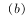则比重同比上升，即高于上年水平。定位表格可知2013年、2014年中国旅游业总收入和在线旅游收入各部分的相关数据。利用公式“增长率”可得，总体增长率即中国旅游业总收入增长率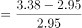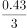；增长率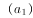即在线交通预订收入增长率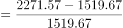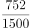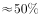；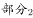增长率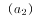即在线住宿预订收入增长率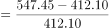；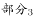增长率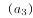即在线度假旅游预订收入增长率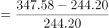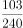。因此，满足条件的有在线交通预订，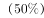；在线住宿预订，；在线度假旅游预订，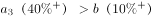。

方法二：根据表格中2013年、2014年中国旅游业总收入和在线旅游收入各部分的相关数据，利用公式“比重”可得，2013年、2014年在线交通预订收入占中国旅游业总收入的比重分别、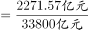，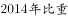，即比重高于上年水平；

2013年、2014年在线住宿预订收入占中国旅游业总收入的比重分别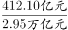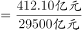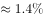、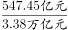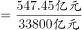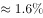，，即比重高于上年水平；

2013年、2014年在线度假旅游预订收入占中国旅游业总收入的比重分别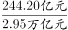、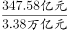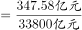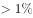，则，即比重高于上年水平。

故满足条件的有在线交通预订、在线住宿预订、在线度假旅游预订。

故正确答案为B。

### 给定材料

