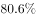

# 现期比重计算（整体=部分÷比重，比重=部分÷整体）

考点：[[20-考点/资料分析/比重/现期比重计算（整体=部分÷比重，比重=部分÷整体）|比重 / 现期比重计算（整体=部分÷比重，比重=部分÷整体）]]
材料：[[15-材料/资料分析/247103 2018年B市新经济发展情况：从新经|247103 2018年B市新经济发展情况：从新经]]

**问法模型**：题干问'第二段中（X）处应填入的数值最可能是'→ 属挖空比重反算模型：先由'整体=部分÷比重'换算出地区生产总值，再用'比重=部分÷整体'反算（X）

## 推理链
1. 第1步：定位第二段，（X）位于'占地区生产总值的比重为'处，即信息产业增加值占GDP的比重，部分值=信息产业增加值4940.7亿元
2. 第2步：整体（地区生产总值）未直接给出，用第一段换算：GDP=新经济增加值10057.4亿元÷新经济占GDP比重33.2%≈30293.4亿元
3. 第3步：代入'比重=部分÷整体'：（X）=4940.7÷30293.4≈16.3%
4. 第4步：合成式校验：4940.7×33.2%≈1640亿元，1640÷10057.4≈16.3%，结果一致
5. 第5步：与选项对照：A项15.0、B项13.7、C项17.6均明显偏离，仅D项16.3与计算结果吻合，故选D

**最快解法**：⚡ 比重合成一步式（截位直除）：（X）=4940.7×33.2%÷10057.4≈1640÷10057≈16.3%，首两位直除即可锁定D，省去先算GDP≈30293亿元的中间步骤

## 易错点
- ⚠ '比上年提高0.9个百分点'是比重的差值而非增速，不能把0.9与（X）相加或把（X）误当增长率套增速公式
- ⚠ 高技术产业、战略性新兴产业、信息产业三者交叉包含，不能加总求比重，也不能误用4893.4亿元或6976.8亿元代替4940.7亿元
- ⚠ 整体GDP未直接给出，误将新经济增加值10057.4亿元直接当作GDP去除会得约49%的荒谬结果；必须先用'部分÷比重'换算整体（转载材料中33.2%呈空缺，按解析口径补全）

## 母题抽象
> 🧩 当题干要求填补材料中挖空的'部分占整体比重'且整体未直接给出时，先用'整体=另一已知部分÷其占比'换算出整体，再用'比重=部分÷整体'反算（X）并对照选项

**同类特征**：（X）处应填入的数值最可能是、第二段、占地区生产总值的比重、现期比重计算、挖空数值反推、整体需由'部分÷占比'换算

## 相关题
- [[10-真题/资料分析/比重/15527 现期比重计算（多子条件混合的加权平均）|15527]]（黑龙江 2010，相关度1）
- [[10-真题/资料分析/比重/2028300 现期比重计算+饼图扇区匹配|2028300]]（国考 2017，相关度1）
- [[10-真题/资料分析/比重/1752662 现期比重计算（表格空缺比率补值）|1752662]]（北京 2016，相关度1）
- [[10-真题/资料分析/比重/1758932 现期比重计算＋跨图表数值比对定位|1758932]]（上海 2016，相关度1）
- [[10-真题/资料分析/比重/4652175 现期比重计算＋条件充分性判断（双路径验证）|4652175]]（北京 2022，相关度1）

---

### 题干
第二段中（X）处应填入的数值最可能是：

### 选项
- A. 15.0
- B. 13.7
- C. 17.6
- D. 16.3　✅

### 官方解析
由题干“第二段中（X）处应填入的数值最可能是”，结合材料“占地区生产总值的比重为”，可判定本题为现期比重计算问题。定位文字材料第二段，“2018年，B市高技术产业实现增加值6976.8亿元，比上年增长，占地区生产总值的比重为，比上年提高0.2个百分点。战略性新兴产业实现增加值4893.4亿元，增长，占地区生产总值的比重为，比上年提高0.1个百分点。信息产业实现增加值4940.7亿元，增长，占地区生产总值的比重为，比上年提高0.9个百分点。”。代入公式“ ”可得：2018年，B市地区生产总值亿元，代入公式“”可得：2018年，信息产业实现增加值占地区生产总值的比重，
与D项最接近。

### 给定材料

        2018年，B市新经济实现增加值10057.4亿元，比上年增长，占全市地区生产总值的比重为，比上年提高0.4个百分点。全年全市新设立的企业中，信息服务业、科技服务业企业合计达到70661家，占比为，注册资本达到7311.4亿元，同比增长。

        2018年，B市高技术产业实现增加值6976.8亿元，比上年增长，占地区生产总值的比重为，比上年提高0.2个百分点。战略性新兴产业实现增加值4893.4亿元，增长，占地区生产总值的比重为，比上年提高0.1个百分点。信息产业实现增加值4940.7亿元，增长，占地区生产总值的比重为，比上年提高0.9个百分点。

        2018年，B市高技术服务业完成投资507.8亿元，同比增长。其中，信息服务业投资增长，科技服务业投资增长。

        2018年，B市限额以上批发零售业网上零售额达到2632.9亿元，比上年增长，占全市零售额比重为，对全市零售额增长的贡献率（限额以上批发零售业网上零售额同比增量在全市零售额同比增量中占的比重）达到。限额以上住宿餐饮企业通过公共网络实现的餐费收入为124.7亿元，比上年增长，对全市餐费收入增长的贡献率达到。

        2018年，B市高新技术示范区规模以上高新技术企业实现技术收入10629.4亿元，比上年增长，占高新技术示范区规模以上高新技术企业总收入的比重为，比上年提高1.8个百分点。

> [!warning] 疑点（官方解析可能有误，待人工复核）
> 材料转载版中各百分数均以空缺呈现（含新经济占GDP比重33.2%），官方解析按'GDP=10057.4÷33.2%'代入计算；且材料导读将（X）标注为'高技术产业增速'并称用'比重变化反推增速'模型，与官方解析'现期比重计算'口径不符——按解析，(X)实为信息产业增加值占地区生产总值的比重（4940.7÷30293.4≈16.3%），答案D无争议
