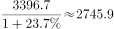
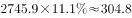
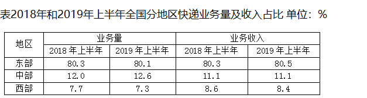
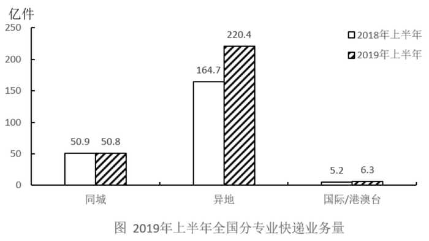

# 基期部分量计算（基期总量×基期占比）

考点：[[20-考点/资料分析/比重/基期部分量计算（基期总量×基期占比）|比重 / 基期部分量计算（基期总量×基期占比）]]
材料：[[15-材料/资料分析/247399 2019年上半年（含6月当月）全国快|247399 2019年上半年（含6月当月）全国快]]

**问法模型**：题干为'基期年份+某地区部分量'且材料只给占比不给绝对量 → 先用现期总量÷(1+同比增速)求基期总量，再乘该地区基期占比（部分=整体×比重）

## 推理链
1. 第1步：题干求2018年上半年中部地区快递业务收入；文字段给出2019年上半年全国快递业务收入3396.7亿元、同比+23.7%；统计表给出中部2018年上半年业务收入占比11.1%
2. 第2步：确定两步模型——基期总量=现期总量÷(1+增长率)，部分量=整体×比重
3. 第3步：求基期总量：2018年上半年全国快递业务收入=3396.7÷1.237≈2746亿元
4. 第4步：求部分量：中部地区收入=2746×11.1%≈2746÷9≈305亿元（精确值2745.9×11.1%≈304.8亿元）
5. 第5步：对照选项，304.8亿元对应C项；A236.1≈2746×8.6%（误用西部占比）、B285.3≈3396.7×8.4%、D377.0≈3396.7×11.1%（未折基期），均系陷阱值，排除

**最快解法**：⚡ 截位直除+百化分：先算3396.7÷1.237，首位商2、前三位≈2746；再把11.1%百化分为1/9，2746÷9≈305，锁定C（精确304.8亿元）；亦可合并列式3396.7×11.1%÷1.237≈377÷1.237≈304.8，两步到位

## 易错点
- ⚠ 跳过基期折算：直接用现期总量3396.7×11.1%≈377.0亿元，恰好掉入D项陷阱
- ⚠ 占比表横向串行：折基期后误乘西部2018年占比8.6%得≈236.1（A项），或未折基期误乘8.4%得≈285.3（B项）；表中东/中/西数值接近，须核对'业务收入—2018年上半年—中部'单元格，且勿误用业务量占比12.0%
- ⚠ 公式方向与口径错误：基期=现期÷(1+增速)，误乘(1+23.7%)或误用6月当月增速26.5%、环比口径；另注意中部收入占比两年均为11.1%，占比持平不等于可直接用现期总量，仍须先除以1.237

## 母题抽象
> 🧩 当题干出现'基期年份求某地区/某部分量'且材料只给占比表和现期总量同比增速时，用'现期总量÷(1+增速)×基期占比'两步法，并反向验证选项是否恰为'现期总量×某占比'的未折基期陷阱值

**同类特征**：基期时间点（2018年上半年）+地区收入、材料只给占比%、不给绝对量、现期总量与同比增速联动、部分=整体×比重、先除(1+增速)再乘占比、单位为亿元

## 相关题
- [[10-真题/资料分析/增长/2377372 增长量（增长额）计算与作差比较|2377372]]（陕西 2019，相关度1）
- [[10-真题/资料分析/比重/3523609 两期比重之部分量同比增减判定（部分=整体×比重，逐年判号）|3523609]]（四川 2021，相关度1）
- [[10-真题/资料分析/增长/5802085 增长量计算（现期与同比增速求增长量）|5802085]]（浙江 2023，相关度1）
- [[10-真题/资料分析/比重/19283971 现期比重比较（部分占整体比重超10%的品类计数）|19283971]]（国考 2025，相关度1）
- [[10-真题/资料分析/比重/4769985 现期比重计算（部分=整体×比重，饼图多扇区求和）|4769985]]（四川 2017，相关度1）

---

### 题干
2018年上半年，中部地区快递业务收入为（  ）

### 选项
- A. 236.1亿元
- B. 285.3亿元
- C. 304.8亿元　✅
- D. 377.0亿元

### 官方解析

根据题干“2018年上半年······收入为”，结合资料时间为2019年，可判定本题为基期计算问题。定位文字资料第一段可得，2019年上半年全国快递业务收入完成3396.7亿元，同比增长，根据公式：，2018年上半年全国快递业务收入为亿元；定位表格资料可得，中部地区2018年上半年业务收入占比为，根据公式：部分=整体×比重，2018年上半年中部地区快递业务收入为亿元。

故正确答案为C。

### 给定材料

        2019年上半年，全国快递业务量完成277.5亿件，同比增长25.7%；业务收入完成3396.7亿元，同比增长23.7%。6月份，全国快递业务量完成54.6亿件，同比增长29.1%；业务收入完成643.2亿元，同比增长26.5%。

        2019年6月，国家邮政局和各省（区、市）邮政管理局接到消费者对快递服务问题申诉42840件，环比下降0.3%，同比下降10.1%；处理的申诉中，有效申诉量1479件，环比下降5.7%，同比下降68.5%。

