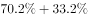
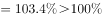

# 两项目交集必然存在判定（占比之和-100%的容斥-最不利模型）

考点：[[20-考点/资料分析/比重/两项目交集必然存在判定（占比之和-100%的容斥-最不利模型）|比重 / 两项目交集必然存在判定（占比之和>100%的容斥/最不利模型）]]
材料：[[15-材料/资料分析/247400 某市统计局2019年2月中下旬对20|247400 某市统计局2019年2月中下旬对20]]

**问法模型**：题干问'有A项目的人群中一定有人B项目'→ 判定模型：A%+B%>100%则两集合必有交集，即一定有人同时属于两者。

## 推理链
1. 第1步：从图2提取数据：'餐饮消费'占比70.2%（=70.2%×2000=1404人）；四个选项占比分别为：参加教育培训33.2%、去旅游27.9%、购保健品14.9%、购数码产品智能家电16%。
2. 第2步：判定规则——两集合均以同一整体2000人为分母，若两项目占比之和超过100%，则两集合不可能互斥（无交集时占比和至多为100%），必有交集。
3. 第3步：逐项验证：A项70.2%+33.2%=103.4%>100%；B项70.2%+27.9%=98.1%<100%；C项70.2%+14.9%=85.1%<100%；D项70.2%+16%=86.2%<100%。
4. 第4步：人数角度复核：非餐饮人数=2000−1404=596人，参加教育培训有660人，660>596，教育培训者中至少660−596=64人必为餐饮消费者；只有A项满足'一定有人'，故选A。

**最快解法**：⚡ 和超100%判定法（容斥最不利）：餐饮70.2%固定，直接找选项中占比大于100%−70.2%=29.8%的项目，仅'参加教育培训33.2%'达标（33.2%>29.8%），秒选A；其余选项均用'70.2%+选项占比是否破百'口算排除。

## 易错点
- ⚠ 误以为图2是多选占比、合计超100%就不能相加——实际判定交集时两占比分母同为2000人，占比之和>100%即可判定必交，无需换算人数。
- ⚠ 方向搞反：'一定有人'要求交集必然存在，占比和<100%时两集合可以不交（如去旅游27.9%可全部落在非餐饮的29.8%内），故B/C/D只是'可能有人'而非'一定有人'。
- ⚠ 图2条形按占比从小到大自上而下排布，最大值在最底部，易看串行把'参加教育培训33.2%'误读成相邻的'看电影等53.2%'或'去旅游27.9%'，导致排除A。

## 母题抽象
> 🧩 当题干出现'有A的（人群）中一定有人B'或'至少同时'特征时，用容斥交集判定法：A%+B%>100%（或B%>100%−A%）即必有交集，逐一验证选项。

**同类特征**：一定有人、有'餐饮消费'的受访居民中、不同消费项目并列选项、多选占比（图2）、必然交集、占比之和超过100%

## 相关题
- [[10-真题/资料分析/其他/2172295 容斥原理-抽屉原理——两集合占比和＞100%必有交集的必然性判断|2172295]]（江苏 2018，相关度1）
- [[10-真题/资料分析/综合/2367976 综合推断（'能够推出'判定——交集必然性-容斥思想）|2367976]]（江苏 2019，相关度1）

---

### 题干
2019年春节期间有“餐饮消费”的受访居民中，一定有人：

### 选项
- A. 参加教育培训　✅
- B. 去旅游
- C. 购保健产品
- D. 购数码产品、智能家电

### 官方解析

根据题干“2019年······受访居民中······”，结合选项为不同消费项目，可判定本题为现期比重问题。定位图2，2019年春节期间不同消费项目中有“消费餐饮”的受访居民占比为；结合选项，受访居民参加教育培训的占比为，二者占比之和为，超过整体，说明二者之间必然有交集，也就是说，春节期间有“餐饮消费”的受访居民中，一定有人参加教育培训。

故正确答案为A。

### 给定材料

        2019年2月中下旬，某市统计局随机抽取2000名在该市居住半年以上的18～65周岁居民，就其2019年春节期间的消费情况进行了调查。调查结果显示：与上年春节相比，的受访居民消费支出有所增加，的受访居民消费支出基本持平。

                                                     

                                                                          

