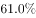
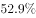

# 容斥原理（两集合交集最小值）求现期比重——'至少占'型

考点：[[20-考点/资料分析/比重/容斥原理（两集合交集最小值）求现期比重——'至少占'型|比重 / 容斥原理（两集合交集最小值）求现期比重——'至少占'型]]
材料：[[15-材料/资料分析/247400 某市统计局2019年2月中下旬对20|247400 某市统计局2019年2月中下旬对20]]

**问法模型**：题干'A群体中满足B的至少占多少'→先用交集最小值公式min=A+B−总样本求出最少共同人数，再除以A群体人数得比重下限。

## 推理链
1. 第1步：由图1读出消费支出2000元以下占比36.70%，换算人数=2000×36.70%=734人
2. 第2步：由图2读出'发红包、给压岁钱'占比82.7%（多选口径），换算人数=2000×82.7%=1654人
3. 第3步：验证交集存在：1654+734=2388>2000（受访总人数），两群体必有重合；交集最小值=1654+734−2000=388人
4. 第4步：所求'至少占'=交集最小值÷2000元以下人数=388/734≈52.9%
5. 第5步：对照选项，与D项一致，故选D

**最快解法**：⚡ 容斥交集下限公式+截位直除：min=A+B−N=734+1654−2000=388人，388/734直除首两位≈52.9%，锁定D；亦可等价变形为1−(2000−1654)/734=1−346/734≈52.9%心算完成。

## 易错点
- ⚠ 误把82.7%当作734人中的占比，算734×82.7%≈607人——实际82.7%是全样本2000人口径，必须先各自换算人数再做容斥
- ⚠ 交集下限公式用错方向：误取|1654−734|=920人为最少重合，或求出2388后忘记减去全集2000
- ⚠ 图1（互斥结构、合计100%）与图2（多选、合计超100%）口径不同，两图占比不能直接相加减，必须统一换算成人数后再运算

## 母题抽象
> 🧩 当题干出现'某子群体中另一特征的至少占…'时，先把两条件占比分别×样本总量换算成人数，用交集最小值公式min=A+B−N，再除以子群体人数，并先验证A+B>N确保交集存在。

**同类特征**：至少占、消费支出在2000元以下、发红包、给压岁钱、受访居民中、图1金额档×图2消费项目交叉、交集最小值/最不利容斥

## 相关题
（暂无）

---

### 题干
2019年春节期间消费支出在2000元以下的受访居民中，“发红包、给压岁钱”的至少占

### 选项
- A. 

- B. 

- C. 

- D. 

　✅

### 官方解析
根据题干“2019年······至少占”，结合选项为百分数，可判定本题为现期比重问题。定位图1可知春节期间消费支出在2000元以下的受访居民占比为，则消费支出在2000元以下的受访居民人数为人；定位图2可知“发红包、给压岁钱”的受访居民占比为，则“发红包、给压岁钱”的受访居民人数为人，因为人，证明消费支出在2000元以下的受访居民与发红包、给压岁钱的受访居民有交集，所以消费支出在2000元以下的受访居民中，“发红包、给压岁钱”的人数至少为人，所求。
故正确答案为D。

### 给定材料

        2019年2月中下旬，某市统计局随机抽取2000名在该市居住半年以上的18～65周岁居民，就其2019年春节期间的消费情况进行了调查。调查结果显示：与上年春节相比，的受访居民消费支出有所增加，的受访居民消费支出基本持平。

                                                     

                                                                          

