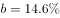
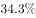

# 两期比重升降判定（比重变化比较）

考点：[[20-考点/资料分析/比重/两期比重升降判定（比重变化比较）|比重 / 两期比重升降判定（比重变化比较）]]
材料：[[15-材料/资料分析/247411 2019年上半年我国东部地区10个省|247411 2019年上半年我国东部地区10个省]]

**问法模型**：题干问'各省占地区总收入的比重同比提高的有几个'→两期比重升降判定模型：部分增速a>整体增速b则比重上升，只需逐省比较增速与整体增速14.6%的大小，无需算基期

## 推理链
1. 第1步：从表格提取基准——东部地区合计行软件业务收入263354838万元、同比增长14.6%，即整体增速b=14.6%
2. 第2步：从表格'软件业务收入—同比增长(%)'列提取10省增速：北京15.5、天津20.3、河北34.3、上海13.8、江苏15.2、浙江16.3、福建15.5、山东16.5、广东10.3、海南43.8
3. 第3步：套用两期比重结论'若部分增速a>整体增速b，则比重同比提高'，逐省与14.6%比较：北京15.5>14.6✓、天津20.3✓、河北34.3✓、上海13.8<14.6✗、江苏15.2✓、浙江16.3✓、福建15.5✓、山东16.5✓、广东10.3✗、海南43.8✓
4. 第4步：统计满足a>b的有北京、天津、河北、江苏、浙江、福建、山东、海南共8个省（市），对照选项D（8个），故选D

**最快解法**：⚡ 两期比重结论法+首数比较：以整体增速14.6%为基准线，逐行扫'软件业务收入同比增长(%)'列，只数大于14.6%的行数（15.5、20.3、34.3、15.2、16.3、15.5、16.5、43.8共8行），30秒出答案，全程不计算基期或比重数值

## 易错点
- ⚠ 口径列选错：误用'信息技术服务收入'增速列（如北京17.6%、上海16.3%）判断，正确口径应为'软件业务收入'增速列，两者数值不同会改变数数结果
- ⚠ 把增速当比重变化：'同比增长(%)'是增速，'比重同比提高'是百分点变化，不能直接用增速大小排比重，必须走a与b比较的结论
- ⚠ 临界与漏数：上海13.8%与基准14.6%接近需仔细比较，广东10.3%明显排除；10个省（市）须逐行数全，且不能把'东部地区'合计行误计入省份数

## 母题抽象
> 🧩 当题干出现'…占…比重同比提高（上升）的有几个'特征时，直接用两期比重结论——只比较部分增速a与整体增速b，a>b即入选，无需计算任何基期量或比重值；b取合计行对应指标增速

**同类特征**：占…比重同比提高的有几个、各省(市)中、两期比重升降、部分增速与整体增速比较、无需计算具体比重值、合计行增速作基准14.6%

## 相关题
- [[10-真题/资料分析/比重/3523610 两期比重比较（比重升降判断+计数）|3523610]]（四川 2021，相关度2）
- [[10-真题/资料分析/比重/1746802 两期比重变化比较（增速比较法，连续两年判断）|1746802]]（国考 2016，相关度1）
- [[10-真题/资料分析/比重/1796176 两期比重升降判断（分量增速a与总量增速b比较）|1796176]]（贵州 2016，相关度1）
- [[10-真题/资料分析/比重/1797640 两期比重变化（比重差定量计算）|1797640]]（山东 2016，相关度1）
- [[10-真题/资料分析/综合/2049570 综合判断题（两期比重变化判断＋现期比值-占比比较）|2049570]]（新疆 2017，相关度1）

---

### 题干
东部地区各省(市)中，2019年上半年软件业务收入占地区软件业务总收入的比重同比提高的有

### 选项
- A. 5个
- B. 6个
- C. 7个
- D. 8个　✅

### 官方解析

根据题干“······2019年上半年······占······比重同比提高的有”，可判定本题为两期比重问题。定位表格资料可知2019年上半年我国东部地区各省（市）软件业务收入同比增长率（a）、东部地区软件业务总收入同比增长率（），根据两期比重结论“若 ，则比重同比提高”，满足题干要求的有北京（）、天津（）、河北（）、江苏（）、浙江（）、福建（）、山东（）、海南（），共8个省（市）。

故正确答案为D。

### 给定材料

根据以下资料，回答116～120题

 

> [!warning] 疑点（官方解析可能有误，待人工复核）
> 官方解析中整体增速b及各省增速a的具体数值位置显示为空白（占位符缺失），但判定逻辑与结论（8个，选D）正确，不影响答案

<!-- CODEX-ANSWER-REVIEW:BEGIN -->
### 本次独立复核

**复核状态：** `resolved`（答案与解析已核定）

**计分答案：** D（可计分）

**复核解析：**

判断省级收入增速a是否高于东部整体软件收入增速b。按表中各省增速比较，北京、天津、河北、江苏、浙江、福建、山东、广东共8省满足a>b，因此D。

**相关信息：**

两期比重变化常用公式：现期比重×(部分增长率−整体增长率)/(1+部分增长率)；部分增速高于整体时比重上升。

**题源依据：** [固定版本原题](https://github.com/Mentat-Uran/kaogongzhentizhengliu/blob/84ab93d4b64b61d897bece8a1c0a5bab06b4feb2/10-%E7%9C%9F%E9%A2%98/%E8%B5%84%E6%96%99%E5%88%86%E6%9E%90/%E6%AF%94%E9%87%8D/2452707%20%E4%B8%A4%E6%9C%9F%E6%AF%94%E9%87%8D%E5%8D%87%E9%99%8D%E5%88%A4%E5%AE%9A%EF%BC%88%E6%AF%94%E9%87%8D%E5%8F%98%E5%8C%96%E6%AF%94%E8%BE%83%EF%BC%89.md)；固定内容 commit `84ab93d4b64b61d897bece8a1c0a5bab06b4feb2`，Markdown blob `8c4ebfa75d134a654d4aa83c4cfd5801a361eb0f`。
<!-- CODEX-ANSWER-REVIEW:END -->
