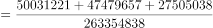
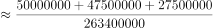
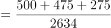
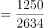
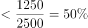
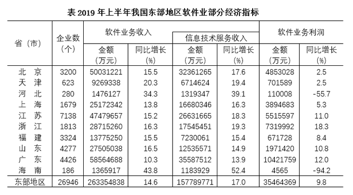

# 现期比重构成（饼图对照判断）

考点：[[20-考点/资料分析/比重/现期比重构成（饼图对照判断）|比重 / 现期比重构成（饼图对照判断）]]
材料：[[15-材料/资料分析/247411 2019年上半年我国东部地区10个省|247411 2019年上半年我国东部地区10个省]]

**问法模型**：题干要求判断哪个图形正确表示'2019年上半年……收入构成'且选项均为饼图 → 各省比重的分母统一为地区合计，按'分母相同、分子越大比重越大'对各省现期收入排序，再与图形扇区相对大小逐项对照排除

## 推理链
1. 第1步：由题干'2019年上半年……收入构成'和饼图选项判定为现期比重构成问题，分母统一取东部地区软件业务收入合计263354838万元
2. 第2步：从表格提取各省现期收入（万元）：广东58564688、北京50031221、江苏47479657、浙江28715260、山东27505038、上海25172342、福建13775250、天津9269338、河北1476127、海南1365917
3. 第3步：所用规则：比重=部分÷整体，分母一致时分子越大比重越大，故图形中扇区大小顺序必须与各省收入金额大小顺序一致
4. 第4步：排除A——图中北京占比大于广东，但实际北京50031221万元＜广东58564688万元，与数据矛盾
5. 第5步：排除C——图中江苏占比大于北京，但实际江苏47479657万元＜北京50031221万元，与数据矛盾
6. 第6步：排除D——北京+江苏+山东=50031221+47479657+27505038=125015916万元，占合计125015916÷263354838≈47.5%，未超过50%，与图中'超过'的说法矛盾
7. 第7步：B项各扇区相对大小与各省收入排序相符，故正确答案为B

**最快解法**：⚡ 排除法+截位直除：先抓收入排序'广东58564688＞北京50031221＞江苏47479657'直接排除A、C；再对D截位估算三省和占比125015916/263354838≈125/263≈47.5%＜50%排除D，锁定B，全程无须精算每个省的比重

## 易错点
- ⚠ 分母口径陷阱：构成比重分母必须用'软件业务收入'合计263354838万元；'信息技术服务收入'（合计157789771万元）只是软件业务收入的组成部分，误当分母会使所有占比失真
- ⚠ 图形题不必逐个精算比重：核心是'分母一致比分子的相对大小'排序对照，若对10个省都算占比会严重浪费时间
- ⚠ D项需三省8位数求和（50031221+47479657+27505038），抄写易错位；判断'是否超过50%'用截位估算≈47.5%即可，无须精确计算

## 母题抽象
> 🧩 当题干出现'下列图形中表示……构成/占比正确的是'且各选项分母相同时，用'分子排序对照扇区大小'的排除法，再抽取最大两三项做占比量级验证（如三省合计≈47.5%＜50%），即可快速锁定答案

**同类特征**：图形表示收入构成、选项为饼形图、现期比重、分母相同比分子的排序、逐项排除、只需相对大小无须精确占比

## 相关题
- [[10-真题/资料分析/比重/4792819 现期比重计算（多部分比重依次求解）|4792819]]（新疆 2014，相关度1）
- [[10-真题/资料分析/比重/827355 现期比重比较（部分占比过半速判）|827355]]（政法干警 2014，相关度1）
- [[10-真题/资料分析/比重/2272297 现期比重比较|2272297]]（选调 2015，相关度1）
- [[10-真题/资料分析/比重/2032972 现期比重计算（多地区占比求和）|2032972]]（吉林 2015，相关度1）
- [[10-真题/资料分析/比重/2187857 现期比重计算（部分量需先由'总量−其中量'减法间接求得）|2187857]]（山东 2018，相关度1）

---

### 题干

下列图形中，对2019年上半年东部地区各省（市）软件业务收入构成表示正确的是

### 选项
- A. A
- B. B　✅
- C. C
- D. D

### 官方解析

根据题干“······2019年上半年······收入构成······”，结合选项均为饼形图，可判定本题为现期比重问题。定位表格资料可得2019年上半年东部地区软件业务总收入以及各省（市）软件业务收入。根据公式：比重，可知分母一致，分子越大，比重越大。分别分析各个选项。

A项：图中北京占比大于广东，但在表格资料中，北京（50031221万元）广东（58564688万元），错误。

C项：图中江苏占比大于北京，但在表格资料中，江苏（47479657万元）北京（50031221万元），错误。

D项：图中北京、江苏和山东三个省（市）的总和占东部地区的比重超过，但在表格资料中，北京、江苏和山东三个省（市）的总和占东部地区的比重，错误。

故正确答案为B。

### 给定材料

根据以下资料，回答116～120题

 

> [!warning] 疑点（官方解析可能有误，待人工复核）
> 官方解析D项表述不完整（'比重超过'后缺失具体阈值），按数据计算北京+江苏+山东合计占比约47.5%，可反推D图所示为超过50%（或类似阈值）与实际不符，不影响答案B的正确性
