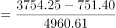
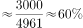

# 现期比重之差（同一总量作分母的两部分占比相减）

考点：[[20-考点/资料分析/比重/现期比重之差（同一总量作分母的两部分占比相减）|比重 / 现期比重之差（同一总量作分母的两部分占比相减）]]
材料：[[15-材料/资料分析/247412 以2018年为重点、回溯2010—2|247412 以2018年为重点、回溯2010—2]]

**问法模型**：题干问'A、B占整体的比重之差为多少个百分点' → 采用比重差模型：两部分之差÷同一总量，即(3754.25−751.40)/4960.61，一步作商

## 推理链
1. 第1步：定位文字资料：2018年末全国文物机构拥有文物藏品总量4960.61万件，其中博物馆文物藏品3754.25万件，文物商店文物藏品751.40万件（材料时间为2018年末，为现期比重问题）
2. 第2步：两比重之差=博物馆占比−文物商店占比，因分母相同（均为总量4960.61万件），可合并为(3754.25−751.40)/4960.61
3. 第3步：分子作差：3754.25−751.40=3002.85万件；分母截位：4960.61≈4961
4. 第4步：截位直除：3002.85/4960.61≈3000/4961≈60.5%，即60.5个百分点
5. 第5步：与选项对照：C项60.5个百分点与计算结果一致，选C

**最快解法**：⚡ 截位直除：先口算分子差3754.25−751.40≈3003，再截位3003/4961≈3000/4960≈60.5%；亦可分步估：3754/4961≈75.7%、751/4961≈15.1%，差≈60.6%内即可锁定C

## 易错点
- ⚠ 分母误用博物馆与文物商店之和4505.65万件：两者之和小于总量4960.61万件（剩余为其他机构藏品），比重差的分母必须统一为总量4960.61万件
- ⚠ 单位与表述陷阱：结果单位是'个百分点'而非'%'，若把60.5%再当成增长率二次换算或与小数百分位对错位会错选
- ⚠ 减法借位粗心：3754.25−751.40小数部分0.25−0.40需借位，得3002.85；减错为3003.15或3002.35虽仍选C，但若整体算错方向（如751.40−3754.25取错顺序）将无法匹配选项

## 母题抽象
> 🧩 当题干出现'两部分占同一整体的比重之差'特征时，直接用(部分A−部分B)÷同一总量一步作商，先减后除（分子先合并），结果以'个百分点'表述，验证与最接近选项匹配

**同类特征**：比重之差、占全国文物机构文物藏品的比重、2018年末、现期比重、同一分母合并分子、个百分点

## 相关题
- [[10-真题/资料分析/比重/4792819 现期比重计算（多部分比重依次求解）|4792819]]（新疆 2014，相关度1）
- [[10-真题/资料分析/比重/827355 现期比重比较（部分占比过半速判）|827355]]（政法干警 2014，相关度1）
- [[10-真题/资料分析/比重/2272297 现期比重比较|2272297]]（选调 2015，相关度1）
- [[10-真题/资料分析/比重/2032972 现期比重计算（多地区占比求和）|2032972]]（吉林 2015，相关度1）
- [[10-真题/资料分析/比重/2187857 现期比重计算（部分量需先由'总量−其中量'减法间接求得）|2187857]]（山东 2018，相关度1）

---

### 题干
2018年末全国博物馆文物藏品、文物商店文物藏品占全国文物机构文物藏品的比重之差为

### 选项
- A. 53.6个百分点
- B. 55.2个百分点
- C. 60.5个百分点　✅
- D. 66.3个百分点

### 官方解析

根据题干“2018年末······占全国文物机构文物藏品的比重之差为”结合资料时间为2018年末，可判定本题为现期比重问题。定位文字资料可得，2018年末，全国文物机构拥有文物藏品4960.61万件，其中，博物馆文物藏品3754.25万件，文物商店文物藏品751.40万件。根据公式：比重，可得所求比重差，即60个百分点，与C项最接近。

故正确答案为C。

### 给定材料

        2018年末，全国共有各类文物机构10160个，比上年末增加229个。其中，文物保护管理机构3550个，占；博物馆4918个，占。全国文物机构从业人员16.26万人，比上年末增加0.11万人。其中，高级职称占，中级职称占。全国文物机构拥有文物藏品4960.61万件，比上年末增长。其中，博物馆文物藏品3754.25万件，文物商店文物藏品751.40万件。

图  2010—2018年全国文物机构及其从业人员情况

