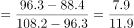
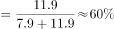

# 混合比重（线段法-十字交叉反推部分占比）

考点：[[20-考点/资料分析/比重/混合比重（线段法-十字交叉反推部分占比）|比重 / 混合比重（线段法/十字交叉反推部分占比）]]
材料：[[15-材料/资料分析/247415 全国10个市'我国儿童校外生活状况'|247415 全国10个市'我国儿童校外生活状况']]

**问法模型**：题干'市区儿童占被调查儿童的比重是'→总体均值96.3介于乡镇108.2与市区88.4之间，用线段法距离反比求市区人数占比

## 推理链
1. 第1步：从统计图提取周末儿童日均使用电子产品总用时96.3分钟；从文字提取周末乡镇儿童108.2分钟、市区儿童88.4分钟
2. 第2步：混合平均模型——总体96.3必介于88.4与108.2之间，人数比等于对侧距离比（线段法），即乡镇:市区=(96.3-88.4):(108.2-96.3)
3. 第3步：计算两段距离：96.3-88.4=7.9（乡镇份额），108.2-96.3=11.9（市区份额），故乡镇:市区=7.9:11.9
4. 第4步：市区占比=11.9÷(7.9+11.9)=11.9/19.8≈60.1%
5. 第5步：与选项对照，60.1%对应C项，故正确答案为C

**最快解法**：⚡ 线段法（十字交叉）：96.3写在中间，108.2与88.4分列两侧，得差7.9与11.9；市区份额取远离自己的差11.9，占比=11.9/(7.9+11.9)=11.9/19.8≈60%，直接锁定C

## 易错点
- ⚠ 距离反比方向搞反：乡镇应占同侧差7.9份、市区占11.9份，若误取同侧距离会算成7.9/19.8≈40%而误选
- ⚠ 数据口径分散：总体96.3在图表、乡镇108.2与市区88.4在文字，只看单一材料拼不齐数据，必须跨图表+文字拼接
- ⚠ 题干未给儿童人数，易误判'无法求解'；实际无需问卷15000份的具体分配，靠均值加权即可反推人数结构

## 母题抽象
> 🧩 当题干给出总体均值介于两个部分均值之间并求某部分占比时，用线段法：该部分占比=对侧距离÷两侧距离之和，距离与数量成反比

**同类特征**：'占……的比重是'、总体均值（96.3）与两个部分均值（108.2/88.4）同时出现、混合加权反推人数结构、适用线段法/十字交叉、数据分散于文字与图表需拼接、无基期/增长信息，纯现期比重

## 相关题
（暂无）

---

### 题干
在该次调查中，市区儿童占被调查儿童的比重是

### 选项
- A. 

- B. 

- C. 

　✅
- D. 

### 官方解析

根据题干“······占······比重是”，可判定本题为现期比重问题。定位图形资料可知，周末儿童平均使用电子产品的时间为96.3分钟；定位文字资料可知，周末，乡镇儿童日平均使用电子产品用时108.2分钟，市区儿童88.4分钟。利用线段法求解乡镇和市区儿童的数量比为。乡镇和市区儿童的数量之比，乡镇儿童占7.9份，市区儿童占11.9份，则市区儿童占被调查儿童的比重。

故正确答案为C。

### 给定材料

        某研究机构从全国随机抽取10个市的儿童家长，对其进行“我国儿童校外生活状况”的问卷调查，回收有效问卷15000份。调查结果显示：对儿童校外生活表示“很重视”的家长占以上，表示“很满意”或“比较满意”的占；上学日，儿童日平均使用电子产品用时43.2分钟，其中利用电子产品学习用时13.9分钟，看动画等娱乐用时16.6分钟；周末，乡镇儿童日平均使用电子产品用时108.2分钟，市区儿童88.4分钟。

