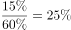
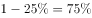

# 现期比重——嵌套比重与极端假设放缩求下界

考点：[[20-考点/资料分析/比重/现期比重——嵌套比重与极端假设放缩求下界|比重 / 现期比重——嵌套比重与极端假设放缩求下界]]
材料：[[15-材料/资料分析/247415 全国10个市'我国儿童校外生活状况'|247415 全国10个市'我国儿童校外生活状况']]

**问法模型**：题干问'表示很满意/比较满意的家长中，表示很重视的家长占比可能是'（子集内嵌套比重且材料只给范围条件）→ 用极端假设放缩构造所求比重的下界，再与选项比对取唯一满足者

## 推理链
1. 第1步：从文字提取条件：调查回收有效问卷15000份，对儿童校外生活表示'很重视'的家长占a%以上、表示'很满意'或'比较满意'的占b%以上（a、b具体数值在所给材料中留空，属数据缺口）
2. 第2步：规则（全集对子集的放缩）：全体家长中'很重视'占a%以上，则非'很重视'的家长占比小于(100−a)%，这(100−a)%是满意家长中'非很重视'占比的分子上限
3. 第3步：极端假设：即使非'很重视'的家长全部同时表示'很满意/比较满意'，其占满意家长（至少b%）的比例也小于(100−a)%÷b%
4. 第4步：代入得下界：满意家长中'很重视'的占比大于1−(100−a)/b（记为T），官方解析依原文数值算出T后判定'只有D项满足'
5. 第5步：对照选项：A、B、C三项数值均低于下界T，仅D项高于T，故选D

**最快解法**：⚡ 极端假设放缩法（分子封顶+分母取下限）：非'很重视'占比≤(100−a)%作分子上限，'很满意/比较满意'占比≥b%作分母下限，心算下界1−(100−a)/b，四个选项中唯一高于该下界的D即为答案，无需精确计算各选项

## 易错点
- ⚠ 材料文字中两个比重数值留空（'很重视'占__以上、'很满意/比较满意'占__），切勿凭印象代入记忆中的具体数值精算；本题考查的是范围放缩而非精确比重计算
- ⚠ 分子分母用反或口径混淆：所求是'满意家长中很重视'的占比（子集内比重），需先用'非很重视'的上限构造其在满意家长中的占比上限、再取补数；直接拿全集比重相除或把'很重视'占全集的比重当成其在子集中的比重即错
- ⚠ 忘记取极端情形：只有当非'很重视'者全部落在'满意'群体时下界才取到最小值，不取极端或把不等号方向写反都会误判可行区间而错选

## 母题抽象
> 🧩 当题干出现'A群体中B群体的占比可能是'且材料只给出两个比重范围（X占a%以上、Y占b%以上）时，用极端假设放缩：非X占比≤(100−a)%，则A中X占比>1−(100−a)/b，验证选项中唯一高于该下界者即为答案

**同类特征**：'……中……的家长占比可能是'（嵌套比重+范围型问法）、材料仅提供比重范围条件（'占__以上'）、选项为离散百分比，需构造下界排除、涉及两个交叉分类（重视程度×满意程度）的家长子集、'可能是'提示无需精确值、只需满足约束、纯文字材料题，图表数据非必需

## 相关题
（暂无）

---

### 题干
对儿童校外生活表示“很满意”或“比较满意”的家长中，表示“很重视”的家长占比可能是

### 选项
- A. 

- B. 

- C. 

- D. 

　✅

### 官方解析

根据题干“······占比······”，可判定本题为现期比重问题。定位文字资料可知，对儿童校外生活表示“很重视”的家长占以上，表示“很满意”或“比较满意”的占。对儿童校外生活表示“很重视”的家长占比大于，则不是很重视的占比小于，若不是很重视的家长均表示“很满意”或“比较满意”，则在表示“很满意”或“比较满意”的家长中，不是很重视的家长占比应小于，则表示“很重视”的家长占比应大于，只有D项满足。

故正确答案为D。

### 给定材料

        某研究机构从全国随机抽取10个市的儿童家长，对其进行“我国儿童校外生活状况”的问卷调查，回收有效问卷15000份。调查结果显示：对儿童校外生活表示“很重视”的家长占以上，表示“很满意”或“比较满意”的占；上学日，儿童日平均使用电子产品用时43.2分钟，其中利用电子产品学习用时13.9分钟，看动画等娱乐用时16.6分钟；周末，乡镇儿童日平均使用电子产品用时108.2分钟，市区儿童88.4分钟。

> [!warning] 疑点（官方解析可能有误，待人工复核）
> 所给材料文字中'很重视'与'很满意/比较满意'两个关键比重数值均留空（数据缺口），下界1−(100−a)/b的具体数值无法从给定材料核验；官方解析的极端假设放缩逻辑自洽且与答案D一致，不构成解析错误，仅提示该题依赖原文缺失数值、解题时不得凭空代入

<!-- CODEX-ANSWER-REVIEW:BEGIN -->
### 本次独立复核

**复核状态：** `resolved`（答案与解析已核定）

**计分答案：** D（可计分）

**复核解析：**

设全体家长中很重视者比例为H>85%，满意者比例为S=60%。非很重视者总比例1−H<15%，即使全部落在满意者中，满意群体内非很重视者比例也小于15%÷60%=25%；因此满意家长中很重视者比例大于75%。选项53%、58%、63%均低于下界，只有78%符合。78%可实现，例如总体60%满意者中46.8%既满意又很重视、13.2%满意但不很重视；其余40%不满意者可有38.2%很重视、1.8%不很重视，则全体很重视85%、满意者中很重视比例46.8/60=78%。故选D。

**相关信息：**

条件概率下界：P(A∩B)/P(B)≥[P(A)+P(B)−1]/P(B)。本题“很重视”按总体计，“满意中很重视”以满意家长为分母；原调研有效问卷14,874份，85%和60%比例足以完成集合推理。

**题源依据：** [固定版本原题](https://github.com/Mentat-Uran/kaogongzhentizhengliu/blob/84ab93d4b64b61d897bece8a1c0a5bab06b4feb2/10-%E7%9C%9F%E9%A2%98/%E8%B5%84%E6%96%99%E5%88%86%E6%9E%90/%E6%AF%94%E9%87%8D/2452780%20%E7%8E%B0%E6%9C%9F%E6%AF%94%E9%87%8D%E2%80%94%E2%80%94%E5%B5%8C%E5%A5%97%E6%AF%94%E9%87%8D%E4%B8%8E%E6%9E%81%E7%AB%AF%E5%81%87%E8%AE%BE%E6%94%BE%E7%BC%A9%E6%B1%82%E4%B8%8B%E7%95%8C.md)；固定内容 commit `84ab93d4b64b61d897bece8a1c0a5bab06b4feb2`，Markdown blob `a2192671fcded793ae3c5d1094057ae0d8b16e4e`。
<!-- CODEX-ANSWER-REVIEW:END -->
