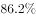
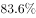
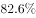
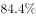
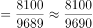
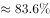

# 现期比重计算

考点：[[20-考点/资料分析/比重/现期比重计算|比重 / 现期比重计算]]
材料：[[15-材料/资料分析/247417 2018年1-2月份全国规模以上工业|247417 2018年1-2月份全国规模以上工业]]

**问法模型**：题干时间（2018年1-2月）与材料现期一致，问'制造业利润总额占全国规上工业企业利润总额的比重'→直接用部分值÷整体值，无需基期换算、无需引入增速

## 推理链
1. 第1步：判断时间口径——材料主时间为2018年1-2月，题干所求也是2018年1-2月的比重，属现期比重问题
2. 第2步：从材料提取部分值与整体值——制造业实现利润总额8100亿元，全国规模以上工业企业实现利润总额9689亿元（行业三项877.9+8100+711.1=9689为完备划分，制造业确为总体的组成部分）
3. 第3步：套用现期比重公式——比重=部分值÷整体值=8100÷9689
4. 第4步：截位直除速算——8100÷9689≈81/97≈0.836，即约83.6%
5. 第5步：与选项对照，B项数值与之最接近，故正确答案为B

**最快解法**：⚡ 截位直除（配合百化分）：8100/9689≈81/97，97×0.836≈81.09，故比值≈0.836即83.6%左右，在选项中锁定B项即可，全程不需要任何增速数据

## 易错点
- ⚠ 时间与增速干扰：材料通篇是'同比增长'表述（且增速数值留空），勿被带偏误算成基期比重（基期比重需乘(1+部分增速)/(1+整体增速)，而本题增速缺失，恰好提示本题根本不该用增速）
- ⚠ 整体值选错：企业性质五类之和14874.9亿元因交叉重叠远大于9689亿元，绝不能把总体取成五类之和或某一类；整体必须取第一层总口径9689亿元
- ⚠ 量级与口径：集体企业仅36.9亿元与总体9689亿元相差两个数量级，比较/代入时勿套错基数；8100与9689单位均为亿元，只需注意百分数换算勿丢百分号或错位小数

## 母题抽象
> 🧩 当题干出现'现期某部分占现期总体的比重'且题干时间=材料主时间时，直接用部分值÷整体值并截位直除对照选项，不引入增速、不换基期、不重算总体口径

**同类特征**：题干时间与材料现期一致（2018年1-2月份）、'占……的比重为'标准现期比重问法、部分值与整体值同在一段文字材料中可直接定位、整体为第一层总口径（利润总额9689亿元）、行业分组（制造业8100亿元）作部分值、选项为公式/百分数图片型

## 相关题
- [[10-真题/资料分析/比重/2604234 现期比重计算|2604234]]（广东 2020，相关度2）
- [[10-真题/资料分析/比重/1751688 现期比重计算|1751688]]（江苏 2015，相关度2）
- [[10-真题/资料分析/比重/2456370 现期比重计算|2456370]]（浙江 2020，相关度2）
- [[10-真题/资料分析/比重/2050970 现期比重计算|2050970]]（江西 2017，相关度2）
- [[10-真题/资料分析/比重/2188157 现期比重计算|2188157]]（陕西 2018，相关度2）

---

### 题干
2018年1-2月份制造业实现利润总额占全国规模以上工业企业实现利润总额的比重为：

### 选项
- A. 

- B. 

　✅
- C. 

- D. 

### 官方解析

题干所求为“2018年1-2月份······占······比重为”，且材料时间为2018年1-2月，判定本题为现期比重问题。定位文字材料“2018年1-2月份，全国规模以上工业企业实现利润总额9689亿元······制造业实现利润总额8100亿元”，则2018年1-2月份制造业实现利润总额占全国规模以上工业企业实现利润总额的比重，B项最为接近。

故正确答案为B。

### 给定材料

        2018年1-2月份，全国规模以上工业企业实现利润总额9689亿元，同比增长。其中，国有控股企业实现利润总额2918.1亿元，同比增长；集体企业实现利润总额36.9亿元，增长；股份制企业实现利润总额6829.5亿元，增长；外商及港澳台商投资企业实现利润总额2259.6亿元，增长；私营企业实现利润总额2830.8亿元，增长。按行业分其中采矿业实现利润总额877.9亿元，同比增长；制造业实现利润总额8100亿元，增长；电力、热力、燃气及水生产和供应业实现利润总额711.1亿元，增长。

