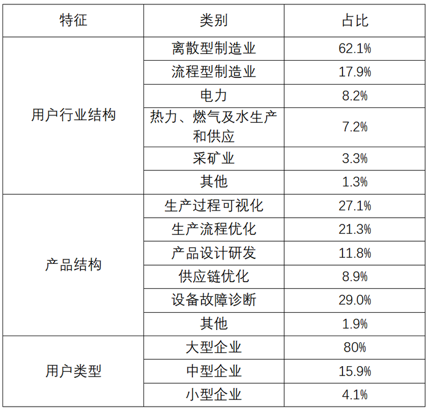

# 现期部分量差值计算（总量×占比之差，跨表拼接）

考点：[[20-考点/资料分析/比重/现期部分量差值计算（总量×占比之差，跨表拼接）|比重 / 现期部分量差值计算（总量×占比之差，跨表拼接）]]
材料：[[15-材料/资料分析/247431 2016～2021年我国工业大数据市|247431 2016～2021年我国工业大数据市]]

**问法模型**：'某年A比B高多少亿元'且材料只给占比不给绝对额 → 先求占比差，再乘总量：差值=总量×(占比A−占比B)

## 推理链
1. 第1步：题干问2018年离散型制造业比流程型制造业高多少亿元，属现期计算；从表1提取2018年工业大数据市场规模114.2亿元
2. 第2步：从表2'用户行业结构'内部提取离散型制造业占比62.1%、流程型制造业占比17.9%（两行同属行业结构，合计口径一致）
3. 第3步：用公式 差值=总量×(占比A−占比B)=114.2×(62.1%−17.9%)=114.2×44.2%
4. 第4步：代入计算：114.2×0.442≈50.5亿元（114.2×0.4=45.68，114.2×0.04=4.57，合计约50.5）
5. 第5步：与选项对照：50.5与B项50最接近；A的44恰为占比差44.2的整数（忘乘总量的陷阱值），C、D均不符，故选B

**最快解法**：⚡ 

## 易错点
- ⚠ 忘乘总量：表2只有占比无绝对额，若把占比差44.2%≈44直接当答案会误选A；必须与表1的2018年规模114.2亿元跨表相乘
- ⚠ 看错行/跨特征混用：表2行业、产品、用户类型三个特征各自合计100%，数字跨特征不能相加比较；须锁定'用户行业结构'内部，勿拿产品结构（如设备故障诊断29.0%）或用户类型（大型企业80%）的数字
- ⚠ 现期口径：2018年数据材料直接给出，是现期差值计算，勿误作基期倒推或用其他年份规模（如2019年146.9）代入

## 母题抽象
> 🧩 当题干出现'某年A部分比B部分高/多多少（带绝对量单位）'且材料仅给占比时，用'总量×占比之差'跨表拼接，先求占比差再乘一次总量，切勿分别求两个部分量再相减

**同类特征**：现期年份（2018年材料已给）、'比…高…亿元'差值问法、材料只给占比无绝对额、跨表拼接（规模表×占比表）、占比之差乘总量、'约'字提示估算、选项为整数

## 相关题
（暂无）

---

### 题干
2018年，我国离散型制造业大数据市场规模约比流程型制造业大数据市场规模高            亿元。

### 选项
- A. 44
- B. 50　✅
- C. 98
- D. 113

### 官方解析
根据题干“2018年，···比···高多少亿元”，材料中包含2018年数据，可判定本题为现期计算问题。定位表1与表2，2018年我国工业大数据市场规模为114.2亿元，其中离散型制造业占比，流程型制造业占比，则前者比后者高：亿元，与B项接近。
故正确答案为B。

### 给定材料

                      表1  2016～2021年我国工业大数据市场规模增长及预测 

                    表2  按不同方式划分的2018年我国工业大数据销售额比例

