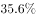
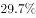
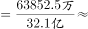
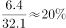

# 现期比重计算（跨文字与表格取数，含单位换算）

考点：[[20-考点/资料分析/比重/现期比重计算（跨文字与表格取数，含单位换算）|比重 / 现期比重计算（跨文字与表格取数，含单位换算）]]
材料：[[15-材料/资料分析/247460 2016年“一带一路”沿线64国的G|247460 2016年“一带一路”沿线64国的G]]

**问法模型**：题干'A（2016年）约占B（2016年）的＋百分数选项'→ 现期比重模型：比重=部分值÷整体值，分子取表格'总计'行人口、分母取文字段64国人口，先统一单位再直除

## 推理链
1. 第1步：由题干'2016年……约占……的'且选项为百分数，判定为现期比重问题，无需基期转换；分子=东南亚'一带一路'沿线国家人口总数，分母=沿线64国人口总数
2. 第2步：定位统计表'总计'行，东南亚11国人口合计63852.5万人；定位文字材料，沿线64国人口总数约32.1亿人
3. 第3步：统一单位口径：表格单位为万人、文字单位为亿人，相差1万倍，故63852.5万人=6.38525亿人（或将分母化为321000万人）
4. 第4步：代入比重公式：6.38525亿÷32.1亿≈0.199，即约19.9%（≈20%）
5. 第5步：与选项对照，计算结果与C项最接近，故正确答案为C

**最快解法**：⚡ 单位换算＋截位直除：63852.5万人÷32.1亿人，先把分子化成6.38525亿（或记住'万人÷亿人'需÷10^4），再截位为6.4÷32≈20%，首两位商'19'即约19.9%，秒锁C

## 易错点
- ⚠ 单位跨表不一致：表格人口单位是'万人'、文字是'亿人'，相差1万倍；若直接用63852.5÷32.1会算出1989%的荒谬结果
- ⚠ 整体与部分范围混淆：表格'总计'仅是东南亚11国合计（约6.39亿人），不等于沿线64国整体（32.1亿人），把分子分母位置放反会得到约5倍数而非百分数
- ⚠ 时间与口径干扰：文字与表格均为2016年当期值，本题不需要基期换算、也不需要动用折线图数据，误把贸易份额21.7%当相关数据即被误导

## 母题抽象
> 🧩 当题干出现'表格中某区域合计约占文字中全国/全域总量的（百分数）'特征时，用现期比重=表格部分值÷文字整体值，第一步必先核对两处单位（万人vs亿人、亿美元vs万亿美元）并统一量级，再截位直除验证选项

**同类特征**：约占、人口总数、东南亚、沿线64个国家、现期（2016年）、跨文字与表格取数

## 相关题
- [[10-真题/资料分析/比重/18643736 现期比重计算（部分合计÷整体总量）|18643736]]（天津 2026，相关度1）
- [[10-真题/资料分析/比重/2374810 现期比重计算（流量占存量比重）|2374810]]（广东 2019，相关度1）
- [[10-真题/资料分析/比重/2662198 现期比重计算|2662198]]（新疆 2020，相关度1）
- [[10-真题/资料分析/增长/2676507 基期量与现期量之比（1-(1+增长率)型基期比值）|2676507]]（选调 2018，相关度1）
- [[10-真题/资料分析/比重/2725306 现期比重计算（两分项求和占整体比重）|2725306]]（四川 2020，相关度1）

---

### 题干
2016年东南亚“一带一路”沿线国家人口总数约占“一带一路”沿线64个国家人口总数的：

### 选项
- A. 

- B. 

- C. 

　✅
- D. 

### 官方解析

由题干“2016年······约占······的”，结合选项为百分数，可判定本题为现期比重问题。定位文字材料可得，2016年“一带一路”沿线64个国家人口总数约为32.1亿人，定位表格可得，2016年东南亚“一带一路”沿线国家人口总数为63852.5万人。则所求比重，与C项最接近。

故正确答案为C。

### 给定材料

        2016年“一带一路”沿线64个国家GDP之和约为12.0万亿美元，占全球GDP的；人口总数约为32.1亿人，占全球人口的；对外贸易总额约为71885.5亿美元，占全球贸易总额的。

