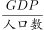
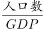
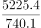
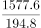
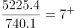
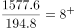
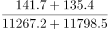
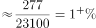

# 现期比重计算（前置人均GDP平均数逐行比较定位主体，两步串联）

考点：[[20-考点/资料分析/比重/现期比重计算（前置人均GDP平均数逐行比较定位主体，两步串联）|比重 / 现期比重计算（前置人均GDP平均数逐行比较定位主体，两步串联）]]
材料：[[15-材料/资料分析/247460 2016年“一带一路”沿线64国的G|247460 2016年“一带一路”沿线64国的G]]

**问法模型**：“人均GDP最低的主体，其进出口额约占总体多少”→两步模型：先用“GDP÷人口”逐行直除定位人均最低的国家，再算“该国(进口+出口)÷东南亚总计(进口+出口)”的现期比重，对照区间式选项

## 推理链
1. 第1步：从统计表提取11国“人口（万人）”与“GDP（亿美元）”两列，“人均GDP最低”即逐行比较GDP÷人口，两列同表、单位自洽，无需跨材料换算
2. 第2步：排除明显偏高国家（新加坡2945.6/558.4≈5.27、文莱91.0/42.3≈2.15、马来西亚3092.6/3152.3≈0.98万美元/人等），仅“GDP小且人口大”的缅甸、柬埔寨入围
3. 第3步：直除比较：缅甸740.1/5225.4≈0.142万美元/人，柬埔寨194.8/1577.6≈0.123万美元/人（约1235美元/人），确定柬埔寨为2016年东南亚人均GDP最低的沿线国家
4. 第4步：从表格取柬埔寨进口额141.7＋出口额135.4＝277.1亿美元（进口列排在出口列之前，两列相加勿取漏）
5. 第5步：取“总计”行东南亚11国进出口合计：11267.2＋11798.5＝23065.7亿美元（该总计仅为东南亚口径，不能误用文字段64国贸易总额71885.5亿美元）
6. 第6步：代入现期比重公式：277.1÷23065.7≈1.2%
7. 第7步：所得比重约1.2%落入官方解析所指区间（解析“即在～之间”对应C项），与官方答案C一致，故选C

**最快解法**：⚡ 转化比较＋截位直除：①“人均GDP最低”反向看即“人口÷GDP最大”，只对入围两行直除：缅甸5225.4/740.1≈7.1，柬埔寨1577.6/194.8≈8.1，锁定柬埔寨；②比重=(141.7+135.4)/(11267.2+11798.5)=277.1/23065.7，截位直除277.1/23066≈1.2%（23066×1.2%≈277验证），对照区间选项得C

## 易错点
- ⚠ “人均GDP最低”≠“GDP总量最小”：GDP最小的东帝汶（21.0亿美元）因人口也最少（118.7万人），人均≈1769美元反而高于柬埔寨（≈1235美元），必须逐行两列相除，只比GDP一列即掉坑
- ⚠ 列序与口径陷阱：进口额列排在出口额列之前，“进出口额”须两列相加，看反列序或只取出口额即错；分子取柬埔寨行、分母取“总计”行，两者同为东南亚11国口径
- ⚠ 分母范围陷阱：分母是东南亚11国总计23065.7亿美元，切勿误用文字段沿线64国对外贸易总额71885.5亿美元，“表格总计”与“64国总量”是两套范围，不能混用

## 母题抽象
> 🧩 当题干出现“某平均指标（人均/单产）最低或最高的主体，其另一量占总体比重”特征时，用“逐行直除定位主体（只需比较入围的2~3行）＋同口径总计行做分母的现期比重截位直除”两步法，最后对照区间式选项

**同类特征**：人均GDP最低的……国家、当年其进出口额约占……、先平均数定位、后现期比重的两步串联问法、区间式选项（不到X%/X%～Y%之间/…以上）、分子用分国行、分母用“总计”行的同表取数、GDP÷人口两列直除比较

## 相关题
（暂无）

---

### 题干
2016年东南亚人均GDP最低的“一带一路”沿线国家，当年其进出口额约占东南亚“一带一路”沿线国家：

### 选项
- A. 
不到

- B. 
-之间

- C. 
-之间
　✅
- D. 
以上

### 官方解析

由题干“······占······”，结合材料时间与题干一致，可判定本题为现期比重问题。需先找到2016年东南亚人均GDP最低的“一带一路”沿线国家，也就是找最小的国家，反过来就是找最大的国家。定位表格，发现明显最大的是缅甸和柬埔寨，直除比较，，，即2016年东南亚人均GDP最低的“一带一路”沿线国家是柬埔寨。其当年进出口额占东南亚“一带一路”沿线国家的比重为，即在～之间。

故正确答案为C。

### 给定材料

        2016年“一带一路”沿线64个国家GDP之和约为12.0万亿美元，占全球GDP的；人口总数约为32.1亿人，占全球人口的；对外贸易总额约为71885.5亿美元，占全球贸易总额的。

> [!warning] 疑点（官方解析可能有误，待人工复核）
> 解析与选项中的比重数值及区间上下限均为未加载的公式图片：解析“比重为，即在～之间”文字空缺，选项各档区间数值无法从文本核验。按材料计算比重＝277.1/23065.7≈1.2%；若C项区间为“1%～5%之间”则与计算一致，若C项为“5%～10%之间”（四档递进区间的第三档）则与计算值1.2%矛盾。答案按官方信息记为C，建议核对选项原图数值以确认区间边界
