# 现期比重·部分÷比重反推整体（整体计算）

考点：[[20-考点/资料分析/比重/现期比重·部分÷比重反推整体（整体计算）|比重 / 现期比重·部分÷比重反推整体（整体计算）]]
材料：[[15-材料/资料分析/247461 2017年全国各级各类民办教育发展情|247461 2017年全国各级各类民办教育发展情]]

**问法模型**：题干给出部分量（民办学校17.76万所）及其占整体的比重（占全国学校总数），问'全国学校总数在哪个区间'→用'整体=部分÷比重'反推整体的现期比重模型

## 推理链
1. 第1步：定位材料总述句'2017年全国共有各级各类民办学校17.76万所，占全国学校总数'，得部分量=17.76万所，比重以完整材料数值为准（所给文本中该比重空白）
2. 第2步：本题问'全国学校总数'即整体，套用现期比重公式：整体=部分÷比重，即全国学校总数=17.76万所÷占全国学校总数的比重
3. 第3步：代入比重数值作截位直除（按官方解析执行该式），商约50余万所的量级
4. 第4步：与选项对照：结果落在50～60万所之间，故选B；排除A（不到50万所）、C（60～70万所）、D（超过70万所）

**最快解法**：⚡ 公式法+截位直除：全国学校总数=17.76万所÷占全国学校总数的比重，只读总述句数据、不看分项，直除估出首两位约50余万所，直接锁定B区间

## 易错点
- ⚠ 公式方向搞反：应'部分÷比重=整体'，若误算成17.76万所×比重，结果远小于17.76万所，会错选A'不到50万所'
- ⚠ 量级与分项干扰：材料中'16.04万所'与'6107所/5277所/3002所/2069所'单位混排，且5个学段分项之和远小于17.76万所（总述还含未单列的其他民办学校类型），不能用分项加总替代或校验整体
- ⚠ 口径混淆：材料中各'比上年增长%'是增速且均为空白，只能用'占全国学校总数'的比重反推整体，不可把任何增速当比重代入

## 母题抽象
> 🧩 当题干出现'某部分占整体的比重已知，求整体（总数）落在哪个区间'的特征时，用'整体=部分÷比重'反推，截位直除估首两位对照区间选项，并确认所除的是比重而非增速

**同类特征**：全国学校总数、占全国学校总数（比重）、17.76万所民办学校、部分÷比重反推整体、区间型选项（不到/之间/超过）、现期比重

## 相关题
- [[10-真题/资料分析/比重/19283962 现期比重计算（部分÷整体，跨图表取数）|19283962]]（国考 2025，相关度2）
- [[10-真题/资料分析/比重/4792819 现期比重计算（多部分比重依次求解）|4792819]]（新疆 2014，相关度1）
- [[10-真题/资料分析/比重/827355 现期比重比较（部分占比过半速判）|827355]]（政法干警 2014，相关度1）
- [[10-真题/资料分析/比重/2272297 现期比重比较|2272297]]（选调 2015，相关度1）
- [[10-真题/资料分析/比重/2032972 现期比重计算（多地区占比求和）|2032972]]（吉林 2015，相关度1）

---

### 题干
2017年全国学校总数在以下哪个范围内？

### 选项
- A. 不到50万所
- B. 50～60万所之间　✅
- C. 60～70万所之间
- D. 超过70万所

### 官方解析
根据“2017年全国学校总数在以下哪个范围内”，结合材料所给数据为2017年的比重数据，判断本题为现期比重问题。定位材料，“2017年全国共有各级各类民办学校17.76万所，占全国学校总数”。因此全国的学校总数为万所，在B选项范围内。
故正确答案为B。

### 给定材料

        2017年全国共有各级各类民办学校17.76万所，占全国学校总数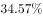；各类民办教育在校生达5120.47万人，比上年增长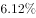。其中：民办幼儿园16.04万所，比上年增长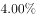；在园儿童2572.34万人，比上年增长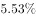。民办普通小学6107所，比上年增长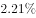；在校生814.17万人，比上年增长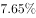。民办初中5277所，比上年增长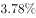；在校生577.68万人，比上年增长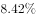。民办普通高中3002所，比上年增长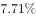；在校生306.26万人，比上年增长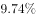。民办中等职业学校2069所，比上年下降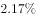；在校生197.33万人，比上年增长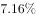。

> [!warning] 疑点（官方解析可能有误，待人工复核）
> 所给文本中'占全国学校总数'的比重数值与官方解析计算式中的结果数值均被截断为空白，无法按原式复核具体商值；本档案不臆造比重数值，整体落点（50～60万所之间）以官方答案B为准
