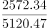
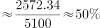

# 现期比重计算（部分÷整体）

考点：[[20-考点/资料分析/比重/现期比重计算（部分÷整体）|比重 / 现期比重计算（部分÷整体）]]
材料：[[15-材料/资料分析/247461 2017年全国各级各类民办教育发展情|247461 2017年全国各级各类民办教育发展情]]

**问法模型**：题干出现'2017年…占…的比例约为'且材料时间为2017年（现期）→ 直接套用'比重=部分÷整体'模型，无需基期换算或增速介入

## 推理链
1. 第1步：题干时间为2017年与材料时间一致，问'民办幼儿园在园儿童人数占民办教育在校生总人数的比例'，判定为现期比重问题
2. 第2步：从材料定位部分值——'在园儿童2572.34万人'（民办幼儿园）；定位整体值——'各类民办教育在校生达5120.47万人'（总述合计口径），两数均直接给出，增速缺失不影响本题
3. 第3步：核对口径：整体必须取总述的5120.47万人，而非5个学段分项之和（2572.34+814.17+577.68+306.26+197.33≈4467.78万人），因总述含未单列的其他民办教育类型
4. 第4步：套用公式：比重=部分÷整体=2572.34÷5120.47
5. 第5步：代入计算：5120.47×0.5=2560.235，2572.34仅比其多约12.1，故比重略高于50%，2572.34÷5120.47≈50.2%
6. 第6步：与选项对照，计算结果≈50.2%对应选项B，故正确答案为B

**最快解法**：⚡ 半数定位法（百化分思想）：先算整体的一半5120.47÷2≈2560，与部分2572.34比较仅高出约12万人（高出不足半个百分点的0.24%），故比重为略超50%的数值≈50.2%，直选B；无需完整截位直除

## 易错点
- ⚠ 整体错取：误用5个学段在校生之和（≈4467.78万人）作整体，而正确整体是总述'各类民办教育在校生5120.47万人'——分项之和≠总数，总述包含未单列的其他类型
- ⚠ 部分/主体看串：误把'民办幼儿园16.04万所'（学校数）当部分代入，人数与学校数两个口径并存，引用前须确认是'在园儿童2572.34万人'
- ⚠ 量级干扰：材料'万所'与'所'混排易引发换算恐慌，但本题两个数值单位均为'万人'，不需任何换算，属虚晃一枪

## 母题抽象
> 🧩 当题干出现'现期年份+A（部分）占B（总体）的比例约为'，且材料总述与分项直接给出两个现期值时，用'比重=部分÷整体'直除，可用'整体的一半'快速锁定略高于或略低于50%的选项

**同类特征**：现期比重、'占…的比例约为'、部分÷整体、同年数据直接取用、不涉及增速、总述合计作整体

## 相关题
- [[10-真题/资料分析/比重/5445740 现期比重计算（部分÷整体）|5445740]]（国考 2023，相关度3）
- [[10-真题/资料分析/比重/16593267 现期比重计算（部分÷整体）|16593267]]（广东 2024，相关度2）
- [[10-真题/资料分析/比重/2256374 现期比重计算（部分÷整体）|2256374]]（江西 2018，相关度2）
- [[10-真题/资料分析/比重/1746796 现期比重计算（部分÷整体）|1746796]]（国考 2016，相关度2）
- [[10-真题/资料分析/比重/4792819 现期比重计算（多部分比重依次求解）|4792819]]（新疆 2014，相关度1）

---

### 题干
2017年民办幼儿园在园儿童人数占民办教育在校生总人数的比例约为

### 选项
- A. 

- B. 

　✅
- C. 

- D. 

### 官方解析

根据“2017年······占······的比例约为多少”，结合材料时间为2017年，判断本题为现期比重问题。定位材料，各类民办教育在校生达5120.47万人，民办幼儿园在园儿童2572.34万人。根据公式：，则2017年民办幼儿园在园儿童人数占民办教育在校生总人数的比例约为。

故正确答案为B。

### 给定材料

        2017年全国共有各级各类民办学校17.76万所，占全国学校总数；各类民办教育在校生达5120.47万人，比上年增长。其中：民办幼儿园16.04万所，比上年增长；在园儿童2572.34万人，比上年增长。民办普通小学6107所，比上年增长；在校生814.17万人，比上年增长。民办初中5277所，比上年增长；在校生577.68万人，比上年增长。民办普通高中3002所，比上年增长；在校生306.26万人，比上年增长。民办中等职业学校2069所，比上年下降；在校生197.33万人，比上年增长。

