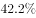
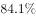
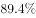
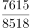
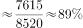

# 现期比重计算

考点：[[20-考点/资料分析/比重/现期比重计算|比重 / 现期比重计算]]
材料：[[15-材料/资料分析/248014 2018年1-11月我国互联网和相关|248014 2018年1-11月我国互联网和相关]]

**问法模型**：题干出现'2018年1-11月，A占B的比重约为'且A、B均与材料同期（现期）→ 直接套现期比重公式：比重=部分量A÷整体量B，无需基期换算

## 推理链
1. 第1步：题干问'信息服务收入占互联网企业业务收入比重约为'，时间2018年1-11月与材料现期一致，判定为现期比重计算，不依赖任何增速
2. 第2步：定位材料总体运行段，2018年1-11月规模以上互联网企业完成业务收入8518亿元，作为整体量（分母）
3. 第3步：定位信息服务业务段，2018年1-11月信息服务收入达7615亿元，作为部分量（分子）；注意电子商务平台收入3212亿元、网络游戏收入1628亿元是信息服务收入的子项，不可误用
4. 第4步：代入公式：比重=7615/8518
5. 第5步：估算：8518×90%=7666.2＞7615，故比重略低于90%；7615/8518≈0.894，即约89.4%
6. 第6步：与选项对照，D项与约89.4%最接近，故正确答案为D

**最快解法**：⚡ 截位直除法：分子分母各取前三位，761/852≈0.894（约89.4%）；辅助验证：8518×90%≈7666＞7615，比重略低于90%，直接对照选项锁定D

## 易错点
- ⚠ 分子分母颠倒：误将整体作分子得8518/7615≈111.9%，比重必须为部分÷整体=7615/8518
- ⚠ 指标层级嵌套混淆：3212亿元、1628亿元是信息服务收入7615亿元的子项，不可与总收入8518亿元混比；且7615+137+129=7881亿元＜8518亿元，分业务未穷尽总体，不能用加和反推验证分母
- ⚠ 时间口径惯性：本材料第1兄弟题为基期量模型（依赖总体增速，且所给文本中增速数值空缺），本题问现期比重，直接用现期数7615与8518即可，勿套基期思维多除一次(1+增速)

## 母题抽象
> 🧩 当题干出现'A占B的比重约为'且A、B为同期现期数据时，用比重=部分÷整体，以'整体×整数百分比与部分比大小+截位直除'快速估算并对照选项

**同类特征**：'信息服务收入占互联网企业业务收入比重'、时间限定与材料同期（2018年1-11月）、'约为'（估算型比重计算）、分子分母需在纯文字材料中两层定位、不涉及增速、无需基期换算、选项为公式/百分数形式，需计算值对照匹配

## 相关题
- [[10-真题/资料分析/比重/2604234 现期比重计算|2604234]]（广东 2020，相关度2）
- [[10-真题/资料分析/比重/1751688 现期比重计算|1751688]]（江苏 2015，相关度2）
- [[10-真题/资料分析/比重/2050970 现期比重计算|2050970]]（江西 2017，相关度2）
- [[10-真题/资料分析/比重/2188157 现期比重计算|2188157]]（陕西 2018，相关度2）
- [[10-真题/资料分析/比重/2256388 现期比重计算|2256388]]（江西 2018，相关度2）

---

### 题干
2018年1-11月，信息服务收入占互联网企业业务收入比重约为：

### 选项
- A. 

- B. 

- C. 

- D. 

　✅

### 官方解析

由题干“2018年1-11月，···占···比重约为”，结合材料时间是2018年1-11月，可判定本题为现期比重计算问题。定位文字材料第二段，“（2018年）1-11月，我国规模以上互联网和相关服务企业（简称互联网企业）完成业务收入8518亿元，···”；定位文字材料第三段，“（2018年）1-11月，信息服务收入达7615亿元，···”。根据公式：比重，可计算出2018年1-11月，信息服务收入占互联网企业收入比重约为：，与D项最接近。

故正确答案为D。

### 给定材料

        2018年1-11月，我国互联网和相关服务业发展态势良好，业务收入保持较快增长，盈利状况基本稳定。分领域看，网络销售、影音直播等应用深受用户欢迎，市场规模稳步扩大，网络生活服务市场活跃。

一、总体运行情况

        1-11月，我国规模以上互联网和相关服务企业（简称互联网企业）完成业务收入8518亿元，同比增长，增速较1-10月提高1.7个百分点，与去年同期基本持平。主要省份保持良好增长态势，互联网业务收入总量居前三位的广东、上海、北京互联网业务收入分别增长、和。

二、分业务运行情况

（一）信息服务业务

        1-11月，信息服务收入达7615亿元，同比增长，其中，电子商务平台收入3212亿元，同比增长；网络游戏（包括客户端游戏、手机游戏、网页游戏等）业务收入1628亿元，同比增长。

（二）互联网数据中心业务

        1-11月，互联网企业完成互联网数据中心业务收入137亿元，同比增长；截至11月末，部署的服务器数量达138万台，同比增长。

（三）互联网接入业务

        1-11月，互联网企业完成互联网接入业务收入129亿元，同比下降，降幅较上半年和前三季度分别收窄6.9个和5个百分点。

三、移动应用程序（APP）数量情况

        我国市场上移动互联网应用数量小幅增长。截至11月底，我国市场上监测到的移动应用为447万款。11月份，我国第三方应用商店与苹果应用商店中新上架14.3万款移动应用。截至11月底，我国本土第三方应用商店移动应用数量超过266万款，苹果商店（中国区）移动应用数量超过181万款。

        截至11月底，游戏类应用数量为137.6万款。生活服务类应用规模达54万款，排名第二。排名第三和第四的分别是电子商务类应用和主题壁纸类应用，规模分别为42万款和37.1万款。在市场热点类应用当中，以物流企业应用、货运运输服务应用和具有自有物流服务能力的电子商城为代表的智慧物流类应用数量超过2.4万款；而提供二维码扫码、转账等金融支付功能的网络支付类应用数量约为2.5万款。

        截至11月底，第三方应用商店分发累计数量超过1.75万亿次。游戏类、系统工具类、影音播放类、社交通讯类、日常工具类、生活服务类和金融类应用下载量均超过千亿次，分别为3014亿次、2892亿次、2264亿次、1911亿次、1212亿次、1143亿次和1911亿次，其中游戏类、系统工具类和影音播放类应用下载量均突破两千亿次。其余各类应用中，下载总量超过500亿次的应用还有电子商务类（999亿次）、资讯阅读类（931亿次）和主题壁纸类（754亿次）。

