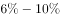
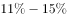
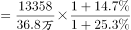
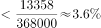

# 基期比重（区间判定型）

考点：[[20-考点/资料分析/比重/基期比重（区间判定型）|比重 / 基期比重（区间判定型）]]
材料：[[15-材料/资料分析/248013 全国技术合同成交情况：文字部分讲20|248013 全国技术合同成交情况：文字部分讲20]]

**问法模型**：题干以'2016年（基期）……数量占……的比例在……'设问 → 采用基期比重模型：基期比重=现期比重×(1+总体增速)/(1+部分增速)，先算现期比重锚定量级再对照区间

## 推理链
1. 第1步：题干问2016年'1000万元以上重大技术合同数量占全国各类技术合同的比例'，分子分母均为项数，判定为基期比重问题
2. 第2步：从文字提取现期（2017年）数据：重大技术合同13358项（第二层），各类技术合同36.8万项=368000项（第一层，须统一单位为'项'）
3. 第3步：先算现期比重锚定量级：13358÷368000≈3.63%
4. 第4步：套基期比重公式：基期比重=3.63%×(1+总项数增速)/(1+重大合同数增速)
5. 第5步：文字材料四处增长率数字全部缺失（图中仅能反推成交金额增速13424.2/11407-1≈17.7%，项数增速无法取得），无法精确代入；但两项增速均为'稳步增长'的正常正增速，(1+g总)/(1+g重)接近1（增速差十个百分点以内时偏离不超过约10%），基期比重仍落在约3.6%~4%量级
6. 第6步：对照选项，该量级远低于B档区间下限，必落在最小的A区间'以内'，故选A

**最快解法**：⚡ 量级锚定法+基期比重公式：36.8万项化成368000项，截位直除得现期比重13358/368000≈3.6%；基期比重只需在此基础上乘(1+g总)/(1+g重)微调，增速缺失或相近时数量级不变（约3.6%~4%），直接锁定最小的A区间'以内'，无需精确增速

## 易错点
- ⚠ 现期/基期口径：题干问2016年，正解须走基期比重公式；且文字四处增速缺失，不能凭空编造增速硬算精确值，应先以现期比重≈3.63%锚定量级或按选项反推
- ⚠ 单位陷阱：'36.8万项'必须化成368000项再与13358项作商，漏化'万'会差上万倍，得出0.0036%的荒谬量级
- ⚠ 层级包含陷阱：分子须用第二层'重大合同13358项'，不能错用第三层'知识产权合同5561项/技术秘密2959项'，分母用第一层36.8万项，四层数字不能混用

## 母题抽象
> 🧩 当题干出现'基期年份+部分占整体的数量比重+百分数区间选项'特征时，先统一单位直除算现期比重锚定量级，再用基期比重公式乘(1+整体增速)/(1+部分增速)判断偏移幅度，增速缺失或量级相近时直接按现期比重锁定区间

**同类特征**：基期年份'2016年'+现期2017年数据、'数量占……的比例在……'区间式问法、选项为百分数区间（以内/之间/以上）、分子分母均为合同项数（万项与项须统一）、重大合同与全部合同的层层包含关系、文字材料增长率缺失需量级锚定

## 相关题
（暂无）

---

### 题干
2016年，1000万元以上重大技术合同数量占全国各类技术合同的比例在：

### 选项
- A. 
以内
　✅
- B. 
之间

- C. 
之间

- D. 
以上

### 官方解析

根据题干“2016年，······占······的比例”，可判定本题为基期比重问题。定位文字材料第一、二段可知，2017年，全年共签订各类技术合同36.8万项，比上年增长；2017年全国共成交1000万元以上重大技术合同13358项，同比增长。代入公式：基期比重，故所求在以内。

故正确答案为A。

### 给定材料

        2017年，我国技术市场交易额稳步增长，全年共签订各类技术合同36.8万项，成交金额13424.2亿元，比上年分别增长和。

        2017年全国共成交1000万元以上重大技术合同13358项，同比增长；成交额10281.4亿元，同比增长。重大技术合同中涉及各类知识产权的合同，成交5561项，成交金额为4121.7亿元。其中，技术秘密为主要交易形式，成交2959项，成交额2239.6亿元，居第一位；专利技术合同成交1291项，成交额1258.5亿元，居第二位。

> [!warning] 疑点（官方解析可能有误，待人工复核）
> 官方解析默认'比上年增长/同比增长'后存在增速数值并直接代入基期比重公式，但本题题面四处增速数字全部缺失，无法复现其精确计算过程；以现期比重13358/368000≈3.63%量级锚定（基期约3.6%~3.8%），结论与官方答案A一致，不影响作答

<!-- CODEX-ANSWER-REVIEW:BEGIN -->
### 本次独立复核

**复核状态：** `confirmed`（独立复算确认答案）

**计分答案：** A（可计分）

**复核解析：**

原公式图读出整体项数增速14.7%、重大合同增速25.3%；2016基期比重=(13358/1.253)/(368000/1.147)≈3.32%，在5%以内，选A。

**相关信息：**

基期比重应以部分、整体分别折现。

**题源依据：** [固定版本原题](https://github.com/Mentat-Uran/kaogongzhentizhengliu/blob/84ab93d4b64b61d897bece8a1c0a5bab06b4feb2/10-%E7%9C%9F%E9%A2%98/%E8%B5%84%E6%96%99%E5%88%86%E6%9E%90/%E6%AF%94%E9%87%8D/2456382%20%E5%9F%BA%E6%9C%9F%E6%AF%94%E9%87%8D%EF%BC%88%E5%8C%BA%E9%97%B4%E5%88%A4%E5%AE%9A%E5%9E%8B%EF%BC%89.md)；固定内容 commit `84ab93d4b64b61d897bece8a1c0a5bab06b4feb2`，Markdown blob `d74c0fce5a41b36f481d4ea7e739cd270ead8858`。
<!-- CODEX-ANSWER-REVIEW:END -->
