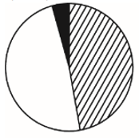
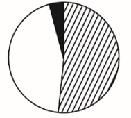
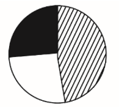
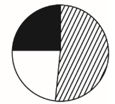

# 现期比重计算+饼图匹配（部分占总体比重与扇区图形对应）

考点：[[20-考点/资料分析/比重/现期比重计算+饼图匹配（部分占总体比重与扇区图形对应）|比重 / 现期比重计算+饼图匹配（部分占总体比重与扇区图形对应）]]
材料：[[15-材料/资料分析/257533 2010～2017年我国生物质发电的|257533 2010～2017年我国生物质发电的]]

**问法模型**：题干为'以下饼图中，能准确反映2017年末三类项目装机占全国装机比重的是'→ 分别计算三部分占总体比重，再按图例（斜线/白色/黑色）与扇区大小逐一比对排除

## 推理链
1. 第1步：从文字材料提取2017年底数据：农林生物质累计并网装机700.9万千瓦、垃圾焚烧725.3万千瓦、沼气50.0万千瓦，全国总计1476.2万千瓦（三者之和700.9+725.3+50.0=1476.2恰等于总量）
2. 第2步：现期比重公式：比重=部分装机÷全国总装机
3. 第3步：农林比重=700.9/1476.2≈47.5%，垃圾焚烧比重=725.3/1476.2≈49.1%，沼气比重=50.0/1476.2≈3.4%
4. 第4步：锚点判断：总量一半约为738，700.9与725.3均略小于一半，其中725.3更接近738，即白色（垃圾焚烧）扇区略大于斜线（农林）扇区，两者合计约96.6%；黑色（沼气）仅为约3.4%的极小扇区
5. 第5步：对照选项：农林约47.5%接近但不达一半，排除农林明显偏离一半的B、D；白色（垃圾焚烧49.1%）应大于斜线（农林47.5%），排除两者画反的C，锁定A

**最快解法**：⚡ 半定量锚点法（免精算）：先算半值1476.2÷2≈738，比较700.9与725.3均低于半值且725.3更大→白色略大于斜线；再算50/1476.2≈3.4%→黑色为极窄扇区；按'近半且白>斜、极小黑'直接匹配A

## 易错点
- ⚠ 图例对应陷阱：垃圾焚烧725.3与农林700.9非常接近且白色略大，二者大小极易画反或看反（C项即此陷阱）
- ⚠ 忽视沼气仅占约3.4%：黑色扇区应极小，误把沼气当成有明显大小的扇区会选错
- ⚠ 口径陷阱：必须用'累计并网装机'（存量）而非'年发电量'（流量）做比重；图中2017年1476为约数，与文字精确值1476.2并存，精确比对应以文字值为准

## 母题抽象
> 🧩 当题干出现'以下饼图能准确反映A、B、C占总体比重'时，先验证部分和是否等于总体，再用锚点法：以总体一半判断接近50%的项的相对大小、以部分/总体识别极小扇区，按图例逐一排除选图

**同类特征**：以下饼图中能准确反映、占全国……装机容量比重、2017年末、三类项目结构对比、图例颜色纹理对应（斜线/白色/黑色）、部分之和恰等于总体1476.2

## 相关题
- [[10-真题/资料分析/比重/2725306 现期比重计算（两分项求和占整体比重）|2725306]]（四川 2020，相关度1）

---

### 题干
以下饼图中，能准确反映2017年末我国农林生物质发电项目（斜线）、生活垃圾焚烧发电项目（白色）和沼气发电项目（黑色）装机容量占全国生物质发电装机容量比重的是：

### 选项
- A. 

　✅
- B. 

- C. 

- D. 

### 官方解析

根据题干“以下饼图中，能准确反映2017年······占······比重的是”，结合材料中时间为2017年，可判定本题为现期比重问题。定位文字材料第一段，截至2017年底，我国共有30个省（区、市）投产了747个生物质发电项目，并网装机容量1476.2万千瓦（不含自备电厂）。其中农林生物质发电项目271个，累计并网装机700.9万千瓦；生活垃圾焚烧发电项目339个，累计并网装机725.3万千瓦；沼气发电项目137个，累计并网装机50.0万千瓦。因此，农林生物质发电项目装机容量比重为，观察图形，可排除B、D两项，同时生活垃圾焚烧发电项目装机容量大于农林生物质发电项目，故其占比也大于农林生物质发电项目，观察图形，可排除C项。

故正确答案为A。

### 给定材料

        截至2017年底，我国共有30个省（区、市）投产了747个生物质发电项目，并网装机容量1476.2万千瓦（不含自备电厂），年发电量794.5亿千瓦时。其中农林生物质发电项目271个，累计并网装机700.9万千瓦，年发电量397.3亿千瓦时；生活垃圾焚烧发电项目339个，累计并网装机725.3万千瓦，年发电量375.2亿千瓦时；沼气发电项目137个，累计并网装机50.0万千瓦，年发电量22.0亿千瓦时。

        2017年，全国生物质发电替代化石能源约2500万吨标煤，减排二氧化碳约6500万吨，农林生物质发电共计处理农林废弃物约5400万吨；垃圾焚烧发电共计处理城镇生活垃圾约10600万吨，约占全国垃圾清运量的。

