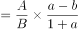
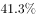
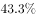
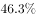

# 两期比重差计算（比重升降方向与变化量）

考点：[[20-考点/资料分析/比重/两期比重差计算（比重升降方向与变化量）|比重 / 两期比重差计算（比重升降方向与变化量）]]
材料：[[15-材料/资料分析/257532 2017年全国及J省海洋经济发展情况|257532 2017年全国及J省海洋经济发展情况]]

**问法模型**：题干为'2017年J省海洋生产总值占全国的比重比上年上升/下降…个百分点'→套用两期比重差公式：比重差=现期比重×(部分增速a−整体增速b)/(1+a)，先由a与b之差定升降方向，再算差值定选项。

## 推理链
1. 第1步：判型——题干问'2017年J省占全国的比重比上年'变化，属两期比重问题；从材料第1段提取：部分=J省海洋生产总值7217亿元（增速a），整体=全国海洋生产总值77611亿元（增速b），两增速均为增长方向（具体百分数原文留空，见图片）。
2. 第2步：定方向——两期比重升降只看a−b：部分增速a>整体增速b则比重上升，a<b则下降；本题J省增速a大于全国增速b，比重上升，先排除C、D两个下降选项。
3. 第3步：列公式——两期比重差=(A/B)×(a−b)/(1+a)，其中A=7217亿元、B=77611亿元，即（7217/77611）×(a−b)/(1+a)，无需分别回推2016年基期值。
4. 第4步：代入计算——现期比重7217/77611≈9.3%（不足10%），将材料中两增速代入(a−b)/(1+a)后，比重差≈0.19个百分点（官方解析代入结果）。
5. 第5步：对照选项——0.19≈0.2个百分点且方向为上升，与A'上升了约0.2个百分点'最接近，故选A；B'上升约2个百分点'量级放大10倍，为最强干扰项。

**最快解法**：⚡ 公式法+两步秒杀：①量级排除——现期比重7217/77611≈9.3%<10%，而比重差=9.3%×(a−b)/(1+a)，由于(a−b)/(1+a)<a−b（增速差仅为几个百分点的量级），比重差必不足1个百分点，直接秒杀B、D的'2个百分点'；②方向锁定——a>b（J省增速快于全国）→比重上升→选A（约0.2个百分点）。

## 易错点
- ⚠ 分母口径错换：'占全国的比重'分母必须是全国海洋生产总值77611亿元；材料中'占地区生产总值'是另一套分子分母体系（7217亿元/J省地区GDP），拿它比较升降必错——这是本材料导读明确标注的头号陷阱。
- ⚠ 量级陷阱：选项刻意设'0.2'与'2'两档，若不列公式、直接把'J省增速−全国增速'的差当作比重差，就会误选B；实际现期比重仅≈9.3%，差值被(1+a)和9.3%双重缩小。
- ⚠ 材料百分数留空：文本中所有增速百分数缺失，必须回原图核对具体数值再代入，不得凭空补数；但升降方向可先用'比上年增长'的文字方向与a>b关系预判，不必等数值。

## 母题抽象
> 🧩 当题干出现'某部分占某整体的比重比上年上升/下降多少个百分点'时，用两期比重差公式'现期比重×(部分增速−整体增速)/(1+部分增速)'：第一步比a、b定升降方向秒杀一半选项，第二步用'现期比重很小→差值必为小数点后量级'排除大数干扰项。

**同类特征**：占…比重比上年上升/下降…个百分点、两期比重问题、部分增速vs整体增速定升降、现期值直接给出（7217/77611，同为亿元可直接相除）、选项呈0.2与2两档量级对比、全国与省级同一指标两组数据连环复用

## 相关题
- [[10-真题/资料分析/比重/1797640 两期比重变化（比重差定量计算）|1797640]]（山东 2016，相关度1）
- [[10-真题/资料分析/比重/11226437 两期比重差（比重比上年提高的百分点数）|11226437]]（江苏 2025，相关度1）
- [[10-真题/资料分析/比重/13504293 两期比重差（比重变化量，百分点区间判断）|13504293]]（甘肃 2025，相关度1）

---

### 题干
2017年J省海洋生产总值占全国的比重比上年：

### 选项
- A. 上升了约0.2个百分点　✅
- B. 上升了约2个百分点
- C. 下降了约0.2个百分点
- D. 下降了约2个百分点

### 官方解析

根据题干中“2017年······占······比重比上年”，可以判定本题为两期比重问题。定位文字材料第一段和第二段，“2017年全国海洋生产总值77611亿元，比上年增长”，“2017年，J省海洋生产总值为7217亿元，比上年增长”。代入公式，两期比重差，即上升了约0.19个百分点，与A项最接近。

故正确答案为A。

### 给定材料

        2017年全国海洋生产总值77611亿元，比上年增长，海洋生产总值占国内生产总值的。

        2017年，J省海洋生产总值为7217亿元，比上年增长，海洋生产总值占地区生产总值的，2017年，全省沿海沿江港口完成货物吞吐量20.4亿吨，同比增长；集装箱吞吐量1698.8万标箱，同比增长。

        2017年，J省造船完工量为1412.4万载重吨，同比下降；新承订单量为1393.4万载重吨，同比增长；手持订单量为3662.3万载重吨，同比下降，分别占全国份额的、和。

        2017年，J省沿海三市接待国内游客10558.01万人次，同比增长；接待入境过夜旅游者27.65万人次，同比增长。

        2017年，J省实现海水养殖产量93.1万吨，同比增长；海洋捕捞产量53万吨，同比下降；远洋渔业产量2.9万吨，同比增长。

        2017年，J省海工装备产值同比增长。全省沿海地区风电装机容量达到589.7万千瓦，同比增长；海上风电装机容量达到162.5万千瓦，同比增长。2017年，全省完成海水淡化产量1.31万吨，同比增长。

> [!warning] 疑点（官方解析可能有误，待人工复核）
> 官方解析称定位'第一段和第二段'，但按材料结构，全国77611亿元与J省7217亿元两组总量数据实际同在第1段（第2段为港口吞吐数据），定位标注有误；不影响计算过程与答案A。

<!-- CODEX-ANSWER-REVIEW:BEGIN -->
### 本次独立复核

**复核状态：** `resolved`（答案与解析已核定）

**计分答案：** A（可计分）

**复核解析：**

J省海洋生产总值增速9.2%，全国为6.9%；2017省占比提高，份额变化≈7217/77611×(9.2−6.9)/(1+9.2)≈0.19个百分点，约上升0.2，A。

**相关信息：**

两期比重变化常用公式：现期比重×(部分增长率−整体增长率)/(1+部分增长率)；部分增速高于整体时比重上升。

**题源依据：** [固定版本原题](https://github.com/Mentat-Uran/kaogongzhentizhengliu/blob/84ab93d4b64b61d897bece8a1c0a5bab06b4feb2/10-%E7%9C%9F%E9%A2%98/%E8%B5%84%E6%96%99%E5%88%86%E6%9E%90/%E6%AF%94%E9%87%8D/2571732%20%E4%B8%A4%E6%9C%9F%E6%AF%94%E9%87%8D%E5%B7%AE%E8%AE%A1%E7%AE%97%EF%BC%88%E6%AF%94%E9%87%8D%E5%8D%87%E9%99%8D%E6%96%B9%E5%90%91%E4%B8%8E%E5%8F%98%E5%8C%96%E9%87%8F%EF%BC%89.md)；固定内容 commit `84ab93d4b64b61d897bece8a1c0a5bab06b4feb2`，Markdown blob `230d5ae488daa8cfa2eacd9fcff22f7497663887`。
<!-- CODEX-ANSWER-REVIEW:END -->
