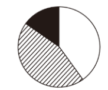
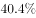
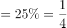
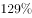
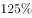

# 基期比重还原（百分点变化反推）+饼图匹配

考点：[[20-考点/资料分析/比重/基期比重还原（百分点变化反推）+饼图匹配|比重 / 基期比重还原（百分点变化反推）+饼图匹配]]
材料：[[15-材料/资料分析/257534 2016年国产工业机器人全年销售状况|257534 2016年国产工业机器人全年销售状况]]

**问法模型**：题干问'最能准确反映2015年不同机械结构销量分布的饼图'→基期比重问题：现期(2016)占比加减'提高/回落…个百分点'还原2015年三块占比，按扇区相对大小匹配图形。

## 推理链
1. 第1步：题干要求2015年（基期）分布，材料现期为2016年；可读硬数据：总销量29144台、多关节11756台（占比比上年提高12.9个百分点）、坐标12830台（占比比上年回落3.5个百分点），其他机器人=29144−11756−12830=4558台
2. 第2步：用销量/总量估算2016年现期占比（图片精确值不可读不可臆造）：多关节11756/29144≈40.3%，坐标12830/29144≈44.0%，其他4558/29144≈15.6%
3. 第3步：基期占比=现期占比∓百分点变化：'提高12.9个百分点'→2015年多关节占比=40.3%−12.9%≈27.4%；'回落3.5个百分点'（现期小于基期）→2015年坐标占比=44.0%+3.5%≈47.5%
4. 第4步：黑色'其他机器人'用100%封口：2015年其他占比=100%−27.4%−47.5%≈25.1%
5. 第5步：比较三块相对大小：斜线(坐标)≈47.5%最大接近半圆，白色(多关节)≈27.4%与黑色(其他)≈25.1%接近且均明显小于斜线；对照四个饼图，仅B项黑色部分约占25%（白色与黑色相近、斜线独大）符合，故选B。

**最快解法**：⚡ 基期比重公式法（百分点反推）+截位估算：先用11756/29144≈40%、12830/29144≈44%截位求现期占比，再∓12.9、+3.5个百分点得2015年三块≈27.4%、47.5%、25.1%，抓两个图形特征直接锁定B——斜线块最大接近一半、白色与黑色两块接近（约27%对25%），无需精算。

## 易错点
- ⚠ '个百分点'与'%'混算/方向搞反：2015年占比只能由2016年占比加减12.9、3.5个百分点，'回落3.5个百分点'应做'+3.5'（2015大于2016），误做减法会把坐标占比算成40.5%左右，图形匹配全错
- ⚠ 排名惯性陷阱：受'多关节首次超万台、增速连续两年超某值'误导，误判2015年白色(多关节)占比最大；实际2015年斜线(坐标)占比仍最大，多关节基期占比仅居中
- ⚠ 黑色'其他机器人'需跨段拼数：其他=29144−11756−12830=4558台；若漏算此块，或把AGV'超过2100台'等约数当精确值，会误判黑色扇区大小；单位混排（万台与台）也须先换算再运算

## 母题抽象
> 🧩 当题干出现'最能准确反映（基期年份）某分类占比分布的饼图'且材料只给现期占比及'比上年提高/回落N个百分点'时，用'基期占比=现期占比∓百分点变化'还原各块占比（剩余块用100%封口），按最大块、次大块的相对大小匹配图形。

**同类特征**：最能准确反映、基期年份（2015年）、销量分布状况、饼图、白色/斜线/黑色分块对应指定类别、比上年提高/回落N个百分点

## 相关题
- [[10-真题/资料分析/比重/5445864 现期比重计算（饼图匹配）|5445864]]（国考 2023，相关度2）
- [[10-真题/资料分析/比重/10297452 现期比重结构与饼图匹配（部分占比比较-倍数排除）|10297452]]（四川 2025，相关度1）
- [[10-真题/资料分析/增长/16593068 增长量比较（多期同比增量趋势与柱状图匹配）|16593068]]（甘肃 2024，相关度1）
- [[10-真题/资料分析/比重/16593075 现期比重计算与饼图占比关系判断（排除法）|16593075]]（海南 2024，相关度1）
- [[10-真题/资料分析/比重/19181372 现期比重计算与饼图扇区识别|19181372]]（吉林 2024，相关度1）

---

### 题干
以下饼图中，最能准确反映2015年不同机械结构的国产工业机器人销量分布状况的是（白色：多关节机器人、斜线：坐标机器人、黑色：其他机器人）：

### 选项
- A. 

- B. 

　✅
- C. 

- D. 

### 官方解析

根据材料时间为2016年及题干“最能准确反映2015年······分布状况的是”，可判定本题为基期比重问题。定位文字材料第二段，“2016年国产多关节机器人······占国产工业机器人总销量的，比上年提高12.9个百分点。坐标机器人······占销售总量的比重为，比上年回落3.5个百分点”。可得，2015年国产多关节机器人（白色部分）占国产工业机器人总销量的比重为，坐标机器人（斜线部分）所占比重为，其他机器人（黑色部分）占比为，只有B项满足黑色部分占比为。

故正确答案为B。

### 给定材料

        2016年国产工业机器人销量继续增长，全年累计销售29144台，较上年增长，增速较上年提升。

        从机械结构看，2016年国产多关节机器人销量首次超过万台，为11756台，增速已连续两年超过，占国产工业机器人总销量的，比上年提高12.9个百分点。坐标机器人仍是国产工业机器人销量第一的机型，2016年销售12830台，占销售总量的比重为，比上年回落3.5个百分点，连续两年占比回落。工厂用AGV机器人销量超过2100台，同比增长。并联机器人销售增长。而SCARA机器人和圆柱坐标机器人的销售则出现超过的下降。

        从应用领域看，2016年搬运与上下料仍是国产工业机器人的首要应用领域，全年销售1.65万台，同比增长，增速放缓，占国产工业机器人销售总量的；焊接和钎焊机器人销售0.51万台，同比增长；装配与拆卸机器人销售0.37万台，同比增长。此外涂层与胶封机器人的销售也实现了的增长，特别是其中的喷漆上釉机器人销量增长了，而洁净室机器人和加工机器人的销售量均出现了同比下降。

       从应用行业看，3C行业和电气设备行业销量均超过5000台，分列第一第二位，特别是电气设备行业，同比大幅增长3倍有余。汽车行业销量同比增长；非金属矿物制品业销量同比增长。此外，在家具、服装、烟草等消费品制造行业的机器人消费量均翻番。

