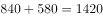

# 现期比重比较（分母相同，比较部分量大小）

考点：[[20-考点/资料分析/比重/现期比重比较（分母相同，比较部分量大小）|比重 / 现期比重比较（分母相同，比较部分量大小）]]
材料：[[15-材料/资料分析/257881 某市甲、乙、丙、丁4所三甲医院分科室|257881 某市甲、乙、丙、丁4所三甲医院分科室]]

**问法模型**：题干问'妇幼出院人数占4所医院妇科和儿科出院总数比重最小的是哪家医院' → 分母（4院妇幼出院总数3190人）对各院相同，比重比较退化为分子（各院妇科+儿科出院人数）的大小比较

## 推理链
1. 第1步：从题干提取模型：比重=各院妇幼出院人数÷4院妇科和儿科出院总数，总体量为同一值，故只需比较分子
2. 第2步：从表格'出院人数'列提取各院妇科+儿科数据并相加：甲=320+130=450人，乙=840+580=1420人，丙=450+350=800人，丁=280+240=520人
3. 第3步：计算共同分母：4院妇科出院320+840+450+280=1890人，儿科出院130+580+350+240=1300人，合计3190人
4. 第4步：比较分子：450＜520＜800＜1420，甲医院妇幼出院人数最少
5. 第5步：验证比重：甲450/3190≈14.1%，丁520/3190≈16.3%，丙800/3190≈25.1%，乙1420/3190≈44.5%，甲最小
6. 第6步：与选项对照，甲医院对应A，故正确答案为A

**最快解法**：⚡ 同分母比较法：分母相同则无需算比重，直接将各院'妇科+儿科'出院人数同行相加（450、1420、800、520），目测最小值450对应甲医院即选A

## 易错点
- ⚠ 分子必须是同一医院妇科与儿科两行出院人数相加（如甲=320+130），不能只取妇科单行或只取儿科单行数据
- ⚠ 勿误读合计行/合计列：如丙医院出院合计2860是全院汇总值，不是某科室数据；本题分子只用'妇科''儿科'两行
- ⚠ 口径陷阱：题干问的是占'4院妇幼出院总数'的比重，不是占本院出院总数（合计行）的比重，用本院合计作分母会误判排序

## 母题抽象
> 🧩 当题干出现'各主体占同一总体比重最大/最小'特征时，先确认分母相同，随后跳过比重计算、直接比较部分量（分子）大小即可得出答案

**同类特征**：占4所医院妇科和儿科出院总数比重最小、妇幼=妇科+儿科两行相加、分母相同（同一总体）、部分量大小比较替代比重计算、现期比重、表格多行拼数

## 相关题
- [[10-真题/资料分析/比重/4792819 现期比重计算（多部分比重依次求解）|4792819]]（新疆 2014，相关度1）
- [[10-真题/资料分析/比重/827355 现期比重比较（部分占比过半速判）|827355]]（政法干警 2014，相关度1）
- [[10-真题/资料分析/比重/2272297 现期比重比较|2272297]]（选调 2015，相关度1）
- [[10-真题/资料分析/比重/2032972 现期比重计算（多地区占比求和）|2032972]]（吉林 2015，相关度1）
- [[10-真题/资料分析/比重/2187857 现期比重计算（部分量需先由'总量−其中量'减法间接求得）|2187857]]（山东 2018，相关度1）

---

### 题干
妇幼出院人数占4所三甲医院妇科和儿科出院总数比重最小的是：

### 选项
- A. 甲医院　✅
- B. 乙医院
- C. 丙医院
- D. 丁医院

### 官方解析

根据题干“妇幼出院人数占4所三甲医院妇科和儿科出院总数比重最小······”，可判定本题为现期比重问题，其中部分量为各医院的“妇幼出院人数”，总体量为“4所三甲医院妇科和儿科出院总数”。因总体量相同，故只需比较部分量的大小关系即可。

定位表格，4所医院的妇幼出院人数分别为：甲医院：人；乙医院：人；丙医院：人；丁医院：人。对比可得，甲医院的人数最少，则占比最小。

故正确答案为A。

### 给定材料

> [!warning] 疑点（官方解析可能有误，待人工复核）
> 官方解析中各院妇幼出院人数的具体数值空缺（'甲医院：___人'等未填），补齐后应为甲450、乙1420、丙800、丁520，结论（甲最小）不受影响

<!-- CODEX-ANSWER-REVIEW:BEGIN -->
### 本次独立复核

**复核状态：** `confirmed`（独立复算确认答案）

**计分答案：** A（可计分）

**复核解析：**

原表四院妇科与儿科出院人数合计：甲450、乙1420、丙800、丁520；分母为四院总数且相同，甲占比最小，选A。

**相关信息：**

共同分母下比较占比可直接比较分子。

**题源依据：** [固定版本原题](https://github.com/Mentat-Uran/kaogongzhentizhengliu/blob/84ab93d4b64b61d897bece8a1c0a5bab06b4feb2/10-%E7%9C%9F%E9%A2%98/%E8%B5%84%E6%96%99%E5%88%86%E6%9E%90/%E6%AF%94%E9%87%8D/2578810%20%E7%8E%B0%E6%9C%9F%E6%AF%94%E9%87%8D%E6%AF%94%E8%BE%83%EF%BC%88%E5%88%86%E6%AF%8D%E7%9B%B8%E5%90%8C%EF%BC%8C%E6%AF%94%E8%BE%83%E9%83%A8%E5%88%86%E9%87%8F%E5%A4%A7%E5%B0%8F%EF%BC%89.md)；固定内容 commit `84ab93d4b64b61d897bece8a1c0a5bab06b4feb2`，Markdown blob `e87eca6b40fedc8769c34118a627fe4efcf9dd16`。
<!-- CODEX-ANSWER-REVIEW:END -->
