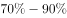
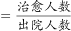
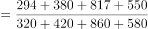
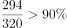
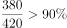
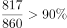

# 现期比重计算（治愈率=治愈人数÷出院人数，四院加总后区间判断）

考点：[[20-考点/资料分析/比重/现期比重计算（治愈率=治愈人数÷出院人数，四院加总后区间判断）|比重 / 现期比重计算（治愈率=治愈人数÷出院人数，四院加总后区间判断）]]
材料：[[15-材料/资料分析/257881 某市甲、乙、丙、丁4所三甲医院分科室|257881 某市甲、乙、丙、丁4所三甲医院分科室]]

**问法模型**：'治愈率在以下哪个范围内'的区间型现期比重题 → 先把4所医院外科的治愈人数、出院人数分别加总，用 治愈率=Σ治愈÷Σ出院 计算整体比率，再与选项区间端点对照。

## 推理链
1. 第1步：定位表格'外科'行（不要误取'合计'行）：甲院治愈294/出院320，乙院380/420，丙院817/860，丁院550/580（单位：人）。
2. 第2步：规则：治愈率=治愈人数÷出院人数；'该市'为四院整体口径，整体治愈率=Σ治愈人数÷Σ出院人数（加权比重），不能把四院各自的治愈率做算术平均。
3. 第3步：纵向加总：治愈=294+380+817+550=2041人；出院=320+420+860+580=2180人。
4. 第4步：代入计算：治愈率=2041/2180≈93.6%（截位直除：首位商9、次位商3）。
5. 第5步：与选项对照：93.6%>93%（验证：2180×93%=2027.4<2041），落入D项'93%以上'的区间，故选D。

**最快解法**：⚡ 加总+区间端点验证法：先纵向加总得2041/2180，不必精算商值，直接用分母乘区间端点判断——2180×93%≈2027<2041，即治愈率>93%，秒锁定'93%以上'的D项；辅以混合居中校验：四院外科治愈率介于90.5%（乙）与95%（丙）之间，出院量大的丙院(95%)、丁院(94.8%)权重大，整体应偏高，与>93%一致。

## 易错点
- ⚠ 算术平均陷阱：把四院外科治愈率（甲91.9%、乙90.5%、丙95%、丁94.8%）直接平均得约93.1%，会选错；比率型指标必须用Σ分子÷Σ分母加权，出院人数多的医院权重大。
- ⚠ 口径陷阱：'该市'须四院外科数据加总，只算某一院（如丙院817/860=95%）即以偏概全；同时勿把'合计'行/列的全院汇总数据误当作外科数据混入。
- ⚠ 看行串行陷阱：甲院外科出院320与妇科出院320数值相同，加总时须逐院核对'外科'行，防止取错格子。

## 母题抽象
> 🧩 当题干出现'某地区/全体的比率（治愈率、利润率、达标率等比重型指标）在以下哪个范围'时，用加权模型 Σ分子÷Σ分母 计算，并用'分母×区间端点 与实际分子比较'快速锁定选项，切忌对各个体比率做算术平均。

**同类特征**：治愈率在以下哪个范围、该市三甲医院（全市汇总口径）、外科、区间型选项（以上/以下）、治愈人数÷出院人数、现期比重直接计算

## 相关题
- [[10-真题/资料分析/比重/2578817 现期比重（治愈率）计算与横向比较|2578817]]（内蒙古 2020，相关度2）
- [[10-真题/资料分析/比重/2578880 现期比重（率）比较——同一医院儿科治愈率与外科治愈率对比|2578880]]（湖南 2020，相关度1）
- [[10-真题/资料分析/比重/2578829 现期比重（治愈率）比较——按科室横向汇总四院数据作商|2578829]]（湖南 2020，相关度1）

---

### 题干
该市三甲医院外科的治愈率在以下哪个范围内：

### 选项
- A. 

- B. 

- C. 

- D. 
以上
　✅

### 官方解析

方法一：根据题干“······的治愈率在以下哪个范围”，结合“治愈率”，可判定本题为现期比重问题。定位表格可得该市三甲医院外科的治愈人数和出院人数，则所求治愈率，D项满足。

方法二：4所医院的外科的治愈率分别为：、、、，因每个医院的外科治愈率均大于，则总体治愈率也一定大于，D项满足。

故正确答案为D。

### 给定材料

> [!warning] 疑点（官方解析可能有误，待人工复核）
> 官方解析方法二称'每个医院的外科治愈率均大于（某阈值），则总体治愈率也一定大于（该阈值）'，但实际四院外科治愈率为甲294/320≈91.9%、乙380/420≈90.5%、丙817/860=95%、丁550/580≈94.8%，甲、乙两院均低于93%；若解析隐含阈值为93%则该推理不成立，只能得出总体>90%，与D项'93%以上'之间存在逻辑缺口。本题应以方法一的加总计算2041/2180≈93.6%为准确依据，答案D本身无误。

<!-- CODEX-ANSWER-REVIEW:BEGIN -->
### 本次独立复核

**复核状态：** `resolved`（答案与解析已核定）

**计分答案：** D（可计分）

**复核解析：**

四家医院外科治愈率应合并人数计算：治愈人数294+380+817+550=2041，出院人数320+420+860+580=2180；总体治愈率=2041/2180≈93.62%，落在D项范围。不能用四家医院治愈率的简单平均代替合并比率。

**相关信息：**

汇总率是按出院人数加权的比率；官方“所有医院均高于阈值”的旁证不成立，但总量加权计算可独立确定答案。

**题源依据：** [固定版本原题](https://github.com/Mentat-Uran/kaogongzhentizhengliu/blob/84ab93d4b64b61d897bece8a1c0a5bab06b4feb2/10-%E7%9C%9F%E9%A2%98/%E8%B5%84%E6%96%99%E5%88%86%E6%9E%90/%E6%AF%94%E9%87%8D/2578815%20%E7%8E%B0%E6%9C%9F%E6%AF%94%E9%87%8D%E8%AE%A1%E7%AE%97%EF%BC%88%E6%B2%BB%E6%84%88%E7%8E%87%3D%E6%B2%BB%E6%84%88%E4%BA%BA%E6%95%B0%C3%B7%E5%87%BA%E9%99%A2%E4%BA%BA%E6%95%B0%EF%BC%8C%E5%9B%9B%E9%99%A2%E5%8A%A0%E6%80%BB%E5%90%8E%E5%8C%BA%E9%97%B4%E5%88%A4%E6%96%AD%EF%BC%89.md)；固定内容 commit `84ab93d4b64b61d897bece8a1c0a5bab06b4feb2`，Markdown blob `67830c9abaf610a47aee94381c72c41f8e5d291e`。
<!-- CODEX-ANSWER-REVIEW:END -->
