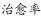
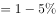

# 现期比重（治愈率）计算与横向比较

考点：[[20-考点/资料分析/比重/现期比重（治愈率）计算与横向比较|比重 / 现期比重（治愈率）计算与横向比较]]
材料：[[15-材料/资料分析/257881 某市甲、乙、丙、丁4所三甲医院分科室|257881 某市甲、乙、丙、丁4所三甲医院分科室]]

**问法模型**：题干问'外科治愈率最高的医院'→ 对4所医院分别用'外科治愈人数÷外科出院人数'求现期比重再比大小

## 推理链
1. 第1步：定位表格外科行，提取4院数据：甲出院320/治愈294，乙出院420/治愈380，丙出院860/治愈817，丁出院580/治愈550（勿误取合计行丙2860/1932）
2. 第2步：治愈率=治愈人数÷出院人数，属现期比重模型，单位统一为'人'，直接相除
3. 第3步：代入计算：甲294/320≈91.9%，乙380/420≈90.5%，丙817/860=95.0%，丁550/580≈94.8%
4. 第4步：因各率均在90%以上、丙丁接近，转化为比较'1-治愈率'：甲26/320=8.1%，乙40/420≈9.5%，丙43/860=5.0%，丁30/580≈5.2%，丙的未治愈率最小
5. 第5步：未治愈率最小者治愈率最高，丙医院95.0%为最高，对照选项选C

**最快解法**：⚡ 转化比较法+截位直除：各率均超90%，改比'1-治愈率'即未治愈率，甲26/320、乙40/420、丙43/860、丁30/580，其中43/860恰为整5%最小（丁30/580≈5.2%略大），一眼锁定丙医院治愈率最高，无需算出全部百分数

## 易错点
- ⚠ 误取合计行数据：丙医院全院出院2860/治愈1932是汇总值，外科必须取860/817，表头'合计'只是校验行
- ⚠ 丙95.0%与丁94.8%仅差0.2个百分点，粗略估算或只保留整数百分点（95%vs95%）易误判丁，需用未治愈率5.0%vs5.2%精确区分
- ⚠ 口径混淆：本题比较的是各院外科治愈率，不能与全市外科总治愈率（2041/2180≈93.6%，第2题口径）或四院治愈率算术平均混用

## 母题抽象
> 🧩 当题干出现'某率最高的主体是'特征时，对各主体分别用分子÷分母求现期比率再比较；若各率均接近100%难以直判，转化为比较'1-率'（未发生率），未发生率最小者率最高

**同类特征**：治愈率最高、外科、4所医院横向比较、治愈人数÷出院人数、现期比重、单表分行列定位

## 相关题
- [[10-真题/资料分析/比重/2578815 现期比重计算（治愈率=治愈人数÷出院人数，四院加总后区间判断）|2578815]]（湖南 2020，相关度2）
- [[10-真题/资料分析/比重/4792819 现期比重计算（多部分比重依次求解）|4792819]]（新疆 2014，相关度1）
- [[10-真题/资料分析/比重/827355 现期比重比较（部分占比过半速判）|827355]]（政法干警 2014，相关度1）
- [[10-真题/资料分析/比重/2272297 现期比重比较|2272297]]（选调 2015，相关度1）
- [[10-真题/资料分析/比重/2032972 现期比重计算（多地区占比求和）|2032972]]（吉林 2015，相关度1）

---

### 题干
外科治愈率最高的医院是：

### 选项
- A. 甲医院
- B. 乙医院
- C. 丙医院　✅
- D. 丁医院

### 官方解析

根据题干“外科治愈率最高······”，结合“”，可判定本题为现期比重问题。定位表格可得4所医院中外科的治愈人数和出院人数，则可得4所医院的外科治愈率分别为：

甲：；

乙：；

丙：；

丁：；

对比可得，在丙医院中，1减去的值最小，则所得值最大，治愈率最高。

故正确答案为C。

### 给定材料

> [!warning] 疑点（官方解析可能有误，待人工复核）
> 官方解析中各院治愈率的具体算式与数值处为空白（占位缺失），但结论C经核算无误（丙817/860=95.0%为四院最高），不影响答案
