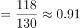
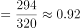
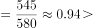
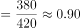
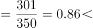
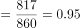
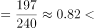
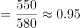

# 现期比重（率）比较——同一医院儿科治愈率与外科治愈率对比

考点：[[20-考点/资料分析/比重/现期比重（率）比较——同一医院儿科治愈率与外科治愈率对比|比重 / 现期比重（率）比较——同一医院儿科治愈率与外科治愈率对比]]
材料：[[15-材料/资料分析/257881 某市甲、乙、丙、丁4所三甲医院分科室|257881 某市甲、乙、丙、丁4所三甲医院分科室]]

**问法模型**：问'儿科治愈率高于外科治愈率的医院'→ 对每所医院分别用'治愈人数÷出院人数'算出儿科、外科两个治愈率，逐院比较大小找满足条件的对象

## 推理链
1. 第1步：从表格提取四院外科'治愈/出院'数据：甲294/320、乙380/420、丙817/860、丁550/580
2. 第2步：提取四院儿科'治愈/出院'数据：甲118/130、乙545/580、丙301/350、丁197/240
3. 第3步：治愈率=治愈人数÷出院人数；甲：儿科118/130≈90.8%＜外科294/320≈91.9%，不满足
4. 第4步：乙：儿科545/580≈94.0%＞外科380/420≈90.5%，满足要求
5. 第5步：验证其余：丙儿科301/350≈86.0%＜外科817/860≈95.0%、丁儿科197/240≈82.1%＜外科550/580≈94.8%，均不满足
6. 第6步：仅乙医院满足'儿科治愈率高于外科治愈率'，对照选项选B

**最快解法**：⚡ 截位直除（或交叉相乘比大小）：先算甲118/130≈90.8% vs 294/320≈91.9%，排除A；再看乙545/580≈94% vs 380/420≈90.5%，满足即锁定B（单选题无需再验丙丁，验证仅丙86%＜95%、丁82.1%＜94.8%）；同院两分数比较可用交叉相乘：乙545×420=228900＞380×580=220400，故儿科＞外科

## 易错点
- ⚠ 分子分母取反：治愈率=治愈人数÷出院人数，误将出院人数作分子或拿治愈人数直接比大小（如乙545＞甲294并不代表率更高）
- ⚠ 比较对象搞错：是同一医院内部儿科vs外科比较，不是四院儿科之间或四院外科之间排名
- ⚠ 误用'合计'行数据（如乙合计治愈1782/出院2190）替代科室行数据，合计只是校验行，无科室口径

## 母题抽象
> 🧩 当题干出现'A率高于B率'且两率均为'分子÷分母'的现期比值时，对每个对象分别计算两率并逐一比较，用截位直除首两位或交叉相乘即可快速锁定唯一满足项

**同类特征**：治愈率高于、儿科与外科两科室同院对比、逐医院逐一比较、现期比率比较、治愈人数÷出院人数、结论唯一满足

## 相关题
- [[10-真题/资料分析/比重/2578817 现期比重（治愈率）计算与横向比较|2578817]]（内蒙古 2020，相关度1）
- [[10-真题/资料分析/比重/2578815 现期比重计算（治愈率=治愈人数÷出院人数，四院加总后区间判断）|2578815]]（湖南 2020，相关度1）
- [[10-真题/资料分析/比重/2578829 现期比重（治愈率）比较——按科室横向汇总四院数据作商|2578829]]（湖南 2020，相关度1）

---

### 题干
儿科治愈率高于外科治愈率的医院是：

### 选项
- A. 甲医院
- B. 乙医院　✅
- C. 丙医院
- D. 丁医院

### 官方解析

根据题干“儿科治愈率高于外科治愈率”，由治愈率，可判定本题为现期比重比较问题。定位表格儿科和外科数据可得：

甲医院：儿科治愈率&lt;外科治愈率；

乙医院：儿科治愈率外科治愈率；

丙医院：儿科治愈率外科治愈率；

丁医院：儿科治愈率外科治愈率；

根据结果可知乙医院满足要求。

故正确答案为B。

### 给定材料

> [!warning] 疑点（官方解析可能有误，待人工复核）
> 官方解析中乙、丙、丁三院的比较符号缺失（显示为'儿科治愈率外科治愈率'），按表格数据应为：乙'＞'、丙'＜'、丁'＜'，计算结论与官方答案B一致，仅排版缺符号
