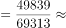
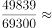
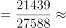
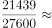
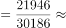
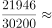
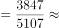
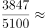

# 现期比重计算与排名比较

考点：[[20-考点/资料分析/比重/现期比重计算与排名比较|比重 / 现期比重计算与排名比较]]
材料：[[15-材料/资料分析/257856 2019年全国及东部、中部、西部、东|257856 2019年全国及东部、中部、西部、东]]

**问法模型**：题干出现'2019年A占B比重排名第二的地区'→ 对四个地区分别套用比重=部分（住宅投资）÷整体（房地产开发投资），截位直除后排序取第二名

## 推理链
1. 第1步：题干时间为2019年（现期），问'住宅投资占房地产开发投资比重'排名，定位表一，提取四地区数据（单位亿元）：东部住宅49839/总额69313，中部21439/27588，西部21946/30186，东北3847/5107
2. 第2步：现期比重公式：比重=住宅投资额÷房地产开发投资额，分子取'住宅'栏第一列（投资额），分母取左侧'投资额'列
3. 第3步：截位直除估算：东部49839/69313≈0.719，中部21439/27588≈0.777，西部21946/30186≈0.727，东北3847/5107≈0.753
4. 第4步：排序比较：中部77.7%＞东北75.3%＞西部72.7%＞东部71.9%，排名第二为东北地区
5. 第5步：与选项对照：东北地区对应D，与官方答案一致

**最快解法**：⚡ 截位直除：四个比重分子分母各截前2~3位快速作商——东部≈50/69.3≈0.72、中部≈2.14/2.76≈0.78、西部≈2.19/3.02≈0.73、东北≈3.85/5.11≈0.75，无需精算即可排序，第二名是东北，选D

## 易错点
- ⚠ 表一'住宅'表头横跨两列（住宅投资额+住宅增速），易看串行误把增速当投资额；分子必须用住宅投资额（如东北3847），分母用投资总额（5107）
- ⚠ 题干问'地区'须排除'全国总计'行，全国住宅占比97071/132194≈73.4%只是干扰参考，不是备选项
- ⚠ 误用'住宅比上年增长'列（9.9%、14.0%、24.7%、12.1%）来比大小，把'增速最快'错当'占比第二'

## 母题抽象
> 🧩 当题干出现'A占B的比重排名第N的地区'且时间与材料现期一致时，直接对各地区的'部分÷整体'作截位直除估算，按大小排序后取目标名次对应选项

**同类特征**：住宅投资占房地产开发投资比重、排名第二、地区（须排除全国总计）、现期2019年数据、表一取数、部分÷整体再排序

## 相关题
- [[10-真题/资料分析/倍数/2616169 现期倍数计算|2616169]]（海南 2020，相关度1）

---

### 题干
2019年全国住宅投资占房地产开发投资比重排名第二的地区是：

### 选项
- A. 东部地区
- B. 中部地区
- C. 西部地区
- D. 东北地区　✅

### 官方解析

根据题干“2019年······占······比重”，材料时间为2019年，可判定本题为现期比重问题。定位表一，可知四个地区的住宅投资额和房地产开发投资额。根据公式：比重，可得东部地区比重，中部地区比重，西部地区比重，东北地区比重，故比重排名第二的地区是东北地区。

故正确答案为D。

### 给定材料

        2019年全国房地产开发投资132194亿元，比上年增长，增速比上年加快0.4个百分点。其中，住宅投资97071亿元，增长，增速比上年加快0.5个百分点。2019年，全国商品房销售面积171558万平方米，比上年下降。其中，住宅销售面积增长，办公楼销售面积下降，商业营业用房销售面积下降。商品房销售额159725亿元，增长，增速比上年回落5.7个百分点。其中，住宅销售额增长，办公楼销售额下降，商业营业用房销售额下降。

