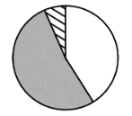
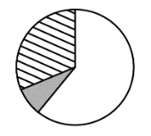
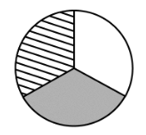

# 累计做差求单月+现期比重比较（饼图匹配）

考点：[[20-考点/资料分析/比重/累计做差求单月+现期比重比较（饼图匹配）|比重 / 累计做差求单月+现期比重比较（饼图匹配）]]
材料：[[15-材料/资料分析/257930 2017年1-4月T地区批发和零售业|257930 2017年1-4月T地区批发和零售业]]

**问法模型**：题干问'2017年4月（单月）各规模企业销售额占比关系（饼图）'→ 先用'1-4月累计−1-3月累计'做差求单月分量，再比较占比大小与扇区幅度匹配图形

## 推理链
1. 第1步：题干要求2017年4月限额以上商品销售额中按规模分（大型/中型/小微型）的占比，而表格只给1-3月与1-4月两组累计值，4月单月必须做差求得
2. 第2步：从表格'按规模分'提取数据——大型企业1-4月1811亿元、1-3月1381亿元；中型企业4498亿元、3533亿元；小微型企业4798亿元、3639亿元
3. 第3步：做差求4月单月：大型=1811−1381=430亿元，中型=4498−3533=965亿元，小微=4798−3639=1159亿元
4. 第4步：交叉验证：430+965+1159=2554亿元，恰等于文字中4月限额以上商品销售额2554亿元，做差无误
5. 第5步：算占比：大型430/2554≈17%，中型965/2554≈38%，小微1159/2554≈45%，即小微>中型>大型
6. 第6步：与选项对照：排除B、C（占比排序不符），又小微与中型明显大于大型（大型约17%不足1/6圆、小微接近半圆），排除比例差距失真的D，故选A

**最快解法**：⚡ 累计做差+截位估占比：心算差值430、965、1159（合计恰为文字中的2554，自检通过）；占比约17%:38%:45%，只看相对大小——小微>中型>大型且大型不足60°扇区、小微接近但不到半圆，直接锁定A，无需精算百分比

## 易错点
- ⚠ 忘记做差，直接用1-4月累计值（1811/4498/4798）算占比，会使中型误成最大、图形完全不同
- ⚠ 1-3月与1-4月两列看反（基期现期混淆），导致差值算错甚至出现负值
- ⚠ 只排序不比幅度：大型仅约17%（不足1/6圆）、小微约45%接近半圆，需结合扇区角度差距排除'三类接近'的干扰图形；同时切勿把业务类型、所有制维度的数据跨维度加进占比

## 母题抽象
> 🧩 当题干出现'某单月+各分类占比（饼图/比重比较）'特征而表格只给累计值时，用'1-N月累计−1-(N-1)月累计'求单月分量，先验证分量合计=单月总量，再按占比排序与扇区幅度匹配图形

**同类特征**：2017年4月（单月）、不同规模企业、销售额占比关系、饼图、限额以上口径、累计值需做差

## 相关题
- [[10-真题/资料分析/比重/19181372 现期比重计算与饼图扇区识别|19181372]]（吉林 2024，相关度1）
- [[10-真题/资料分析/比重/2571801 基期比重还原（百分点变化反推）+饼图匹配|2571801]]（山东 2020，相关度1）
- [[10-真题/资料分析/比重/2444768 现期比重比较（饼图辨析型）|2444768]]（四川 2019，相关度1）
- [[10-真题/资料分析/比重/4637459 现期比重计算与饼图占比对照|4637459]]（国考 2022，相关度1）
- [[10-真题/资料分析/比重/5445864 现期比重计算（饼图匹配）|5445864]]（国考 2023，相关度1）

---

### 题干
以下哪个饼图最符合2017年4月T地区限额以上商品销售额中不同规模的企业销售额占比关系？

### 选项
- A. 

　✅
- B. 

- C. 

- D. 

### 官方解析
根据题干“······2017年4月······占比关系”，结合材料时间为2017年，可判定本题为现期比重问题。定位表格材料可得：
2017年1-4月大型企业限额以上商品销售额为1811亿元，1-3月其限额以上商品销售额为1381亿元，可知2017年4月份大型企业限额以上商品销售额为亿元；
2017年1-4月中型企业限额以上商品销售额为4498亿元，1-3月其限额以上商品销售额为3533亿元，可知2017年4月份中型企业限额以上商品销售额为亿元；
2017年1-4月小微型企业限额以上商品销售额为4798亿元，1-3月其限额以上商品销售额为3639亿元，可知2017年4月份小微型企业限额以上商品销售额为亿元。
可知2017年4月T地区限额以上商品销售额中：小微型企业中型企业大型企业，排除B、C两项，又因为小微型企业和中型企业明显比大型企业大，排除D项。
故正确答案为A。

### 给定材料

        2017年1-4月，T地区批发和零售业商品销售总额为15220亿元，同比增长，其中，限额以上商品销售额达到11107亿元，同比增长；4月份，T地区批发和零售业商品销售总额和限额以上商品销售额分别为3339亿元和2554亿元。

> [!warning] 疑点（官方解析可能有误，待人工复核）
> 官方解析中'2017年4月份大型/中型/小微型企业限额以上商品销售额为 亿元'三处缺印计算结果（应为430、965、1159），属排版缺失，但结论与做差结果一致，不影响答案
