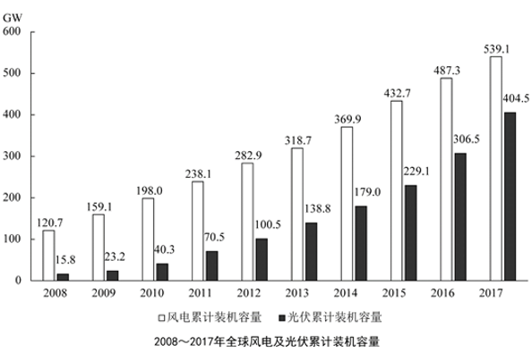

# 现期比重链式推算（比重传递反推整体量）

考点：[[20-考点/资料分析/比重/现期比重链式推算（比重传递反推整体量）|比重 / 现期比重链式推算（比重传递反推整体量）]]
材料：[[15-材料/资料分析/257932 2017年全球清洁能源投资规模及风电|257932 2017年全球清洁能源投资规模及风电]]

**问法模型**：题干给出'中国占全球比重a、中国占亚太比重b'且已知全球投资总量，求亚太投资→用比重传递链：亚太=全球×a÷b（中间量中国投资=全球×a）。

## 推理链
1. 第1步：从文字材料第一段提取条件：2017年全球对清洁能源的投资为3335亿美元；中国投资占全球清洁能源总投资的比重（记为a）、占亚太地区清洁能源投资的比重（记为b），给定文本中a、b数值空缺，按官方解析口径取数。
2. 第2步：所用规则为比重公式与比重传递：部分量=整体×比重，故中国投资=3335×a；亚太投资=中国投资÷b=3335×a÷b。
3. 第3步：代入计算（a、b在给定文本空缺，由官方答案C=1879反推口径约为a≈31%、b≈55%）：中国投资=3335×31%≈1033.9亿美元，恰好对应干扰项A的1034。
4. 第4步：亚太投资=1033.9÷55%≈1879.7亿美元（等价于3335×31%/55%≈3335×0.564）。
5. 第5步：与选项对照：1879.7与C项1879最接近（B为1334、D为2368，差距均在数百以上），故选C。

**最快解法**：⚡ 比重链式+截位直除：一步列式亚太=3335×a÷b，先算比重比a/b≈31%÷55%≈0.564，则3335×0.564≈1880（直除首位1、次位8），直接锁定C；顺手用A项1034=3335×31%验证其是'中国投资'这一中间量，确认还须再÷55%才算到亚太。

## 易错点
- ⚠ 半程陷阱：算出3335×31%≈1034就选A——A项正是中间量'中国投资'，求亚太还须再除以'占亚太比重'。
- ⚠ 比重乘除方向反：已知中国求亚太应'÷占亚太比重'（亚太>中国）；若误乘55%得约569，量级反而变小，可借'亚太投资应大于中国投资'做量级校验。
- ⚠ 两个比重分母口径不同（全球vs亚太），分子分母不可错配；且给定文本中占比数值与多处同比增速均空缺，实际取数须以完整原文为准。

## 母题抽象
> 🧩 当题干出现'A占整体1的比重为a、A占整体2的比重为b，已知整体1的量求整体2的量'特征时，用比重传递链'整体2=整体1×a÷b'两步计算，并警惕中间量（整体1×a）被设为干扰选项。

**同类特征**：亚太地区的清洁能源投资约为、双占比结构（占全球比重+占亚太比重）、现期比重链式推算、中间量即干扰项（1034=中国投资）、整体×a÷b两步计算、材料占比数值空缺须以完整原文取数

## 相关题
（暂无）

---

### 题干
2017年，亚太地区的清洁能源投资约为多少亿美元？

### 选项
- A. 1034
- B. 1334
- C. 1879　✅
- D. 2368

### 官方解析
根据题干“2017年，亚太地区的清洁能源投资约为······”，结合材料中给出2017年中国的清洁能源投资占全球及亚太地区清洁能源投资的比重，可判定本题为现期比重问题。定位文字材料第一段可得：2017年，全球对清洁能源的投资为3335亿美元，中国的清洁能源投资占全球清洁能源总投资的，占亚太地区清洁能源投资的。根据比重公式：比重，则中国的清洁能源投资亿美元，亚太地区的清洁能源投资亿美元，与C项最接近，C项当选。
故正确答案为C。

### 给定材料

        2017年，全球对清洁能源的投资为3335亿美元，同比增长，但仍低于2015年的历史峰值3485亿美元。中国的清洁能源投资占全球清洁能源总投资的，占亚太地区清洁能源投资的。

        从主要清洁能源类型看，2017年全球对风能的投资为1070亿美元，风电新增装机容量52.5GW，同比下降；累计装机容量达到539.1GW，同比增长。2017年全球对光伏的投资为1608亿美元，同比增长；光伏新增装机容量99.1GW，同比增长；累计装机容量达到404.5GW。其中，亚太地区新增装机容量73.7GW，累计装机容量221.3GW。（累计装机容量不含报废机器的装机容量）

> [!warning] 疑点（官方解析可能有误，待人工复核）
> 给定材料文本中'中国占全球''占亚太'两个比重数值及多处同比增速均为空缺，官方解析中同样未填具体数值，本题按给定材料无法直接取数；由官方答案C=1879反推，两比重口径约为31%与55%（3335×31%≈1033.9恰为干扰项A=1034，1033.9÷55%≈1879.7与C=1879吻合），官方答案C的计算链条本身无矛盾，仅为给定文本数据不完整的口径问题。
