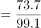
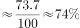
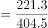
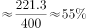
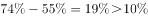

# 现期比重计算及两比重作差比较

考点：[[20-考点/资料分析/比重/现期比重计算及两比重作差比较|比重 / 现期比重计算及两比重作差比较]]
材料：[[15-材料/资料分析/257932 2017年全球清洁能源投资规模及风电|257932 2017年全球清洁能源投资规模及风电]]

**问法模型**：'A占B的比重'比'C占D的比重'高/低多少个百分点 → 分别套用比重=部分÷整体求两个现期比重，再作差并与10个百分点比较

## 推理链
1. 第1步：题干时间2017年与材料现期一致，判定为现期比重问题，从文字材料提取四个数：全球光伏新增99.1GW、全球光伏累计404.5GW、亚太新增73.7GW、亚太累计221.3GW
2. 第2步：两套口径不可混用，分别列式——新增口径比重=73.7/99.1，累计口径比重=221.3/404.5
3. 第3步：截位直除估算新增比重：73.7/99.1，99.1×0.74≈73.3，故约为74.4%
4. 第4步：截位直除估算累计比重：221.3/404.5，因404.5×0.55≈222.5略大于221.3，故略低于55%，约为54.7%
5. 第5步：作差：74.4%－54.7%≈19.7个百分点，方向为'高'且数值超过10个百分点
6. 第6步：对照选项，D项'高10个百分点以上'符合，A、B方向错，C量级不符，故选D

**最快解法**：⚡ 放缩界定法（免精算）：新增比重73.7/99.1>70%（把分母放到105.3仍有73.7/105.3=70%），累计比重221.3/404.5<60%（242.7/404.5才等于60%），两界线相差已超10个百分点且新增比重大，直接锁定D'高10个百分点以上'

## 易错点
- ⚠ 口径混淆：新增装机是当年流量、累计装机是历年滚存存量，两个比重的分子分母必须各自配对（73.7/99.1与221.3/404.5），若分母统一用404.5或99.1即出错
- ⚠ 高低方向判反：新增比重约74%大于累计比重约55%，是'高'，误看数据顺序易选成'低'（A/B）
- ⚠ 百分点与百分数混淆：两比重之差约19.7是'百分点'差，不是比73.7/99.1比221.3/404.5'多百分之几'的算法
- ⚠ 取数来源陷阱：亚太光伏数据只在正文文字段，柱状图中无亚太口径，且图中白柱为风电、深色柱为光伏，误从图中取数或取成风电数据即错

## 母题抽象
> 🧩 当题干出现'现期A占B比重比C占D比重高/低多少个百分点'特征时，先分清两套口径各自配对分子分母，用截位直除求两比重作差，再用放缩界线（如70%、60%）判断是否跨越10个百分点，免精算直接定选项

**同类特征**：现期比重、两个比重作差、高/低……个百分点、新增装机与累计装机双口径、亚太占全球、数据出自文字材料

## 相关题
- [[10-真题/资料分析/比重/16069828 现期比重作差（百分点差值比较）|16069828]]（贵州 2026，相关度2）
- [[10-真题/资料分析/比重/4792819 现期比重计算（多部分比重依次求解）|4792819]]（新疆 2014，相关度1）
- [[10-真题/资料分析/比重/827355 现期比重比较（部分占比过半速判）|827355]]（政法干警 2014，相关度1）
- [[10-真题/资料分析/比重/2272297 现期比重比较|2272297]]（选调 2015，相关度1）
- [[10-真题/资料分析/比重/2032972 现期比重计算（多地区占比求和）|2032972]]（吉林 2015，相关度1）

---

### 题干
2017年，亚太地区光伏新增装机容量占全球比重比其累计装机容量占全球比重：

### 选项
- A. 低10个百分点以内
- B. 低10个百分点以上
- C. 高10个百分点以内
- D. 高10个百分点以上　✅

### 官方解析

根据题干“2017年，······占······比重”，并且问题时间和材料一致，可判定本题为现期比重问题。定位文字材料第二段可得：2017年全球光伏新增装机容量99.1GW，累计装机容量达到404.5GW，亚太地区新增装机容量73.7GW，累计装机容量221.3GW。故亚太地区光伏新增装机容量占全球比重，亚太地区光伏累计装机容量占全球比重。，所以2017年亚太地区光伏新增装机容量占全球比重比其累计装机容量占全球比重高10个百分点以上，D项当选。

故正确答案为D。

### 给定材料

        2017年，全球对清洁能源的投资为3335亿美元，同比增长，但仍低于2015年的历史峰值3485亿美元。中国的清洁能源投资占全球清洁能源总投资的，占亚太地区清洁能源投资的。

        从主要清洁能源类型看，2017年全球对风能的投资为1070亿美元，风电新增装机容量52.5GW，同比下降；累计装机容量达到539.1GW，同比增长。2017年全球对光伏的投资为1608亿美元，同比增长；光伏新增装机容量99.1GW，同比增长；累计装机容量达到404.5GW。其中，亚太地区新增装机容量73.7GW，累计装机容量221.3GW。（累计装机容量不含报废机器的装机容量）

