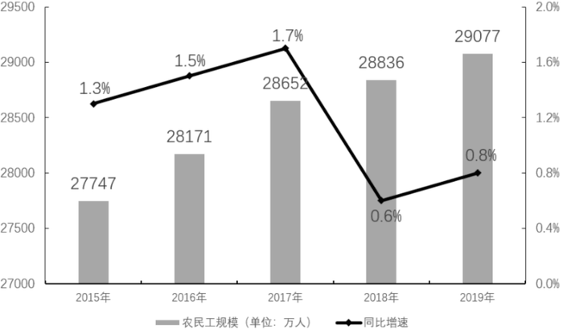
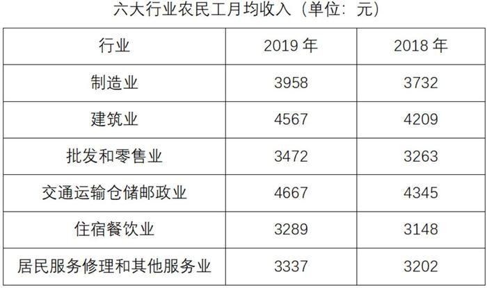

# 基期比重计算（增量倒推型）

考点：[[20-考点/资料分析/比重/基期比重计算（增量倒推型）|比重 / 基期比重计算（增量倒推型）]]
材料：[[15-材料/资料分析/258923 2019年我国农民工监测数据：农民工|258923 2019年我国农民工监测数据：农民工]]

**问法模型**：题干出现'2018年，省内占外出的比重'（时间早于材料现期2019年）→ 采用基期比重模型：基期比重=(省内现期−省内增量)÷(外出现期−外出增量)

## 推理链
1. 第1步：题干时间为2018年，早于材料现期2019年，判定为基期比重问题；从文字段提取：2019年省内就业农民工9917万人、比上年增加245万人，2019年外出农民工17425万人、比上年增加159万人
2. 第2步：材料未直接给2018年数据，需用'基期量=现期量−增长量'倒推；省内、外出均为'比上年增加'，增长量为正，直接相减
3. 第3步：代入计算：2018年省内=9917−245=9672万人，2018年外出=17425−159=17266万人，基期比重=9672÷17266≈56.0%
4. 第4步：对照选项，约56%与C项最接近，故正确答案为C（注意现期比重9917÷17425≈56.9%与基期比重56.0%不同，靠0.9个百分点区分选项）

**最快解法**：⚡ 增量倒推+截位直除：先心算9672/17266，截位为96.7/172.7≈96.7÷172.7，直除首位商5、次位约6，得约56.0%，对应C；不必精算，区分56%与57%即可

## 易错点
- ⚠ 基期现期混淆：直接用2019年数据9917÷17425≈56.9%作答，若选项含56%与57%两档会误选；本题必须减去增量倒推
- ⚠ 增量口径：'比上年增加245/159万人'是增长量而非增速，倒推用减法，不能误用'现期÷(1+增速)'公式
- ⚠ 分子分母对应关系：分子是省内就业（9917、245），分母是外出农民工（17425、159），勿与本地11652万人或总量29077万人混用；另注意材料中跨省'减少86万人'为负增量（本题虽未直接用到，但同段数据正负号易干扰列式）

## 母题抽象
> 🧩 当题干出现'上一基期年份，A占B的（比重/几分之几）'且材料只给现期值和'比上年增加/减少X'增量时，用(A现期−增量A)÷(B现期−增量B)倒推基期量再作商，注意'减少'须加回、'增加'须减去

**同类特征**：2018年（早于材料现期2019年）、省内就业农民工、外出农民工、占…的（比重问法）、比上年增加…万人（需增量倒推）、选项为百分数/分数区间

## 相关题
- [[10-真题/资料分析/倍数/4004923 基期倍数（由现期值与增减量倒推基期值再作商）|4004923]]（新疆 2021，相关度1）

---

### 题干
2018年，省内就业农民工的数量约占外出农民工的（    ）。

### 选项
- A. 

- B. 

- C. 

　✅
- D. 

### 官方解析
根据题干“2018年，······占······的”，结合材料时间为2019年，可判定本题为基期比重问题。定位文字材料第一段，2019年外出农民工17425万人，比上年增加159万人。外出农民工中，在省内就业的农民工9917万人，比上年增加245万人。则2018年省内就业农民工的数量约占外出农民工的比重，与C项最接近。
故正确答案为C。

### 给定材料

        2019年我国农民工规模继续扩大，总量达到29077万人，同比增长。其中，本地农民工11652万人，比上年增加82万人；外出农民工17425万人，比上年增加159万人。外出农民工中，在省内就业的农民工9917万人，比上年增加245万人；跨省流动农民工7508万人，比上年减少86万人。

        从收入看，农民工集中就业的六大行业月均收入均稳定增长。2019年农民工月均收入约4000元；其中外出农民工月均收入4427元，比上年增加320元；本地农民工月均收入3500元，比上年增加160元。分区域看，在东部地区就业的农民工月均收入4222元，比上年增长；在中部地区就业的农民工月均收入3794元，比上年增长；在西部地区就业的农民工月均收入3723元，比上年增长；在东北地区就业的农民工月均收入3469元，同比增长。

