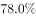

# 基期比重计算（重复用水率=重复用水量÷(用水量+重复用水量)的基期倒推）

考点：[[20-考点/资料分析/比重/基期比重计算（重复用水率=重复用水量÷(用水量+重复用水量)的基期倒推）|比重 / 基期比重计算（重复用水率=重复用水量÷(用水量+重复用水量)的基期倒推）]]
材料：[[15-材料/资料分析/259047 2019年广东省规模以上工业企业的用|259047 2019年广东省规模以上工业企业的用]]

**问法模型**：题干问'2018年…重复用水率约为'→材料时间为2019年现期，判定为基期比率问题：用定义式反推基期分子分母精算，同时可用材料'提高到'的方向性与现期比率定性排除选项

## 推理链
1. 第1步：从材料第2段提取：2019年重复用水量147.10亿立方米、同比增长率r（原文百分数以图片给出），附注释定义'重复用水率=重复用水量÷(用水量+重复用水量)'；2019年用水量39.54亿立方米。
2. 第2步：反推2018年用水量：由表格四地区变化率计算29.85÷0.994+2.46÷0.90+2.96÷0.918+4.27÷0.976≈40.34亿立方米，即2019年比2018年减少约0.8亿立方米（与上一题97题结论一致）。
3. 第3步：反推2018年重复用水量=147.10÷(1+r)（r为2019年重复用水量同比增速）。
4. 第4步：代入定义式：2018年重复用水率=[147.10÷(1+r)]÷{40.34+[147.10÷(1+r)]}，r为百分之几的增速时结果约78%，低于78.8%，A项最接近。
5. 第5步：定性校验：2019年重复用水率=147.10÷(39.54+147.10)=147.10÷186.64≈78.8%，材料称'提高到'78.8%，故2018年重复用水率必低于78.8%。
6. 第6步：与选项对照：仅A项低于78.8%且与精算值约78%吻合，B、C高于78.8%被排除，D'无法判断'不成立，故选A。

**最快解法**：⚡ 定性排除法（考场秒杀）：先算现期重复用水率147.10÷(39.54+147.10)≈78.8%，抓住材料'重复用水率提高到'中'提高到'三字判定2018年<78.8%，四个选项中只有A低于78.8%，直接选A，完全免算基期量。

## 易错点
- ⚠ 公式口径：重复用水率=重复用水量÷(用水量+重复用水量)，分母为两者之和而非用水量；误用147.10÷39.54会得出约372%的荒谬结果
- ⚠ 指标混淆：'用水量'（39.54）与'重复用水量'（147.10）是两个并列且口径完全不同的指标，求和作分母时勿张冠李戴
- ⚠ 基期现期混淆：分子须用基期重复用水量147.10÷(1+r)，分母中的用水量须用2018年基期值≈40.34亿立方米（=39.54+0.8），不能一半现期一半基期；且表格同比变化率全为负，反推基期时符号易错

## 母题抽象
> 🧩 当题干求'基期年份+某比率约为'且材料以'提高到/下降至'给出现期比率时，先算现期比率并按升降方向定性排除选项（唯一低于/高于者即为答案），仅当选项间距过近无法排除时，再用基期量代入定义式（基期分子÷(基期分母+基期分子)）精算验证。

**同类特征**：基期时间词'2018年'+'约为'、求材料附定义注释的复合比率（重复用水率）、材料现期比率带'提高到'类方向词、选项含'无法判断'、需复用表格反推的2018年用水量（与兄弟小题连环）

## 相关题
- [[10-真题/资料分析/增长/2730982 基期增速判断——信息不足-无法判断类|2730982]]（深圳市考 2020，相关度1）
- [[10-真题/资料分析/增长/4651881 存量（在校生）增长率——流量平衡法求增量与基期|4651881]]（深圳市考 2022，相关度1）

---

### 题干
2018年广东规模以上企业重复用水率约为：

### 选项
- A. 

　✅
- B. 

- C. 

- D. 
无法判断

### 官方解析
根据题干“2018年···重复用水率约为”，结合材料公式可知重复利用率为比重且材料时间为2019年，可判定本题为基期比重问题。
方法一：定位文字材料第2段可知：2019年，广东规模以上工业企业重复用水量为147.10亿立方米，比上年增长，则2018年重复用水量亿立方米。根据上一题（97题）可知，2019年用水量39.54亿立方米比2018年减少0.8亿立方米，则2018年用水量现期增长量亿立方米。所以根据材料所给公式：重复用水率重复用水量（用水量重复用水量），则2018年广东规模以上企业重复用水率，A项最接近。
方法二：定位文字材料第2段中可知，“2019年···重复用水率提高到”，说明2018年的重复用水率低于，只有A项符合。
故正确答案为A。

### 给定材料

        2019年，广东规模以上工业企业用水量39.54亿立方米，分水种看，自来水用水量最大，达35.67亿立方米，占全部用水量的；地表淡水用水量2.52亿立方米，地下淡水0.03亿立方米，其他水1.32亿立方米。分地区看，珠三角地区用水量达29.85亿立方米，占比超。

        2019年，广东规模以上工业企业重复用水量为147.10亿立方米，比上年增长，重复用水率提高到（注：重复用水率）。分行业看，重复用水量主要集中在电力、冶金和石油石化行业。其中，电力行业重复用水量为50.72亿立方米，比上年下降，占全省规模以上工业企业全部重复用水量的；冶金行业重复用水量为40.82亿立方米，增长，占全部重复用水量的；石油石化行业重复用水量为32.12亿立方米，增长，占全部重复用水量的。

        整体而言，在全省规模以上工业企业中，重复用水量普及面窄且重复用水率较低的问题值得关注。有重复用水的企业只有3573家，只占全省规模以上工业企业的，说明九成多企业无重复用水。重复用水量超过1000万立方米以上的企业88家，仅占重复用水量的，主要集中在石油化工、电厂和钢铁厂等少数大型企业中，重复用水应用领域明显较窄。

