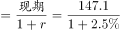
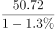
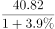
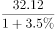
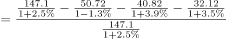
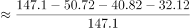
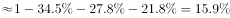

# 基期比重计算（'其他-剩余'类分量=1−各分量占比，需先基期反推）

考点：[[20-考点/资料分析/比重/基期比重计算（'其他-剩余'类分量=1−各分量占比，需先基期反推）|比重 / 基期比重计算（'其他/剩余'类分量=1−各分量占比，需先基期反推）]]
材料：[[15-材料/资料分析/259047 2019年广东省规模以上工业企业的用|259047 2019年广东省规模以上工业企业的用]]

**问法模型**：题干出现'2018年（基期年份）……其他行业……约占……'且选项为百分比 → 基期比重模型：先反推2018年重复用水总量与电力、冶金、石油石化三大行业基期量，'其他行业'=基期总量−三大行业基期之和，再除以基期总量

## 推理链
1. 第1步：定位文字第二段，2019年重复用水总量147.10亿立方米（同比增长，增速以完整原文为准）；电力50.72亿立方米（比上年下降）、冶金40.82亿立方米（增长）、石油石化32.12亿立方米（增长）。
2. 第2步：三大行业之和=50.72+40.82+32.12=123.66亿立方米≠147.10，故2019年其他行业重复用水量=147.10−123.66=23.44亿立方米。
3. 第3步：基期反推规则：2018年值=2019年值÷(1+变化率)；电力为'下降'，变化率取负号，冶金、石化取正增速。
4. 第4步：分别反推：2018年总量=147.10÷(1+g总)，2018年电力=50.72÷(1−d电)，2018年冶金=40.82÷(1+g冶)，2018年石化=32.12÷(1+g石)（各增速在完整原文中给出，所给文本该处为空缺，代入时符号不可弄反）。
5. 第5步：2018年其他行业量=2018年总量−三行业2018年之和；所占比重=该差值÷2018年总量。
6. 第6步：因总量增速与三行业增（降）幅均较小，基期占比与现期占比接近，可用23.44/147.10≈15.9%作锚定参考，与选项对照，官方判定B项最为接近。

**最快解法**：⚡ 基期比重公式法+现期锚定：其他行业基期占比=1−[50.72/(1−d)+40.82/(1+g₂)+32.12/(1+g₃)]÷[147.10/(1+g)]；考场提速可先算现期其他行业占比23.44/147.10≈15.9%（各增速小、基期占比≈现期占比），直接圈定数值最接近的B项再微调验证。

## 易错点
- ⚠ 时间混淆：题干问2018年，若直接用现期23.44/147.10≈15.9%只是近似锚定，选项间距近时必须按基期反推修正，基期与现期口径不能等同。
- ⚠ 符号陷阱：电力行业是'下降'，反推时分母为(1−降幅)（基期量比现期大），冶金、石化为(1+增速)，符号弄反则四个基期量全错。
- ⚠ 总量口径：三大行业之和123.66亿立方米≠总量147.10亿立方米，'其他行业'必须用总量做差求出，勿误以为三行业占100%；分母应为重复用水量147.10，不能误用用水量39.54。

## 母题抽象
> 🧩 当题干出现'基期年份+某分量（尤其是'其他/剩余'类）约占'特征时，用'基期量=现期量÷(1+变化率)'分别反推总量与各分量，'其他'=基期总量−各分量基期之和，再除以基期总量；各增速较小时可先以现期占比锚定选项再验证。

**同类特征**：2018年（基期时间限定）、电力、冶金和石油石化以外的其他行业、重复用水量、约占（选项为百分比）、基期比重、需做差求剩余分量

## 相关题
- [[10-真题/资料分析/比重/16069815 基期比重倒推与排序（现期比重−提升百分点）|16069815]]（贵州 2026，相关度1）
- [[10-真题/资料分析/比重/5494775 基期比重（月度基期量÷年度总量，跨源拼接）|5494775]]（湖北 2023，相关度1）
- [[10-真题/资料分析/比重/16437531 基期比重（'恢复至同期比例'反推基期值+全年值求占比）|16437531]]（山东 2024，相关度1）
- [[10-真题/资料分析/比重/2050986 基期比重计算|2050986]]（江西 2017，相关度1）
- [[10-真题/资料分析/比重/2377416 基期比重计算（现期分量+同比倒推基期，除以基期总量）|2377416]]（黑龙江 2019，相关度1）

---

### 题干
2018年电力、冶金和石油石化行业以外的其他行业的重复用水量约占广东规模以上工业企业重复用水量的：

### 选项
- A. 

- B. 

　✅
- C. 

- D. 

### 官方解析

根据题干“2018年······约占······”，结合选项为百分比，可判定本题为基期比重问题。定位文字材料第二段，可知2018年重复用水量；2018年电力、冶金和石油石化行业的重复用水量分别为，，。因此2018年电力、冶金和石油石化行业以外的其他行业的重复用水量占比，B项最为接近。

故正确答案为B。

### 给定材料

        2019年，广东规模以上工业企业用水量39.54亿立方米，分水种看，自来水用水量最大，达35.67亿立方米，占全部用水量的；地表淡水用水量2.52亿立方米，地下淡水0.03亿立方米，其他水1.32亿立方米。分地区看，珠三角地区用水量达29.85亿立方米，占比超。

        2019年，广东规模以上工业企业重复用水量为147.10亿立方米，比上年增长，重复用水率提高到（注：重复用水率）。分行业看，重复用水量主要集中在电力、冶金和石油石化行业。其中，电力行业重复用水量为50.72亿立方米，比上年下降，占全省规模以上工业企业全部重复用水量的；冶金行业重复用水量为40.82亿立方米，增长，占全部重复用水量的；石油石化行业重复用水量为32.12亿立方米，增长，占全部重复用水量的。

        整体而言，在全省规模以上工业企业中，重复用水量普及面窄且重复用水率较低的问题值得关注。有重复用水的企业只有3573家，只占全省规模以上工业企业的，说明九成多企业无重复用水。重复用水量超过1000万立方米以上的企业88家，仅占重复用水量的，主要集中在石油化工、电厂和钢铁厂等少数大型企业中，重复用水应用领域明显较窄。

> [!warning] 疑点（官方解析可能有误，待人工复核）
> 所给材料文本中重复用水量总增速、电力行业降幅及冶金、石油石化行业增速均为空缺（材料导读已标注'需以完整原文为准'），故2018年各基期量及B项的具体数值无法仅凭所给文本完整复核；官方解析'2018年重复用水量及三行业2018年量'的得出依赖完整原文数据，结论'B项最为接近'以官方为准，不得改判。

<!-- CODEX-ANSWER-REVIEW:BEGIN -->
### 本次独立复核

**复核状态：** `confirmed`（独立复算确认答案）

**计分答案：** B（可计分）

**复核解析：**

从原公式图回推2018年：总重复用水量147.10/1.025≈143.51；电力50.72/0.987≈51.39、冶金40.82/1.039≈39.29、石化32.12/1.035≈31.03。其他行业约21.81，占约15.2%，选B。

**相关信息：**

剩余行业量=整体基期量−已列部分基期量。

**题源依据：** [固定版本原题](https://github.com/Mentat-Uran/kaogongzhentizhengliu/blob/84ab93d4b64b61d897bece8a1c0a5bab06b4feb2/10-%E7%9C%9F%E9%A2%98/%E8%B5%84%E6%96%99%E5%88%86%E6%9E%90/%E6%AF%94%E9%87%8D/2606261%20%E5%9F%BA%E6%9C%9F%E6%AF%94%E9%87%8D%E8%AE%A1%E7%AE%97%EF%BC%88'%E5%85%B6%E4%BB%96-%E5%89%A9%E4%BD%99'%E7%B1%BB%E5%88%86%E9%87%8F%3D1%E2%88%92%E5%90%84%E5%88%86%E9%87%8F%E5%8D%A0%E6%AF%94%EF%BC%8C%E9%9C%80%E5%85%88%E5%9F%BA%E6%9C%9F%E5%8F%8D%E6%8E%A8%EF%BC%89.md)；固定内容 commit `84ab93d4b64b61d897bece8a1c0a5bab06b4feb2`，Markdown blob `22edfc3bbe4f66e21b2d96fc351ce33c2efba073`。
<!-- CODEX-ANSWER-REVIEW:END -->
