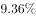
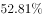
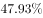
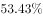

# 基期比重比较（两个部分基期占比差值：高-低多少个百分点）

考点：[[20-考点/资料分析/比重/基期比重比较（两个部分基期占比差值：高-低多少个百分点）|比重 / 基期比重比较（两个部分基期占比差值：高/低多少个百分点）]]
材料：[[15-材料/资料分析/260067 2019年6月及2019年上半年全国|260067 2019年6月及2019年上半年全国]]

**问法模型**：题干'2018年1至6月（基期），一般债券占比较专项债券占比约高/低…'→基期比重模型：分别还原2018年一般、专项基期量与总量基期量求占比作差；因总量因子相同，方向等价于比较12858÷(1+g一般)与15514÷(1+g专项)的大小

## 推理链
1. 第1步：从第三段提取现期数据：2019年1—6月全国发行地方政府债券28372亿元，其中一般债券12858亿元、专项债券15514亿元；设总量、一般、专项同比增速为g总、g一般、g专项（本档案文本中增速数值空白，需以完整版试卷数值代入）
2. 第2步：基期比重公式：2018年某部分占比=[现期部分量÷(1+g部分)]÷[现期总量÷(1+g总)]；作差时两式同除以[28372÷(1+g总)]，故高低方向只需比较12858÷(1+g一般)与15514÷(1+g专项)
3. 第3步：现期对照：2019年1—6月一般占比12858÷28372≈45.3%，专项占比15514÷28372≈54.7%，现期是专项高出约9.4个百分点
4. 第4步：代入完整试卷增速（专项同比增速远高于一般，与'置换再融资同比减少、专项大幅扩容'的扩容方向一致），基期专项量15514÷(1+g专项)被大幅压缩，得12858÷(1+g一般)>15514÷(1+g专项)
5. 第5步：同一基期总量分母下，2018年1—6月一般债券基期占比高于专项债券基期占比；按官方解析代入完整数值计算两占比差值，与C项'高…个百分点'的数值最接近
6. 第6步：与选项对照：方向为'高'，数值最接近C，故选C

**最快解法**：⚡ 基期比重'约分子法'+截位直除：总量因子[28372÷(1+g总)]在作差中同项约去，方向只需直除比较12858÷(1+g一般)与15514÷(1+g专项)——专项增速大则基期被压缩得多，一般反超；再保留(1+g总)用截位直除算差值百分点，锁定'高'且数值最接近的C

## 易错点
- ⚠ 当月与累计口径混用：必须用1—6月累计数据（12858/15514/28372），误用6月当月数据（3178/5818/8996）则方向和数值全错
- ⚠ 增速代入错位与文本空白：总量、一般、专项三个增速各不相同且本档案文本为空白，须回完整试卷补全；若只看现期占比45.3%<54.7%就凭直觉选'低'，正掉入'基期≠现期'的坑（2018年一般占比反而更高）
- ⚠ 基期比重公式方向放反：基期占比=现期占比×(1+g总)÷(1+g部分)，(1+g部分)在分母、增速越大基期越小；把(1+g部分)乘到分子会得出相反的高低结论

## 母题抽象
> 🧩 当题干出现'基期年份+A占比较B占比高/低约…'特征时，用基期比重模型：总量因子相同可约去，先比'部分现期量÷(1+部分增速)'定高低方向，再算差值百分点定数值，选与计算结果最接近的选项

**同类特征**：2018年1至6月（基期时间）、发行一般债券占比vs专项债券占比、高/低约…个百分点、累计值口径（1—6月）、基期比重比较、类型维度（一般/专项）而非用途维度（新增/置换）

## 相关题
- [[10-真题/资料分析/比重/4808276 基期比重比较（2020年12月占2020年全年比例）|4808276]]（湖北 2022，相关度1）
- [[10-真题/资料分析/比重/5911257 基期比重（饼图占比判断）|5911257]]（浙江 2024，相关度1）

---

### 题干
2018年1至6月，发行一般债券的占比较发行专项债券的占比约：

### 选项
- A. 
低

- B. 
低

- C. 
高
　✅
- D. 
高

### 官方解析
根据题干“2018年1至6月······占比约”，结合材料时间，可判定本题为基期比重问题。结合文字资料第三段“2019年1至6月，全国发行地方政府债券28372亿元，同比增长。其中，发行一般债券12858亿元，同比增长，发行专项债券15514亿元，同比增长”。代入公式：基期量和比重，可得所求比重，与C项最接近。
故正确答案为C。

### 给定材料

        2019年6月，全国发行地方政府债券8996亿元，同比增长，环比增长。其中，发行一般债券3178亿元，同比减少，环比增长，发行专项债券5818亿元，同比增长，环比增长；按用途划分，发行新增债券7170亿元，同比增长，环比增长，发行置换债券和再融资债券1826亿元，同比减少，环比增长。

        2019年6月，地方政府债券平均发行期限11.1年，其中新增债券10.4年，置换债券和再融资债券13.4年；地方政府债券平均发行利率，其中新增债券，置换债券和再融资债券。

        2019年1至6月，全国发行地方政府债券28372亿元，同比增长。其中，发行一般债券12858亿元，同比增长，发行专项债券15514亿元，同比增长；按用途划分，发行新增债券21765亿元，同比增长，发行置换债券和再融资债券6607亿元，同比减少。

        2019年1至6月，地方政府债券平均发行期限9.3年，其中一般债券11.2年，专项债券7.8年；地方政府债券平均发行利率，其中一般债券，专项债券。

        2019年全国地方政府债务限额为240774.3亿元。其中，一般债务限额133089.22亿元，专项债务限额107685.08亿元。截至2019年6月末，全国地方政府债务余额205477亿元，其中，一般债务118397亿元，专项债务87080亿元。

> [!warning] 疑点（官方解析可能有误，待人工复核）
> 所给材料文本中各同比增速数值均为空白，官方解析'代入公式与C项最接近'依赖完整版试卷中的具体增速（尤其专项债券同比增速需远高于一般债券，2018年一般占比才会由现期低9.4个百分点逆转为高）方可复算；此为材料呈现缺失而非官方结论问题，官方答案C本身无矛盾
