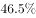
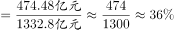

# 现期比重计算

考点：[[20-考点/资料分析/比重/现期比重计算|比重 / 现期比重计算]]
材料：[[15-材料/资料分析/264431 N省2018年规模以上工业运行情况（|264431 N省2018年规模以上工业运行情况（]]

**问法模型**：题干为『A约占B的……』且时间（2018年1—11月）与材料口径一致 → 采用现期比重模型：比重=部分值÷整体值=制造业利润÷利润总额，直接代入相除

## 推理链
1. 第1步：由题干『2018年1—11月……占……』且选项为百分比形式，判定时间为现期，题型为现期比重
2. 第2步：定位文字材料利润段，提取整体量：『1—11月，N省规模以上工业企业实现利润总额达到1332.8亿元』
3. 第3步：提取部分量：『其中，制造业利润474.48亿元』（『其中』引导的即部分，作分子）
4. 第4步：套用公式 比重=部分÷整体=474.48÷1332.8，截位直除：474÷1333，首位商3、次位商5，得≈0.356，即约35.6%
5. 第5步：与选项对照，结果与B项最接近，故正确答案为B

**最快解法**：⚡ 截位直除：474.48÷1332.8，分子分母各截前三位→474÷1333，首位商3得0.35…、验证1333×0.356≈474.5，即约35.6%，直接锁定B

## 易错点
- ⚠ 分子分母颠倒：制造业利润474.48亿元是『其中』引导的部分量应作分子，利润总额1332.8亿元作分母；若颠倒会得1332.8÷474.48≈2.8（倍数），明显超出比重0—100%的合理区间
- ⚠ 时间口径：两数均为1—11月累计值，题干同样问1—11月，口径一致；不要误联想全年数据或『同比增速』信息，增速在本题中完全用不到
- ⚠ 本材料中『0.3个百分点』『4.1个百分点』等差值信息是干扰项，比重题只涉及两个现期绝对量相除，勿把百分点差值卷入计算

## 母题抽象
> 🧩 当题干出现『A（部分）占B（整体）的比重/约占』且时间与材料一致时，用 现期比重=部分÷整体，以『其中』字锁定分子，再截位直除，验证结果落在0%—100%区间

**同类特征**：1—11月（与材料同口径的现期时间）、约占、『占』字比重问法、部分量制造业利润474.48亿元、整体量利润总额1332.8亿元、选项为百分比形式

## 相关题
- [[10-真题/资料分析/比重/12881976 现期比重计算|12881976]]（广东 2025，相关度3）
- [[10-真题/资料分析/比重/12881988 现期比重计算|12881988]]（广东 2025，相关度3）
- [[10-真题/资料分析/比重/2423305 现期比重计算|2423305]]（甘肃 2019，相关度3）
- [[10-真题/资料分析/比重/2604234 现期比重计算|2604234]]（广东 2020，相关度2）
- [[10-真题/资料分析/比重/1751688 现期比重计算|1751688]]（江苏 2015，相关度2）

---

### 题干
2018年1—11月，N省制造业利润额约占规模以上工业企业实现利润总额的：

### 选项
- A. 

- B. 

　✅
- C. 

- D. 

### 官方解析

根据题干“2018年1—11月，······占······”，且选项为“”，结合材料时间为2018年，可判定本题为现期比重问题。定位文字材料第二段“（2018年）1—11月，N省规模以上工业企业实现利润总额达到1332.8亿元，同比增长，······其中，制造业利润474.48亿元”，根据公式：，则2018年1—11月，N省制造业利润额约占规模以上工业企业实现利润总额的比重，与B项最接近。

故正确答案为B。

### 给定材料

        2018年N省规模以上工业增加值比上年增加，增速比上年提高4.0个百分点。其中，新产品增长强劲。石墨及碳素制品增长，单晶硅增长1.2倍，多晶硅增长，汽车增长。

        1—11月，N省规模以上工业企业实现利润总额达到1332.8亿元，同比增长，同期全国平均水平为。其中，制造业利润474.48亿元，同比增长。规模以上工业企业主营业务收入利润率为，同比提高0.3个百分点，也高于全国平均水平4.1个百分点。

