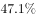
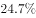
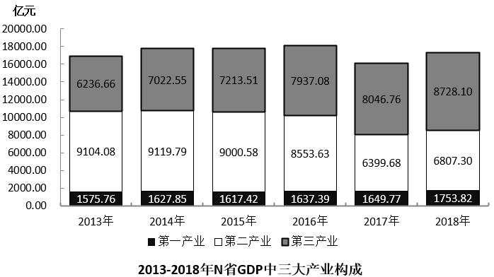

# 现期比重比较（占比过半判断）

考点：[[20-考点/资料分析/比重/现期比重比较（占比过半判断）|比重 / 现期比重比较（占比过半判断）]]
材料：[[15-材料/资料分析/264431 N省2018年规模以上工业运行情况（|264431 N省2018年规模以上工业运行情况（]]

**问法模型**：题干问'占比过半的年份有几个'→将'第二产业占GDP比重>50%'等价转化为'第二产业增加值>第一产业+第三产业之和'，逐年代入比较即可，无需先算GDP总量。

## 推理链
1. 第1步：从统计图提取2013—2018年三大产业增加值（亿元）：第一产业1575.76/1627.85/1617.42/1637.39/1649.77/1753.82，第二产业9104.08/9119.79/9000.58/8553.63/6399.68/6807.30，第三产业6236.66/7022.55/7213.51/7937.08/8046.76/8728.10
2. 第2步：图中不直接给GDP总量，须自行加总；利用'占比过半'的等价规则：第二产业>GDP/2 ⟺ 第二产业>第一产业+第三产业之和
3. 第3步：逐年代入：2013年9104.08>1575.76+6236.66=7812.42，符合；2014年9119.79>1627.85+7022.55=8650.40，符合；2015年9000.58>1617.42+7213.51=8830.93，符合
4. 第4步：2016年8553.63<1637.39+7937.08=9574.47，不符合；2017、2018年第三产业(8046.76、8728.10)已大于第二产业(6399.68、6807.30)，第二产业必然不足一半，直接排除
5. 第5步：符合条件的年份为2013、2014、2015共3个，与选项C对应

**最快解法**：⚡ 比重过半转化法＋截位口算：先把'占比过半'转化为'二产>一产+三产'；2017、2018年直接目测第三产业段大于第二产业段排除；对2013—2015取千位级口算验证9104>7812、9120>8650、9001>8831，2016年8554<9574，得3个年份，选C。

## 易错点
- ⚠ 图中只给分量不给总量：不能只看柱子总高度或第二产业绝对值升降判断占比，如2016年第二产业8553.63亿元虽高于2017年，但占比未过半；必须逐年比较'二产>一产+三产'
- ⚠ 若先逐年加总三大产业求GDP再算比重，计算量大且易算错，应使用'过半⟺大于其余分量之和'的等价转化
- ⚠ 堆积柱状图读数陷阱：第二产业是中间白色段，勿把顶部灰色段（第三产业）的高度误读为第二产业；且图中'第二产业'与文字中'规模以上工业'口径不同，本题只能用图形数据

## 母题抽象
> 🧩 当题干出现'某部分占总量比重过半/超过一半'且材料只给各分量不给总量时，不必加总求总量，直接比较'该分量>其余分量之和'即可逐项判定。

**同类特征**：占比过半、第二产业增加值、年份有几个、2013—2018年间、三大产业构成、图中只给分量未给总量

## 相关题
- [[10-真题/资料分析/增长/13504272 一般增长率计算与计数比较（同比增速-5%年份计数）|13504272]]（云南 2025，相关度1）
- [[10-真题/资料分析/增长/16070145 同比增长率比较（逐年增速计算并计数年份）|16070145]]（贵州 2026，相关度1）
- [[10-真题/资料分析/增长/2024184 同比增长率比较（超阈值年份计数）|2024184]]（重庆 2016，相关度1）
- [[10-真题/资料分析/倍数/4673147 现期倍数比较（'多N倍'的转化判断）|4673147]]（广东 2022，相关度1）
- [[10-真题/资料分析/平均数/5445748 现期平均数（进口平均单价）逐年计算与阈值比较计数|5445748]]（国考 2023，相关度1）

---

### 题干
2013—2018年间，N省GDP中第二产业增加值占比过半的年份有几个？

### 选项
- A. 1
- B. 2
- C. 3　✅
- D. 4

### 官方解析
根据题干“N省GDP中第二产业增加值占比······”，可判定本题为现期比重问题。N省GDP中第二产业增加值占比过半，即GDP中第二产业增加值第一产业增加值第三产业增加值，定位柱状图，可得：
2013年：第二产业增加值9104.08亿元第一产业增加值1575.76亿元第三产业增加值6236.66亿元，符合；
2014年：第二产业增加值9119.79亿元第一产业增加值1627.85亿元第三产业增加值7022.55亿元，符合；
2015年：第二产业增加值9000.58亿元第一产业增加值1617.42亿元第三产业增加值7213.51亿元，符合；
2016年：第二产业增加值8553.63亿元第一产业增加值1637.39亿元第三产业增加值7937.08亿元，不符合；
其中，2017年与2018年第三产业增加值均大于第二产业，不符合。
则2013—2018年间，N省GDP中第二产业增加值占比过半的年份有2013年、2014年、2015年，共3个。
故正确答案为C。

### 给定材料

        2018年N省规模以上工业增加值比上年增加，增速比上年提高4.0个百分点。其中，新产品增长强劲。石墨及碳素制品增长，单晶硅增长1.2倍，多晶硅增长，汽车增长。

        1—11月，N省规模以上工业企业实现利润总额达到1332.8亿元，同比增长，同期全国平均水平为。其中，制造业利润474.48亿元，同比增长。规模以上工业企业主营业务收入利润率为，同比提高0.3个百分点，也高于全国平均水平4.1个百分点。

