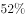

# 基期比重计算

考点：[[20-考点/资料分析/比重/基期比重计算|比重 / 基期比重计算]]
材料：[[15-材料/资料分析/264433 2014年全国及东、中、西部地区房地|264433 2014年全国及东、中、西部地区房地]]

**问法模型**：题干以'2013年……住宅投资占投资额的比重约为'发问（问上年比重），材料数据为2014年现期 → 采用基期比重公式：基期比重=(A/B)×(1+b)/(1+a)，其中A、a为部分（住宅投资）现期值与增速，B、b为整体（总投资）现期值与增速

## 推理链
1. 第1步：题干时间为2013年（基期）而材料数据为2014年（现期），判定为基期比重问题，定位统计表提取东部地区数据：住宅投资35477亿元、增速8.5%，总投资52941亿元、增速10.4%
2. 第2步：套用基期比重公式：基期比重=(A/B)×(1+b)/(1+a)=（35477/52941）×(1+10.4%)/(1+8.5%)
3. 第3步：先算现期比重，截位直除35477/52941≈67.0%（52941×0.67≈35470，接近35477）
4. 第4步：计算修正系数1.104/1.085≈1.0175（增速差0.019÷1.085≈0.0175），基期比重≈67.0%×1.0175≈68.2%；可用基期值验证：2013年住宅投资=35477/1.085≈32698亿元，2013年总投资=52941/1.104≈47957亿元，32698/47957≈68.2%，两种算法一致
5. 第5步：部分增速8.5%小于整体增速10.4%，比重应从2013年到2014年下降，故基期比重68.2%大于现期比重67.0%，67%为干扰项，约68.2%对应选项B，故正确答案为B

**最快解法**：⚡ 基期比重公式法+截位直除：先算现期比重35477/52941≈67.0%；再看增速差判断方向——住宅增速8.5%＜总投资增速10.4%，基期比重应大于现期比重，乘(1.104/1.085)≈1.018得68.2%，锁定B

## 易错点
- ⚠ 把现期比重35477/52941≈67%直接当基期比重作答，漏乘修正项(1+b)/(1+a)，正好落入67%这个干扰项
- ⚠ 部分与整体的增速用混或分子分母颠倒：住宅投资对应a=8.5%、总投资对应b=10.4%，若颠倒为(1.085/1.104)≈0.983会算出约65.9%的反向错误结果
- ⚠ 指标口径混淆：材料文字段讲商品房'销售'、统计表讲'投资'，本题须用表格投资数据；且住宅投资增速(8.5%)与总投资增速(10.4%)不同，还原基期时不能用同一增速

## 母题抽象
> 🧩 当题干出现'上年（基期）部分占整体的比重约为'特征时，用基期比重公式A/B×(1+b)/(1+a)：先截位直除算现期比重，再按增速差定方向——部分增速a小于整体增速b则基期比重大于现期比重，选项中现期比重的数值必是干扰项

**同类特征**：2013年、基期、住宅投资占投资额、比重约为、东部地区、分地区投资统计表

## 相关题
- [[10-真题/资料分析/比重/2051382 基期比重计算|2051382]]（天津 2017，相关度3）
- [[10-真题/资料分析/比重/2049856 基期比重计算|2049856]]（湖南 2017，相关度2）
- [[10-真题/资料分析/比重/2050986 基期比重计算|2050986]]（江西 2017，相关度2）
- [[10-真题/资料分析/比重/2172071 基期比重计算|2172071]]（广州市考 2018，相关度2）
- [[10-真题/资料分析/比重/2188466 基期比重计算|2188466]]（黑龙江 2018，相关度2）

---

### 题干
2013年，东部地区住宅投资占投资额的比重约为：

### 选项
- A. 

- B. 

　✅
- C. 

- D. 

### 官方解析
由题干“2013年······的比重”，结合材料时间是2014年，可判定本题为基期比重问题。定位统计表材料，2014年东部地区住宅投资额为35477亿元（A），增速为（a）； 总投资额为52941亿元（B），增速为（b）。根据基期比重公式：，可得2013年东部地区住宅投资占投资额的比重。
故正确答案为B。

### 给定材料

        2014年，全国房地产开发投资95036亿元，比上年增长，增速比2013年回落9.3个百分点。其中，住宅投资64352亿元，增长。

        2014年，全国商品房销售面积120649万平方米，比上年下降，降幅比1—11月份收窄0.6个百分点，2013年为增长；商品房销售额76292亿元，下降，降幅比1—11月份收窄1.5个百分点，2013年为增长。

        2014年，东部地区商品房销售面积54756万平方米，比上年下降，降幅比1—11月份收窄1.3个百分点；销售额43607亿元，下降，降幅收窄2.1个百分点。中部地区商品房销售面积33824万平方米，下降，降幅收窄0.4个百分点；销售额16558亿元，增长，1—11月份为下降。西部地区商品房销售面积32068万平方米，增长，增速回落0.6个百分点；销售额16127亿元，增长，增速回落0.6个百分点。

