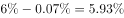
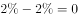
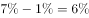
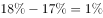

# 两期比重作差比较（百分点增幅最大项）

考点：[[20-考点/资料分析/比重/两期比重作差比较（百分点增幅最大项）|比重 / 两期比重作差比较（百分点增幅最大项）]]
材料：[[15-材料/资料分析/264846 中国发电量的电源结构：图1为2010|264846 中国发电量的电源结构：图1为2010]]

**问法模型**：题干出现'与基期年相比，某部分比重增幅最大'→ 对各部分用'2020年比重−2010年比重'作差，比较百分点大小（比重为百分率，不采用除法求变化率）。

## 推理链
1. 第1步：读图1得2010年各电源占比——火电80%、水电17%、核电2%、风电1%、太阳能0.07%；读图2得2020年占比——火电67%、水电18%、核电2%、风电7%，太阳能数值显示为'太阳能,…'被截断无法读出。
2. 第2步：比重本身是百分率，'比重增幅'按官方口径采用作差法：现期比重−基期比重，单位为百分点，不用（现期−基期）÷基期的相对变化率。
3. 第3步：逐项作差：风电7%−1%=+6个百分点；水电18%−17%=+1个百分点；核电2%−2%=0个百分点；火电67%−80%=−13个百分点（下降，直接排除）；太阳能因图2数值截断无法定量计算，只能在可读项中比较。
4. 第4步：可读项中+6个百分点为最大增幅，对应风电；与选项对照：A太阳能无法量化、B核电0、D水电+1、C风电+6，故选C。

**最快解法**：⚡ 口算作差法：先排除下降或持平项（火电−13个百分点、核电0），再在上升项中比差值——风电+6个百分点 vs 水电+1个百分点，风电一眼最大，无需列式计算。

## 易错点
- ⚠ 误把'比重增幅'算成相对增长率（现期−基期）/基期：若按此算法，太阳能基数仅0.07%，相对变化率会畸大，极易误选A；正确口径是作差比百分点。
- ⚠ 图2中太阳能数值被截断显示不全，不能凭空补数参与定量比较，只能在可读数据（火电、水电、核电、风电）中比增幅。
- ⚠ 核电两年占比均为2%，易误判为'比重不变'选项而纠结；且百分点差不能与增长率%混用表述。

## 母题抽象
> 🧩 当题干出现'与某年相比，……所占比重增幅/上升最大'的特征时，直接用'现期比重−基期比重'作差比较百分点（比重是百分率不作商），排除数值不可读项与下降项，在可读项中取差值最大者。

**同类特征**：与2010年相比……比重增幅最大、两期比重作差比较、饼图结构占比（无绝对量）、百分点而非增长率、预测值与实际值对比、定性比较选最大项

## 相关题
- [[10-真题/资料分析/比重/5746648 基期比重之百分点还原（现期比重−提高的百分点）|5746648]]（江苏 2023，相关度1）

---

### 题干
与2010年相比，预测中国2020年发电量所占比重增幅最大的是：

### 选项
- A. 太阳能
- B. 核电
- C. 风电　✅
- D. 水电

### 官方解析

根据题干“与2010年相比······比重增幅最大的是”，由于比重自身是百分率，一般不考查比重的变化率，因此对比重的增长问题优先进行作差计算。定位图1与图2可知，2010年与2020年各类型发电量占比数据。

太阳能的比重增幅为：；

核电的比重增幅为：；

风电的比重增幅为：；

水电的比重增幅为：。

可看出风电所占比重的增幅最大。

故正确答案为C。

### 给定材料

> [!warning] 疑点（官方解析可能有误，待人工复核）
> 官方解析中四个选项的比重增幅算式结果处均为空白（太阳能一项因图2数值截断无法给出计算值），属解析呈现不完整；但按可读项作差风电+6个百分点最大（若按饼图合计100%推算太阳能约6%，其增幅约5.93个百分点仍小于风电），结论与答案C一致，不构成对答案的质疑。

<!-- CODEX-ANSWER-REVIEW:BEGIN -->
### 本次独立复核

**复核状态：** `resolved`（答案与解析已核定）

**计分答案：** C（可计分）

**复核解析：**

按2010与2020发电结构图比较各能源占比增幅（百分点）：太阳能约+5.93，核电0，风电+6，水电+1；风电最大，C。

**相关信息：**

两期比重变化常用公式：现期比重×(部分增长率−整体增长率)/(1+部分增长率)；部分增速高于整体时比重上升。

**题源依据：** [固定版本原题](https://github.com/Mentat-Uran/kaogongzhentizhengliu/blob/84ab93d4b64b61d897bece8a1c0a5bab06b4feb2/10-%E7%9C%9F%E9%A2%98/%E8%B5%84%E6%96%99%E5%88%86%E6%9E%90/%E6%AF%94%E9%87%8D/2670123%20%E4%B8%A4%E6%9C%9F%E6%AF%94%E9%87%8D%E4%BD%9C%E5%B7%AE%E6%AF%94%E8%BE%83%EF%BC%88%E7%99%BE%E5%88%86%E7%82%B9%E5%A2%9E%E5%B9%85%E6%9C%80%E5%A4%A7%E9%A1%B9%EF%BC%89.md)；固定内容 commit `84ab93d4b64b61d897bece8a1c0a5bab06b4feb2`，Markdown blob `2b129c4c33c5b20f51ca50ebb30df75c4b528ee8`。
<!-- CODEX-ANSWER-REVIEW:END -->
