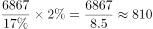

# 现期比重计算（部分量反推总量再求另一部分量）

考点：[[20-考点/资料分析/比重/现期比重计算（部分量反推总量再求另一部分量）|比重 / 现期比重计算（部分量反推总量再求另一部分量）]]
材料：[[15-材料/资料分析/264846 中国发电量的电源结构：图1为2010|264846 中国发电量的电源结构：图1为2010]]

**问法模型**：题干为'已知同年A部分量，求B部分量'且图只给比重→用A÷A的比重反推总量，再乘B的比重（或等价地A×B比重÷A比重）

## 推理链
1. 第1步：题干给出2010年水电发电量6867亿兆瓦时，定位图1得2010年各电源比重：火电80%、水电17%、核电2%、风电1%、太阳能0.07%
2. 第2步：现期比重公式：总量=部分÷比重，部分=总量×比重
3. 第3步：2010年发电量总量≈6867÷17%≈40394亿兆瓦时（即每1%对应约404亿兆瓦时）
4. 第4步：核电发电量=40394×2%≈808亿兆瓦时
5. 第5步：与选项对照，808正好对应C项，其余选项（583/763/926）均偏差明显

**最快解法**：⚡ 等比转化（比重传递）法：核电/水电=2%/17%，故核电=6867×2÷17；先算6867÷17≈404，再乘2得808，一步锁定C，无需写出总量

## 易错点
- ⚠ 单位陷阱：'亿兆瓦时'非'亿千瓦时'，量级差1000倍，勿引入外部常识数据纠偏，全程沿用材料单位
- ⚠ 比重看串：核电2%与风电1%在饼图上相邻且扇区极小，误用1%会得约404（无对应选项则可能错选相近值）
- ⚠ 时间口径：本题是同年（2010年）内部换算，直接用图1比重即可，勿误用图2的2020年比重（核电虽也是2%，但水电为18%，混用会得约763而错选B）

## 母题抽象
> 🧩 当题干出现'已知某年A部分量，求同年B部分量'且材料只有结构比重图时，用 A×(B比重/A比重) 一条式等比转化（如6867×2%/17%），既最快又避免先算总量的中间舍入误差

**同类特征**：'已知……发电量为6867亿兆瓦时'（给部分量）、'同年……约为'（同现期，无增速）、材料仅给比重饼图无总量、单位'亿兆瓦时'为非常规单位、选项为具体数值且量级约800

## 相关题
（暂无）

---

### 题干
已知中国2010年水电发电量为6867亿兆瓦时，那同年核电发电量约为（    ）亿兆瓦时。

### 选项
- A. 583
- B. 763
- C. 808　✅
- D. 926

### 官方解析

根据题干“······水电发电量为6867亿兆瓦时，那同年核电发电量约为······”，结合材料给出2010年各类型发电量所占比重，可判定本题为现期比重计算问题。定位图1可知，2010年水电发电量占比为，核电占比为。则核电发电量为亿兆瓦时，与C项最接近。

故正确答案为C。

### 给定材料

> [!warning] 疑点（官方解析可能有误，待人工复核）
> 官方解析文字中比重与算式数值显示被截断（'占比为，核电占比为'处留空），但按图1数据6867×2%÷17%≈808与其结论C一致，不影响答案

<!-- CODEX-ANSWER-REVIEW:BEGIN -->
### 本次独立复核

**复核状态：** `resolved`（答案与解析已核定）

**计分答案：** C（可计分）

**复核解析：**

2010年水电占全国发电量17%，核电占2%。同一总体下核电量=水电量×(2%/17%)=6867×2/17≈808亿千瓦时，选C。

**相关信息：**

同一总体内两个分项量之比等于其占比之比。

**题源依据：** [固定版本原题](https://github.com/Mentat-Uran/kaogongzhentizhengliu/blob/84ab93d4b64b61d897bece8a1c0a5bab06b4feb2/10-%E7%9C%9F%E9%A2%98/%E8%B5%84%E6%96%99%E5%88%86%E6%9E%90/%E6%AF%94%E9%87%8D/2670127%20%E7%8E%B0%E6%9C%9F%E6%AF%94%E9%87%8D%E8%AE%A1%E7%AE%97%EF%BC%88%E9%83%A8%E5%88%86%E9%87%8F%E5%8F%8D%E6%8E%A8%E6%80%BB%E9%87%8F%E5%86%8D%E6%B1%82%E5%8F%A6%E4%B8%80%E9%83%A8%E5%88%86%E9%87%8F%EF%BC%89.md)；固定内容 commit `84ab93d4b64b61d897bece8a1c0a5bab06b4feb2`，Markdown blob `1fb3dd9204eb5fa4877ce252018897ce5b737ebc`。
<!-- CODEX-ANSWER-REVIEW:END -->
