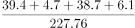

# 现期比重计算与区间定位（多主体求和÷全国总量）

考点：[[20-考点/资料分析/比重/现期比重计算与区间定位（多主体求和÷全国总量）|比重 / 现期比重计算与区间定位（多主体求和÷全国总量）]]
材料：[[15-材料/资料分析/269188 2019年全国地铁（城轨交通）运营规|269188 2019年全国地铁（城轨交通）运营规]]

**问法模型**：题干问'2019年直辖市客运量占全国总量的比重在哪个范围内' → 现期比重模型：四个直辖市客运量之和÷全国客运总量，与选项区间端点比较

## 推理链
1. 第1步：由题干'2019年……占……比重'且材料期同为2019年，判定为现期比重，无需基期换算
2. 第2步：从表1提取四个直辖市2019年客运量：北京39.4、天津4.7、上海38.7、重庆6.1亿人次
3. 第3步：从文字段提取整体量：2019年全国地铁客运总量227.76亿人次（表1仅为13个部分城市，不能求和当分母）
4. 第4步：代入比重公式：分子=39.4+4.7+38.7+6.1=88.9亿人次
5. 第5步：计算比重=88.9÷227.76≈0.390，即约39%
6. 第6步：与选项对照：39%不到40%（验证：227.76×40%=91.104>88.9），落在最小档内，故选A

**最快解法**：⚡ 乘法验证替代除法（放缩法）：先求分子和88.9，再算227.76×40%=91.1，因88.9<91.1即比重<40%，直接锁定'不到40%'的A项，无需精确截位直除

## 易错点
- ⚠ 分母口径陷阱：误用表1中13城客运量求和作分母，而表1仅为'部分城市'，必须用文字段给的全国总量227.76亿人次
- ⚠ 分子漏取/看混：天津4.7、重庆6.1数值小易漏加；北京39.4与上海38.7非常接近易看错（北京略高）
- ⚠ 比重方向搞反：误算全国占直辖市或误用基期公式；材料期与题干期均为2019年，直接用当期值即可

## 母题抽象
> 🧩 当题干出现'某年多主体合计占全国总量的比重在哪个范围内'时，先分别取部分量求和与全国整体量，用'整体×区间端点 与 部分和比较'的乘法放缩法直接定位选项，避免做完整除法

**同类特征**：占全国……总量的比重、在以下哪个范围内、直辖市（多城市数据求和）、题干年份与材料期一致（2019年）、部分城市表格+文字段全国总量联动取数

## 相关题
- [[10-真题/资料分析/其他/5430314 连续年份多期值加总（区间总额范围判断）|5430314]]（浙江 2023，相关度1）
- [[10-真题/资料分析/其他/5894965 多年份数据加总求和（区间判定型）|5894965]]（国考 2024，相关度1）
- [[10-真题/资料分析/比重/10297462 现期比重计算（部分占整体比重+区间型选项）|10297462]]（四川 2025，相关度1）
- [[10-真题/资料分析/增长/15833688 增长量计算（累计值相减求当期现期+混合增长率定当期增速）|15833688]]（黑龙江 2026，相关度1）
- [[10-真题/资料分析/平均数/16593070 年均量（算术平均数）计算与区间判定|16593070]]（甘肃 2024，相关度1）

---

### 题干
2019年，直辖市（北京、天津、上海、重庆）地铁客运量占全国地铁客运总量的比重在以下哪个范围内？

### 选项
- A. 
不到
　✅
- B. 
～之间

- C. 
～之间

- D. 
超过

### 官方解析

根据题干“2019年······占······的比重······”，结合材料时间为2019年，可判定本题为现期比重问题。定位文字材料第二段，2019年末，全年实现地铁客运量227.76亿人次。定位表格可知，北京、天津、上海、重庆的地铁客运量分别为39.4亿人次、4.7亿人次、38.7亿人次、6.1亿人次。代入公式：比重，则题干所求比重为。

故正确答案为A。

### 给定材料

        2019年全国地铁运营线路长度达5181公里，占城轨交通运营线路总里程的。

        2019年末，我国城轨交通配属地铁列车6178列，全年实现地铁客运量227.76亿人次。

