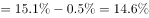
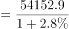
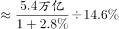
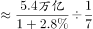
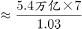
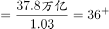

# 基期比重反推整体（基期整体=现期部分÷(1+同比增速)÷基期比重）

考点：[[20-考点/资料分析/比重/基期比重反推整体（基期整体=现期部分÷(1+同比增速)÷基期比重）|比重 / 基期比重反推整体（基期整体=现期部分÷(1+同比增速)÷基期比重）]]
材料：[[15-材料/资料分析/269190 2019年我国服务进出口（上半年与全|269190 2019年我国服务进出口（上半年与全]]

**问法模型**：题干以基期年份（2018年）问更大口径整体（对外贸易总额）→ 先用现期部分÷(1+同比增速)反推2018年服务进出口额，再用'高出0.5个百分点'作差反推2018年全年占比，整体=部分÷比重，最后亿元÷10000换算万亿元。

## 推理链
1. 第1步：题干定位——求2018年（基期）对外贸易总额；材料第2段给现期部分：2019年全年服务进出口总额54152.9亿元及同比增长率，材料第1段给比重差：2019年上半年服务进出口占对外贸易总额的比重比2018年全年高出0.5个百分点（两处百分数在本文本中空缺，原卷有值）。
2. 第2步：规则——基期部分=现期部分÷(1+同比增速)；基期比重=现期比重−高出的百分点数（百分点直接做减法）；整体=部分÷比重。
3. 第3步：代入：2018年服务进出口总额=54152.9÷(1+2019全年同比增速)；2018年全年占比=2019年上半年占比−0.5个百分点。
4. 第4步：2018年对外贸易总额=[54152.9÷(1+增速)]÷(2019上半年占比−0.5个百分点)，单位为亿元，÷10000换算成万亿元。
5. 第5步：与选项对照：官方解析代入原卷百分数后所得结果'与C项接近'，即约36万亿元，选C。

**最快解法**：⚡ 两步反推连除+截位直除：先54152.9÷(1+增速)截位直除得2018年服务额（约5.4万亿量级微缩），再除以(2019上半年占比−0.5个百分点)（百分之十几的占比，相当于再除以0.1~0.2），两步连除后按万亿元量级与选项匹配取最接近项C(36)；四个选项间距达8~12万亿，量级估算即可锁定，无需精算。

## 易错点
- ⚠ 百分点陷阱：'比重比2018年全年高出0.5个百分点'必须做减法（占比−0.5%），不能按'增长0.5%'做乘除运算，也不能忽略。
- ⚠ 跨段跨期口径错配：基期部分必须用2019年全年总额54152.9亿元反推2018年全年服务额（与2018年全年占比匹配），误用上半年26124.6亿元会口径错乱；比重差取自第1段、现期额取自第2段，取数易串。
- ⚠ 单位与量级：题干问'万亿元'而材料为亿元，须÷10000；不换算会得到35万左右的'亿'值，无法与选项对应而错选。

## 母题抽象
> 🧩 当题干出现'求基期年份的更大口径整体（整体=部分÷比重结构）'，且材料给出'现期部分及其同比增速'与'现期比重比基期高出/低x个百分点'时，用 整体=现期部分÷(1+增速)÷(现期比重∓x个百分点) 两步反推，最后按选项单位换算量级、取最接近选项验证。

**同类特征**：问基期年份的整体总量（'2018年…约为多少万亿元'）、比重比基期（2018年全年）高出0.5个百分点——百分点差反推基期比重、现期部分+同比增速已知（2019年全年54152.9亿元及增速）、整体=部分÷比重的两步连除模型、选项单位万亿元、材料单位亿元（需÷10000换算）、选项为整数且间距大（17/25/36/48），估算匹配即可

## 相关题
（暂无）

---

### 题干
2018年，我国对外贸易总额约为多少万亿元？

### 选项
- A. 17
- B. 25
- C. 36　✅
- D. 48

### 官方解析

根据题干“2018年，我国对外贸易总额约为”，结合材料第一段“服务进出口总额占对外贸易总额的比重达到，比2018年全年高出0.5个百分点”，可判定本题为基期比重问题。可得，2018年我国服务进出口总额占对外贸易总额的比重。根据材料第二段，2019年全年，我国服务进出口总额54152.9亿元，同比增长，则2018年我国服务进出口总额亿元。根据公式：整体，则2018年我国对外贸易总额万亿，与C项接近。

故正确答案为C。

### 给定材料

        2019年上半年，我国服务进出口总额达到26124.6亿元，同比增长。其中，出口总额9333.7亿元，同比增长；进口总额16790.8亿元，同比下降。服务进出口总额占对外贸易总额的比重达到，比2018年全年高出0.5个百分点。

        2019年全年，我国服务进出口总额54152.9亿元，同比增长。其中，出口总额19564.0亿元，同比增长；进口总额34588.9亿元，同比减少。

        2019年上半年，我国知识密集型服务进出口额8923.9亿元，同比增长，其中，知识密集型服务出口额4674.1亿元，同比增长；进口额4249.8亿元，同比增长。从具体领域看，知识产权使用费出口同比增长；电信、计算机和信息服务出口同比增长，进口同比增长；其他商业服务（含技术、专业和管理咨询服务、研发成果转让费及委托研发等）出口同比增长；金融服务出口同比增长，进口同比增长。

        2019年全年，我国知识密集型服务进出口额18777.7亿元，同比增长，其中，知识密集型服务出口额9916.8亿元，同比增长；进口额8860.9亿元，同比增长。从具体领域看，个人文化娱乐服务，电信、计算机和信息服务，金融服务进出口总额分别同比增长、、。

> [!warning] 疑点（官方解析可能有误，待人工复核）
> 本文本版本中2019年全年同比增速及2019年上半年占比两处百分数为空缺，本题无法代入精算复核（导读已标注须回原卷补读）；官方解析的模型与结论'与C项36万亿元接近'逻辑无误，但具体数值依赖原卷百分数。
