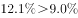

# 两期比重比较（比重升降判断），结合混合增长率'居中不正中'反推下半年增速

考点：[[20-考点/资料分析/比重/两期比重比较（比重升降判断），结合混合增长率'居中不正中'反推下半年增速|比重 / 两期比重比较（比重升降判断），结合混合增长率'居中不正中'反推下半年增速]]
材料：[[15-材料/资料分析/269190 2019年我国服务进出口（上半年与全|269190 2019年我国服务进出口（上半年与全]]

**问法模型**：题干问'知识密集型服务出口额占服务出口额比重'在上、下半年高于/低于上年同期水平 → 两期比重升降判定模型：部分增速a与总量增速b比较，a＞b则比重高于上年同期；下半年增速不计算，用混合增长率'居中不正中'由全年增速夹逼得出相对大小。

## 推理链
1. 第1步：题干将2019年拆为上、下半年，比较'知识密集型服务出口额占服务出口额比重'与上年同期的高低，四个选项为'仅上半年/仅下半年/均高/均低'，判定为两期比重比较问题，核心规则是'部分量增速a高于总量增速b，比重上升'。
2. 第2步：上半年——由材料第一、三段，2019年上半年服务出口总额9333.7亿元同比增速b上、知识密集型服务出口额4674.1亿元同比增速a上，官方解析判定a上＞b上（具体百分数在本文本中空缺，需回原卷补读）。
3. 第3步：套用两期比重结论'部分增速高于总量增速⇒比重上升'，得2019年上半年比重高于上年同期水平，排除B、D。
4. 第4步：下半年总量增速——由材料第一、二段，全年服务出口总额19564.0亿元增速b全由上、下半年混合且'居中不正中'，因b上＞b全，故下半年服务出口增速b下＜b全。
5. 第5步：下半年部分增速——同理由材料第三、四段，全年知识密集型服务出口额9916.8亿元增速a全居中，因a上＜a全，故下半年知识密集型服务出口增速a下＞a全。
6. 第6步：链式比较a下＞a全＞b全＞b下（其中a全＞b全为原卷数值关系），得a下＞b下，部分增速高于总量增速，2019年下半年比重亦高于上年同期水平，排除A。
7. 第7步：上、下半年均高于上年同期水平，与选项对照，选C。

**最快解法**：⚡ 结论定性秒杀法（全程只比增速大小、不算任何比重值）：上半年直接回材料比'部分增速a上 vs 总量增速b上'，a上＞b上⇒上半年比重升，排除B、D；下半年零计算，用混合增长率'居中不正中'夹逼：b下＜b全、a下＞a全，再借全年a全＞b全串成a下＞a全＞b全＞b下⇒下半年比重也升，直接秒选C。

## 易错点
- ⚠ 时间口径陷阱：全年=上半年+下下半年的合计口径，全年增速（如知识密集型出口9916.8亿元对应的增速）不能直接当下半年增速用，下半年增速只能由'居中不正中'反推方向。
- ⚠ 两期比重结论记反：部分增速a高于总量增速b时比重上升（现期高于上年同期），若把a、b对应关系搞反或记成'比重下降'，会误选D或A。
- ⚠ 分母层级配错＋硬算陷阱：分母必须是服务出口总额（9333.7/19564.0亿元），误用服务进出口总额（26124.6/54152.9）或知识密集型进出口额（18777.7）即错；本题是定性比较，若去硬算下半年基期作差既慢，又会受上半年'出口+进口26124.5与总额26124.6差0.1亿元'尾差干扰。

## 母题抽象
> 🧩 当题干出现'某部分占某总量的比重，上/下半年高于或低于上年同期水平'且材料为'上半年/全年'双截面结构时，用两期比重升降结论（a＞b⇒升）判上半年，再用混合增长率'居中不正中'由全年增速反推下半年a、b的相对大小（借全年a全与b全的大小关系串联），全程不需计算任何具体比重值。

**同类特征**：出口额占服务出口额比重、高于/低于上年同期水平、选项按'仅上半年/仅下半年/上、下半年均'分类、两期比重比较（增速大小定升降）、材料为'上半年/全年'平行双截面，下半年数据需反推、纯定性判断、无需精算数值

## 相关题
（暂无）

---

### 题干
2019年，我国知识密集型服务出口额占服务出口额比重：

### 选项
- A. 仅上半年高于上年同期水平
- B. 仅下半年高于上年同期水平
- C. 上、下半年均高于上年同期水平　✅
- D. 上、下半年均低于上年同期水平

### 官方解析

根据题目“2019年，······占······比重”，选项为高于或低于上年同期水平，判定本题为两期比重问题。根据材料第一、三段可得“2019年上半年，服务出口总额同比增长，知识密集型服务出口额同比增长”，结合两期比重比较结论“若部分量增速（）高于总量增速（），比重上升”，，则2019年上半年，知识密集型服务出口额占服务出口额比重高于上年同期水平，排除B、D两项。

根据材料第一、二段可得“2019年上半年，服务出口总额同比增长；2019年全年，服务出口总额同比增长”，结合混合增长率结论“居中不正中”，即全年增速应介于上、下半年增速之间，则下半年服务出口总额同比增速应小于；同理，根据材料第三、四段可得“2019年上半年，知识密集型服务出口额同比增长；2019年全年，知识密集型服务出口额同比增长”，则下半年知识密集型服务出口额同比增速应大于。再次结合两期比重比较的结论，（大于）（小于），则2019年下半年，知识密集型服务出口额占服务出口额比重高于上年同期水平，排除A项。

故正确答案为C。

### 给定材料

        2019年上半年，我国服务进出口总额达到26124.6亿元，同比增长。其中，出口总额9333.7亿元，同比增长；进口总额16790.8亿元，同比下降。服务进出口总额占对外贸易总额的比重达到，比2018年全年高出0.5个百分点。

        2019年全年，我国服务进出口总额54152.9亿元，同比增长。其中，出口总额19564.0亿元，同比增长；进口总额34588.9亿元，同比减少。

        2019年上半年，我国知识密集型服务进出口额8923.9亿元，同比增长，其中，知识密集型服务出口额4674.1亿元，同比增长；进口额4249.8亿元，同比增长。从具体领域看，知识产权使用费出口同比增长；电信、计算机和信息服务出口同比增长，进口同比增长；其他商业服务（含技术、专业和管理咨询服务、研发成果转让费及委托研发等）出口同比增长；金融服务出口同比增长，进口同比增长。

        2019年全年，我国知识密集型服务进出口额18777.7亿元，同比增长，其中，知识密集型服务出口额9916.8亿元，同比增长；进口额8860.9亿元，同比增长。从具体领域看，个人文化娱乐服务，电信、计算机和信息服务，金融服务进出口总额分别同比增长、、。

> [!warning] 疑点（官方解析可能有误，待人工复核）
> 本文本中所有同比增速数值均为空缺，官方解析的关键判定（上半年a上＞b上、全年a全＞b全）依赖原卷数值，回原卷补读后方可复核；另材料导读将本题概括为'现期比重=9916.8÷19564.0、仅用2019全年两个出口额、不依赖缺失数值'，与官方解析的两期比重比较口径不符——本题实际无需计算现期比重，而需上半年及全年共四个同比增速的大小关系，导读概括疑有误（不影响答案C）。
