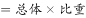
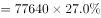
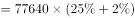
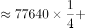
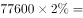
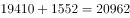

# 现期比重（整体×比重求部分量）

考点：[[20-考点/资料分析/比重/现期比重（整体×比重求部分量）|比重 / 现期比重（整体×比重求部分量）]]
材料：[[15-材料/资料分析/269904 全国就业人员总量与结构（2017年文|269904 全国就业人员总量与结构（2017年文]]

**问法模型**：题干问'2017年末第一产业就业人员约为多少万人'，材料同时给出2017年整体量（全国就业人员77640万）与第一产业占比 → 现期比重模型：部分＝整体×比重，一步乘法求解

## 推理链
1. 第1步：题干时点为2017年末（现期时点数），求部分量'第一产业就业人员'；文字段给出整体：2017年末全国就业人员77640万人，并给出第一产业就业人员占比（原卷该占比数值为27.0%，本版本文本'占'后缺省）
2. 第2步：现期比重公式：部分＝整体×比重，即第一产业就业人员＝77640×第一产业占比
3. 第3步：代入计算：77640×27.0%＝776.4×27≈20963万人（精确值20962.8）
4. 第4步：与选项对照：A.11465（恰为42462×27%≈11465，系误用城镇就业人员作整体的陷阱值）、B.11963、C.20465均不吻合
5. 第5步：20963与D项完全一致，故选D

**最快解法**：⚡ 乘法口算＋选项反验：77640×27%＝776.4×27≈20963，直接锁定D；更稳的反向验证法：用选项除以整体看比重，20963/77640≈27.0%恰为文字段第一产业占比，其余选项反除均对不上27%

## 易错点
- ⚠ 数据来源与时间陷阱：表1仅统计到2016年（第一产业21496万），2017年数据不能从表1读取，必须用文字段'整体×比重'计算，勿拿21496万或其加37万增量充当2017年答案
- ⚠ 整体口径陷阱：整体应取全国就业人员77640万（全口径），而非城镇就业人员42462万；误用42462×27%≈11465恰好落入A项，是本题头号陷阱
- ⚠ 占比取数陷阱：文字段依次给出三产业占比，勿将第二、三产业占比误代入；另注意'+37万''+1034万''+481万'均为增量，本题不需要用到增量数据

## 母题抽象
> 🧩 当题干出现'某现期年份＋部分量约为多少'且文字段给出当年整体总量与该部分占比时，用'部分＝整体×比重'一步乘法求解，并用'选项÷整体≈占比'反向验证；动手前先确认整体口径（全国/城镇）与数据所在年份、所在表

**同类特征**：2017年末（现期时点）、约为多少万人（求部分量）、占比在文字段中、整体×比重一步乘法、全国口径非城镇口径、选项含城镇口径陷阱值

## 相关题
（暂无）

---

### 题干
2017年末，全国第一产业就业人员约为多少万人?

### 选项
- A. 11465
- B. 11963
- C. 20465
- D. 20963　✅

### 官方解析

根据题干“2017年末，全国第一产业就业人员······”，结合材料给了2017年末全国就业人员的人数以及第一产业就业人员所占的比重，可判定本题为现期比重问题。定位文字材料可得：2017年末，全国就业人员77640万人，第一产业就业人员占。根据现期比重公式：部分，代入数据可得：第一产业就业人员万人，与D项最接近。

故正确答案为D。

### 给定材料

        截止2017年末，全国就业人员77640万人，比上年末增加37万人；其中城镇就业人员42462万人，比上年末增加1034万人。全国就业人员中，第一产业就业人员占；第二产业就业人员占；第三产业就业人员占。2017年全国农民工总量28652万人，比上年增加481万人，其中外出农民工17185万人。

> [!warning] 疑点（官方解析可能有误，待人工复核）
> 本版本材料原文中三处占比数值均缺省（'第一产业就业人员占'后为空），无法直接从给定文本读出27.0%；官方解析同样缺省该数值但代入后得20963，对应占比恰为27.0%，结论无误，仅属材料展示缺字问题

<!-- CODEX-ANSWER-REVIEW:BEGIN -->
### 本次独立复核

**复核状态：** `resolved`（答案与解析已核定）

**计分答案：** D（可计分）

**复核解析：**

2017年末全国就业人员77640万人，第一产业占27.0%；77640×27.0%=20962.8万人，约20963万人，选D。

**相关信息：**

部分量=总体量×比重。

**题源依据：** [固定版本原题](https://github.com/Mentat-Uran/kaogongzhentizhengliu/blob/84ab93d4b64b61d897bece8a1c0a5bab06b4feb2/10-%E7%9C%9F%E9%A2%98/%E8%B5%84%E6%96%99%E5%88%86%E6%9E%90/%E6%AF%94%E9%87%8D/2725301%20%E7%8E%B0%E6%9C%9F%E6%AF%94%E9%87%8D%EF%BC%88%E6%95%B4%E4%BD%93%C3%97%E6%AF%94%E9%87%8D%E6%B1%82%E9%83%A8%E5%88%86%E9%87%8F%EF%BC%89.md)；固定内容 commit `84ab93d4b64b61d897bece8a1c0a5bab06b4feb2`，Markdown blob `0b3e9ecde2ee9b4f7587cc2ff7d242de2d9789f4`。
<!-- CODEX-ANSWER-REVIEW:END -->
