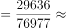
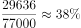
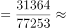
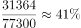
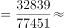
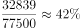
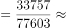
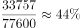

# 现期比重比较（逐年比重计算与排序）

考点：[[20-考点/资料分析/比重/现期比重比较（逐年比重计算与排序）|比重 / 现期比重比较（逐年比重计算与排序）]]
材料：[[15-材料/资料分析/269904 全国就业人员总量与结构（2017年文|269904 全国就业人员总量与结构（2017年文]]

**问法模型**：题干为'2012-2016年……占……比例最大的年份'→ 对各年份分别计算'部分÷整体'的现期比重并比较大小，锁定最大值对应年份

## 推理链
1. 第1步：题干限定区间2012-2016年，定位表1'2012-2016年末按三次产业分就业人员情况表'，提取第三产业就业人员：2013年29636万、2014年31364万、2015年32839万、2016年33757万人
2. 第2步：提取对应年份全国就业人员（整体）：76977、77253、77451、77603万人，用公式'比重=第三产业就业人员÷就业人员合计'
3. 第3步：代入计算：2013年29636/76977≈38.5%，2014年31364/77253≈40.6%，2015年32839/77451≈42.4%，2016年33757/77603≈43.5%
4. 第4步：速判验证：四年分母均在77000万上下（极差不足1%），而分子逐年递增且增幅明显（如2016年分子增918万、增速约2.8%，分母仅增152万、增速约0.2%），故比重逐年上升、最大值在最后一年
5. 第5步：2016年比重约43.5%为四年最大，对照选项D（2016年），故选D

**最快解法**：⚡ 分母相近比较法（截位直除的简化）：四个年份的分母均约77×10³且几乎不变，直接比较分子即可——2016年分子33757万为四年最大，其比重必最大（33757/77603≈43.5%），无需逐一精算

## 易错点
- ⚠ 时间口径：表1只到2016年，勿误用表2（2017年）或文字段2017年末数据；题干区间虽写'2012-2016年'，但选项只含2013-2016，2012年（27690/76704≈36.1%）为最小不影响答案
- ⚠ 口径混淆：分母必须用表1'就业人员'（全国口径77603万等），勿错用表2'城镇就业人员'（仅城镇部分）作分母
- ⚠ 思维陷阱：不能仅凭'第三产业绝对量最大的年份'直接下结论；本题虽2016年绝对量与比重同为最大，但规范逻辑是逐年算比重或论证分子增速（约2.8%）远快于分母增速（约0.2%）

## 母题抽象
> 🧩 当题干出现'某时间段内部分占整体比例最大（最小）的年份'且数据逐年同向变化时，先看分母是否近似不变或分子增速是否明显快于分母：是则直接取分子最大（分子增速快）的末年，否则逐年计算部分÷整体比较

**同类特征**：'2012-2016年'区间限定、'第三产业就业人员'、'占全国就业人员比例'、'比例最大的年份'、现期比重逐年比较、表格多列数据对比

## 相关题
- [[10-真题/资料分析/比重/19283969 现期比重比较（占比超过75%的年份计数）|19283969]]（国考 2025，相关度1）
- [[10-真题/资料分析/比重/5893794 现期比重逐年比较判断变化趋势（跨图取数）|5893794]]（国考 2024，相关度1）

---

### 题干
2012-2016年，我国第三产业就业人员占全国就业人员比例最大的年份是：

### 选项
- A. 2013年
- B. 2014年
- C. 2015年
- D. 2016年　✅

### 官方解析

根据题干“2012-2016年，······占······”，结合表格材料给出2012-2016年末第三产业就业人员和全国就业人员的数据，可判定本题为现期比重问题。定位表格可得，2013-2016年末全国就业人员分别为：76977万人、77253万人、77451万人、77603万人，第三产业就业人员分别为：29636万人、31364万人、32839万人、33757万人。可得：

2013年第三产业就业人员占全国就业人员的比例；

2014年第三产业就业人员占全国就业人员的比例；

2015年第三产业就业人员占全国就业人员的比例；

2016年第三产业就业人员占全国就业人员的比例。

比较可知，所求占比最大的是2016年。

故正确答案为D。

### 给定材料

        截止2017年末，全国就业人员77640万人，比上年末增加37万人；其中城镇就业人员42462万人，比上年末增加1034万人。全国就业人员中，第一产业就业人员占；第二产业就业人员占；第三产业就业人员占。2017年全国农民工总量28652万人，比上年增加481万人，其中外出农民工17185万人。

