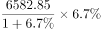
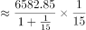
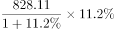
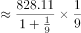
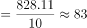
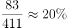

# 增长量计算+增量比重（现期比重，分子分母均为同比增量）

考点：[[20-考点/资料分析/比重/增长量计算+增量比重（现期比重，分子分母均为同比增量）|比重 / 增长量计算+增量比重（现期比重，分子分母均为同比增量）]]
材料：[[15-材料/资料分析/270448 2019年A地区社会消费品零售总额（|270448 2019年A地区社会消费品零售总额（]]

**问法模型**：题干问'A同比增量约占B同比增量的'且选项为百分数、材料时间为2019年（现期）→ 分子分母均套增长量公式 现期×r/(1+r)，再作商求比重

## 推理链
1. 第1步：从表1提取全年数据：社会消费品零售总额6582.85亿元、同比增长6.7%；住宿和餐饮业828.11亿元、同比增长11.2%（本题只需这两行，批发零售业为干扰项）
2. 第2步：规则：同比增量=现期×r/(1+r)，因增速为2019年现期增速，2018年基期未直接给出，须反推
3. 第3步：总额同比增量=6582.85×6.7%/(1+6.7%)=6582.85×0.067/1.067≈441.05/1.067≈413.4亿元
4. 第4步：住宿和餐饮业同比增量=828.11×11.2%/(1+11.2%)=828.11×0.112/1.112≈92.75/1.112≈83.4亿元
5. 第5步：所求比重=83.4/413.4≈0.202，即约20.2%
6. 第6步：对照选项，20.2%对应B项，故正确答案为B

**最快解法**：⚡ 百化分+截位直除：11.2%/1.112≈1/10，故餐饮增量≈828×10.07%≈83.4亿元；6.7%/1.067≈6.28%（约1/16），故总额增量≈6583×6.28%≈413亿元；83.4/413.4≈20.2%选B。更快的比例合成法：比重≈(828/6583)×(11.2/6.7)×(1.067/1.112)≈12.6%×1.67×0.96≈20.2%

## 易错点
- ⚠ 增量公式漏除(1+r)：若直接用现期×增速作差比（92.75/441.05≈21.0%）会误选干扰项，同口径下21.0%与20.2%很接近，必须用r/(1+r)
- ⚠ 时间口径错位：本题须用表1的1-12月全年数据（6.7%、11.2%），勿误取图2中1-11月累计增速6.3%等
- ⚠ 分子选错行：'其中'两分项中本题只要住宿和餐饮业（11.2%），勿错拿批发和零售业（6.1%）

## 母题抽象
> 🧩 当题干出现'A同比增量约占/占B同比增量的'特征时，用增量公式 现期×r/(1+r) 分别算分子分母再作商，或速算为 (A/B)×(rA/rB)×((1+rB)/(1+rA)) 比例合成，验证结果落在最接近的百分数选项

**同类特征**：同比增量、约占、选项为百分数、现期比重、增速反推基期、表1全年累计数据

## 相关题
- [[10-真题/资料分析/比重/2374810 现期比重计算（流量占存量比重）|2374810]]（广东 2019，相关度2）
- [[10-真题/资料分析/比重/2725306 现期比重计算（两分项求和占整体比重）|2725306]]（四川 2020，相关度2）
- [[10-真题/资料分析/比重/5893776 现期比重计算（多地区累计值求比重）|5893776]]（国考 2024，相关度2）
- [[10-真题/资料分析/增长/18643860 增长量比重（同比增量占同比增量的比重）|18643860]]（四川 2026，相关度2）
- [[10-真题/资料分析/比重/2274483 现期比重计算（部分和占整体比重）|2274483]]（北京 2019，相关度2）

---

### 题干
2019年A地区住宿和餐饮业社会消费品零售额同比增量约占社会消费品零售总额同比增量的？

### 选项
- A. 

- B. 

　✅
- C. 

- D. 

### 官方解析

根据题干“2019年A地区······约占······的”，结合选项为百分数，材料所给时间为2019年，可判定本题为现期比重计算问题。定位统计表材料可得，2019年A地区社会消费品零售总额6582.85亿元，同比增长；住宿和餐饮业社会消费品零售额828.11亿元，同比增长。则2019年A地区社会消费品零售总额同比增量为亿元，住宿和餐饮业社会消费品零售额同比增量为亿元，所求比重为，对应B项。

故正确答案为B。

### 给定材料

