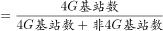
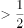
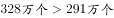
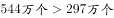

# 现期比重比较（过半判断-部分与整体关系）

考点：[[20-考点/资料分析/比重/现期比重比较（过半判断-部分与整体关系）|比重 / 现期比重比较（过半判断/部分与整体关系）]]
材料：[[15-材料/资料分析/270457 2019年我国电信业务收入构成（固定|270457 2019年我国电信业务收入构成（固定]]

**问法模型**：题干问'4G占基站总量一半以上的年份有几个'→将'过半'等价转化为'4G>非4G'（两分项结构下部分超过另一半即超过总量一半），逐柱比较计数即可，无需计算比重数值

## 推理链
1. 第1步：从堆积柱状图读取2014~2019年各年两分项（单位万个）：2014年4G=85、非4G=266；2015年4G=177、非4G=289；2016年4G=263、非4G=296；2017年4G=328、非4G=291；2018年4G=372、非4G=295；2019年4G=544、非4G=297
2. 第2步：规则转化：4G占总量一半以上 ⇔ 4G > 总量÷2 ⇔ 4G > 非4G（总量=4G+非4G，4G大于另一半即大于总量的一半）
3. 第3步：逐年比较4G与非4G：85<266、177<289、263<296（前三年不过半）；328>291、372>295、544>297（后三年过半）
4. 第4步：满足条件的年份为2017、2018、2019，共3个，与选项对照，C（3个）为官方正确答案

**最快解法**：⚡ 等价转化法（免计算）：'占一半以上'直接转为比较白柱(4G)与灰柱(非4G)两段数值大小，逐柱扫一眼——2014~2016白<灰、2017~2019白>灰（328>291、372>295、544>297），秒数出3年选C，全程不用加总、不用除法

## 易错点
- ⚠ 堆积图误读：柱内标注是分项值，柱顶高度才是总量；若先逐年加总再算4G占比（如2019年544/841≈64.7%）虽可行但费时，且2016年263/559≈47%接近一半，易误判为过半
- ⚠ 忽略等价转化：'过半'不必算百分比，二分结构下直接比4G与非4G大小即可；误把'4G接近非4G'当作'接近一半'仍需严格比较，263<296即不过半
- ⚠ 时间范围遗漏：题干区间为2014~2019共6年，需逐年比较不可跳年，也不可只看后几年

## 母题抽象
> 🧩 当题干出现'某部分占总量一半以上（过半）'且总量仅由两部分构成时，用等价转化法：过半 ⇔ 该部分>另一部分，逐项直接比较大小计数，验证各年分项数据即可，跳过加总与除法

**同类特征**：一半以上/过半、年份有几个（计数型）、占总量比、堆积柱状图两分项、4G基站数、2014~2019年区间逐年比较

## 相关题
- [[10-真题/资料分析/增长/2188583 同比增量（增长量）逐年计算与计数比较|2188583]]（黑龙江 2018，相关度1）
- [[10-真题/资料分析/比重/2579802 比重差值计算（部分量之差=总量×占比差）+ 多年份计数比较|2579802]]（浙江 2020，相关度1）
- [[10-真题/资料分析/增长/5102262 同比增速与50%临界值比较（逐年判定计数）|5102262]]（重庆 2022，相关度1）

---

### 题干
2014~2019年，4G基站数占移动电话基站总量一半以上的年份有几个？

### 选项
- A. 1
- B. 2
- C. 3　✅
- D. 4

### 官方解析

根据题干“2014~2019年······占······总量一半以上······”，可判定本题为现期比重计算问题。定位图形材料可得：移动电话基站总量，因此，整理公式后可得：4G基站数非4G基站数。代入数据，符合要求的年份有：2017年（），2018年（），2019年（），共3个年份。

故正确答案为C。

### 给定材料

根据所给材料，回答76~80题。

        2019年，我国电信业务收入累计完成金额1.31万亿元，固定通信业务收入完成4161亿元，同比增长，在电信业务收入中所占比重较上年提高2.6个百分点；移动通信业务实现收入8942亿元，同比减少。2014~2019年，全国移动电话4G及非4G基站数变化情况如下图所示：

> [!warning] 疑点（官方解析可能有误，待人工复核）
> 官方解析文字存在公式显示截断（'整理公式后可得：4G基站数非4G基站数'缺不等号），但结论经原始数据验证无误：328>291、372>295、544>297，符合年份确为3个，答案C正确

<!-- CODEX-ANSWER-REVIEW:BEGIN -->
### 本次独立复核

**复核状态：** `resolved`（答案与解析已核定）

**计分答案：** C（可计分）

**复核解析：**

逐年比较4G基站数与非4G基站数；占比过半等价于4G数量>非4G数量。2014—2016分别为328>291、372>295、544>297；2017、2018、2019不满足，合计3年，选C。

**相关信息：**

基站总数=4G+非4G；4G占比>50%等价于前者多于后者。

**题源依据：** [固定版本原题](https://github.com/Mentat-Uran/kaogongzhentizhengliu/blob/84ab93d4b64b61d897bece8a1c0a5bab06b4feb2/10-%E7%9C%9F%E9%A2%98/%E8%B5%84%E6%96%99%E5%88%86%E6%9E%90/%E6%AF%94%E9%87%8D/2741708%20%E7%8E%B0%E6%9C%9F%E6%AF%94%E9%87%8D%E6%AF%94%E8%BE%83%EF%BC%88%E8%BF%87%E5%8D%8A%E5%88%A4%E6%96%AD-%E9%83%A8%E5%88%86%E4%B8%8E%E6%95%B4%E4%BD%93%E5%85%B3%E7%B3%BB%EF%BC%89.md)；固定内容 commit `84ab93d4b64b61d897bece8a1c0a5bab06b4feb2`，Markdown blob `276fb95eae6f39f0e8744cf698fbb4b64f7be377`。
<!-- CODEX-ANSWER-REVIEW:END -->
