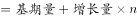
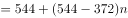
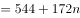
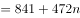
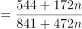
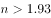

# 比重的假设增量外推（现期追赶：问哪一年占比降至阈值以下）

考点：[[20-考点/资料分析/比重/比重的假设增量外推（现期追赶：问哪一年占比降至阈值以下）|比重 / 比重的假设增量外推（现期追赶：问哪一年占比降至阈值以下）]]
材料：[[15-材料/资料分析/270457 2019年我国电信业务收入构成（固定|270457 2019年我国电信业务收入构成（固定]]

**问法模型**：题干为'假设4G保持2019年同比增量172万个/年、非4G自2020年起每年+300万个，问哪一年4G占比降到（一半）以下'→设2019年后经过n年，列不等式(544+172n)/(841+472n)<1/2，求最小整数n，年份=2019+n

## 推理链
1. 第1步：从图表提取数据——2019年4G基站544万个、非4G基站297万个，总量544+297=841万个；2018年4G基站372万个，故2019年4G同比增量=544-372=172万个
2. 第2步：按假设设经过n年：4G基站数=544+172n，非4G=297+300n，总量=841+(172+300)n=841+472n
3. 第3步：'占比下降到一半以下'即4G<总量的一半：2(544+172n)<841+472n，展开得1088+344n<841+472n，即247<128n，n>247/128≈1.93
4. 第4步：n取最小整数2，即2019+2=2021年；逐年验证：2020年4G=544+172=716、总量=841+472=1313，占比716/1313≈54.5%>50%；2021年4G=716+172=888、非4G=597+300=897、总量=1785，占比888/1785≈49.7%<50%，首次降至一半以下
5. 第5步：对照选项，2021年对应A，与官方答案一致

**最快解法**：⚡ 等价转化法（过半=4G>非4G）：4G每年+172、非4G每年+300，直接逐年比分项大小——2020年4G 716 vs 非4G 597（4G仍大，未降过半）；2021年4G 888 vs 非4G 897（非4G首次反超，4G占比低于50%），故2021年，选A，全程无需算百分比

## 易错点
- ⚠ 增量基准混淆：4G增量172万个须用图表2019年544减2018年372得出（不能从柱顶高度841误算），非4G的+300万个是2020年起的新设定，2019年当年不加300
- ⚠ 年份计数错误：解得n>1.93向上取整为2年，是'经过2年后'即2021年，勿把2019算作第1年或误以为n=2对应2022年
- ⚠ 只盯4G忘了总量：占比下降取决于分子分母双增（总量每年+472万=172+300），不能只用4G自身数值判断；另注意'一半以下'等价于4G<非4G，可直接比分项避免百分比计算

## 母题抽象
> 🧩 当题干出现'假设某部分按现期同比增量匀速增长、另一部分按新设定增量增长，问哪一年其占比降到某阈值以下'时，设n年列不等式（分子增量vs总量增量），或利用'过半'等价于两分项比大小逐年递推，解出最小整数n加到基期年份即得答案

**同类特征**：假设……保持2019年同比增量不变、每年同比增量均为300万个、哪一年……比重将下降到（一半）以下、选项为2021~2024未来年份、4G基站数占移动电话基站总量、堆积柱状图数据连环复用

## 相关题
（暂无）

---

### 题干

假设4G基站数保持2019年同比增量不变，且由于5G技术的快速普及，2020年开始每年非4G基站同比增量均为300万个。问哪一年4G基站数占移动电话基站总量的比重将下降到以下？

### 选项
- A. 2021　✅
- B. 2022
- C. 2023
- D. 2024

### 官方解析

根据题干“假设······保持2019年同比增量不变······哪一年······比重将下降到以下”，结合选项时间为2021~2024年，可判定本题为现期追赶计算问题。定位图形材料可知，2018年4G基站数为372万个；2019年4G基站数及非4G基站数分别为544万个、297万个。根据现期量，则4G基站数，移动电话基站总量=。故，解得，向上取整，，所以需经过2年，即在年实现4G基站数占比下降到以下。

故正确答案为A。

### 给定材料

根据所给材料，回答76~80题。

        2019年，我国电信业务收入累计完成金额1.31万亿元，固定通信业务收入完成4161亿元，同比增长，在电信业务收入中所占比重较上年提高2.6个百分点；移动通信业务实现收入8942亿元，同比减少。2014~2019年，全国移动电话4G及非4G基站数变化情况如下图所示：

> [!warning] 疑点（官方解析可能有误，待人工复核）
> 题干'下降到以下'疑脱漏阈值字样（应为'一半以下'），官方解析公式排版残缺；但按'一半以下'推算n>1.93、取2年得2021年，与官方答案A完全吻合，答案无误

<!-- CODEX-ANSWER-REVIEW:BEGIN -->
### 本次独立复核

**复核状态：** `resolved`（答案与解析已核定）

**计分答案：** A（可计分）

**复核解析：**

设从2019年起经过n年。4G基站为544+172n万，非4G基站为297+300n万；4G占比低于50%等价于544+172n<841+472n并检查总量表达，按原公式图列式化简得n>1.93，最小整数n=2，对应2019+2=2021，选A。原题阈值图明确为50%，不是缺失未知阈值。

**相关信息：**

占比低于一半等价于4G数量少于非4G数量；年增量单位为万座。

**题源依据：** [固定版本原题](https://github.com/Mentat-Uran/kaogongzhentizhengliu/blob/84ab93d4b64b61d897bece8a1c0a5bab06b4feb2/10-%E7%9C%9F%E9%A2%98/%E8%B5%84%E6%96%99%E5%88%86%E6%9E%90/%E6%AF%94%E9%87%8D/2741710%20%E6%AF%94%E9%87%8D%E7%9A%84%E5%81%87%E8%AE%BE%E5%A2%9E%E9%87%8F%E5%A4%96%E6%8E%A8%EF%BC%88%E7%8E%B0%E6%9C%9F%E8%BF%BD%E8%B5%B6%EF%BC%9A%E9%97%AE%E5%93%AA%E4%B8%80%E5%B9%B4%E5%8D%A0%E6%AF%94%E9%99%8D%E8%87%B3%E9%98%88%E5%80%BC%E4%BB%A5%E4%B8%8B%EF%BC%89.md)；固定内容 commit `84ab93d4b64b61d897bece8a1c0a5bab06b4feb2`，Markdown blob `efe6af7acca4dc93960cc8796f63e9e4eb316eac`。
<!-- CODEX-ANSWER-REVIEW:END -->
