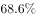
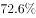
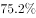
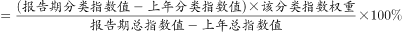
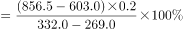
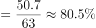

# 贡献率计算（分类指数增量×权重÷总指数增量）

考点：[[20-考点/资料分析/比重/贡献率计算（分类指数增量×权重÷总指数增量）|比重 / 贡献率计算（分类指数增量×权重÷总指数增量）]]
材料：[[15-材料/资料分析/270492 国家统计局以2014年=100的定基|270492 国家统计局以2014年=100的定基]]

**问法模型**：题干出现'某分类指数对总指数增长的贡献率'→直接套注释公式：贡献率=(报告期分类指数值−上年分类指数值)×权重÷(报告期总指数值−上年总指数值)×100%

## 推理链
1. 第1步：题干要求2019年网络经济指数对总指数增长的贡献率，对应材料注释公式，需2019/2018两年网络经济指数、总指数数值及权重0.2
2. 第2步：从表格取数——网络经济：2019年856.5、2018年603.0；总指数（经济发展新动能行）：2019年332.0、2018年269.0；权重统一为0.2
3. 第3步：代入公式：贡献率=(856.5−603.0)×0.2÷(332.0−269.0)×100%=253.5×0.2÷63.0×100%=50.7÷63.0×100%≈80.5%
4. 第4步：与选项对照，约80.5%对应D选项，故正确答案为D

**最快解法**：⚡ 公式法+截位直除：先作差253.5×0.2=50.7，分母332.0−269.0=63.0，50.7/63.0≈0.805，即约80.5%，直除一位小数即可锁定D

## 易错点
- ⚠ 漏乘权重0.2：直接用253.5÷63.0≈402.4%，结果严重偏离选项
- ⚠ 分子分母必须都是'报告期−上年'的增量：误用指数水平值代入（如856.5×0.2÷332.0）必错
- ⚠ 误把增速当增量：表中42.0%（网络经济）、23.4%（总指数）是同比增速，不能替代指数作差；且'经济发展新动能'是总指数行，作分母，不要与分类指数行取错

## 母题抽象
> 🧩 当题干出现'某分类指数对总指数增长的贡献率'时，用公式（分类指数末年值−上年值）×权重÷（总指数末年值−上年值），牢记分子乘权重0.2、分子分母均为相邻年份指数差，截位直除验证选项

**同类特征**：对总指数增长的贡献率、网络经济指数、2019年（报告期）、权重均为0.2、报告期指数−上年指数、需跨表与公式注释拼合取数

## 相关题
- [[10-真题/资料分析/增长/13255487 相邻两年同比增速之差（增速变化幅度）比较|13255487]]（选调 2023，相关度1）
- [[10-真题/资料分析/比重/2741961 贡献率两年比较（比值比较计数）|2741961]]（江苏 2021，相关度1）

---

### 题干
2019年我国网络经济指数对总指数增长的贡献率为：

### 选项
- A. 

- B. 

- C. 

- D. 

　✅

### 官方解析

根据题干“2019年······对总指数增长的贡献率······”，可判定本题为现期比重问题。定位表格材料可知：“2019年网络经济报告期指数856.5，报告期总指数332.0；2018年网络经济报告期指数603.0，报告期总指数269.0”。结合文字材料“5个分类指数的权重均设定为0.2”可得，网络经济指数的权重为0.2。将数据代入注释中公式：贡献率。

故正确答案为D。

### 给定材料

        国家统计局采用定基指数方法，以2014年为100，根据第四次全国经济普查数据修订结果以及部分指标最新数据，将5个分类指标的权重均设定为0.2，对2015-2019年我国经济发展新动能总指数进行测算，结果见下表。

注：分类指数对总指数增长的贡献率计算公式为

