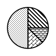
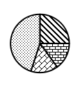
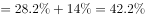
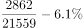
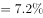
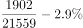
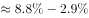
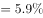
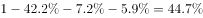

# 基期比重回推（占比变动百分点+饼图排除法）

考点：[[20-考点/资料分析/比重/基期比重回推（占比变动百分点+饼图排除法）|比重 / 基期比重回推（占比变动百分点+饼图排除法）]]
材料：[[15-材料/资料分析/270494 党的十八大以来我国居民收入与消费状况|270494 党的十八大以来我国居民收入与消费状况]]

**问法模型**：题干要求'基期（2000年）消费支出结构'的饼图，而材料只给2019年占比及'较2000年上升/下降x个百分点'→ 用'基期占比=现期占比∓变动百分点'逐项回推，先算最大分项即可用排除法对照扇形大小

## 推理链
1. 第1步：题干要求2000年全国居民人均消费支出结构（食品、交通通信、医疗保健、其他），材料时间为2019年、选项为饼图，判定为基期比重问题
2. 第2步：食品——2019年全国恩格尔系数比2000年下降14.0个百分点，方向为'下降'，故2000年食品占比=2019年恩格尔系数+14.0pp≈28.2%+14.0%≈42.2%（介于40%与45%之间）
3. 第3步：交通通信——2019年占比=2862÷21559≈13.3%，材料称该占比较2000年'提高'6.1个百分点，故2000年占比=13.3%−6.1pp≈7.2%
4. 第4步：医疗保健——2019年占比=1902÷21559≈8.8%，较2000年提高2.9个百分点，故2000年占比=8.8%−2.9pp≈5.9%
5. 第5步：其他支出=1−42.2%−7.2%−5.9%≈44.7%，四项合计100%
6. 第6步：对照选项——仅凭2000年食品占比约42%（40%~45%区间）观察四张饼图食品扇形大小即可排除B、C、D，锁定A，与官方答案一致

**最快解法**：⚡ 排除法+百分点回推：先只算食品项，2000年占比=2019年恩格尔系数+14.0pp≈42%，观察饼图中食品扇形落在40%~45%区间的只有A，直接排除B、C、D；官方备注表明交通通信、医疗保健、其他三项考场无需计算

## 易错点
- ⚠ '下降14.0个百分点'方向陷阱：2000年食品占比=2019年恩格尔系数+14.0pp（约42%），误做成2019−14.0会得到约14%的荒谬占比
- ⚠ 交通通信、医疗保健两处方向与食品相反：'较2000年提高6.1/2.9个百分点'意味着2000年占比=2019年占比−提高值，'一加一减'混用即出错
- ⚠ 2019年交通通信、医疗保健占比材料未直接给出，须现算2862/21559、1902/21559，且分母统一用全国人均消费支出21559元，勿错用城镇28063元或农村13328元口径；材料文本多处百分数空缺（含2019年恩格尔系数），须回核原始材料补齐后再代数

## 母题抽象
> 🧩 当题干出现'用饼图表示基期年支出/收入结构'且材料给出'现期占比较基期上升/下降x个百分点'时，用'基期占比=现期占比∓x'先回推最大分项（食品用恩格尔系数+下降pp，提高项用2019占比−提高pp），再以扇形大小排除法锁定图形，无需算全各分项

**同类特征**：饼图表示基期年消费支出结构、较2000年下降/提高……个百分点、恩格尔系数（食品占人均消费支出比重）、基期比重回推、四个分项占比合计100%、选项为饼状图可排除法

## 相关题
（暂无）

---

### 题干
下列饼图表示2000年全国居民人均消费支出结构（食品消费支出、交通通信支出、医疗保健支出、其他支出）的是：

### 选项
- A. 

　✅
- B. 

- C. 

- D. 

### 官方解析

根据题干“2000年全国居民人均消费支出结构”，结合材料时间为2019年，选项为饼状图，可判定本题为基期比重问题。定位文字材料第三段可得：2019年全国居民恩格尔系数（人均食品支出占人均消费支出的比重）为，比2000年下降14.0个百分点，则2000年食品消费支出占人均消费支出的比重，该占比介于和之间，通过观察选项，可排除B、C、D三项。

故正确答案为A。

备注：2000年居民交通通信支出占人均消费支出的比重：；

2000年居民医疗保健支出占人均消费支出的比重：；

2000年其他支出占人均消费支出的比重：。

在考场上建议直接用排除法，无需计算各部分占比。

### 给定材料

        党的十八大以来，我国居民收入水平持续较快增长，消费水平稳步提高，消费结构优化升级，生活质量明显提升，人民生活正阔步迈向全面小康。

        2019年，全国居民人均可支配收入30733元，比2000年增长4.4倍。全国居民人均消费支出21559元，比2012年增长，年均增长。其中，城镇居民人均消费支出28063元，比2012年增长；农村居民人均消费支出13328元，比2012年增长。

        2019年全国居民恩格尔系数（人均食品支出占人均消费支出的比重）为，比2000年下降14.0个百分点。其中，城镇居民恩格尔系数为，农村居民恩格尔系数为，分别比2000年下降11.0和18.3个百分点。

        2019年，全国居民平均每百户拥有彩色电视机120.6台、洗衣机96.0台、电冰箱100.9台、空调115.6台、汽车35.3辆。城镇居民人均住房建筑面积为39.8平方米，比2002年增长；农村居民人均住房建筑面积为48.9平方米，比2000年增长。全国居民人均交通通信支出2862元，比2000年年均增长，占人均消费支出的比重较2000年提高6.1个百分点。全国居民人均医疗保健支出1902元，比2000年年均增长，占人均消费支出的比重较2000年提高2.9个百分点。

> [!warning] 疑点（官方解析可能有误，待人工复核）
> 本题面文本中2019年全国恩格尔系数水平值为空缺，官方解析'占比介于某两值之间'的区间也依赖该数；按回核原始材料数值（2019年恩格尔系数28.2%）计算2000年食品占比≈42.2%、交通通信≈7.2%、医疗保健≈5.9%、其他≈44.7%，与答案A一致，无实质矛盾，但仅凭空缺题面无法独立复现该排除区间

<!-- CODEX-ANSWER-REVIEW:BEGIN -->
### 本次独立复核

**复核状态：** `resolved`（答案与解析已核定）

**计分答案：** A（可计分）

**复核解析：**

用2019年各项消费支出占比及相对2000年的变化还原，2000年食品约42.2%、交通通信约7.2%、医疗保健约5.9%、其他约44.7%；与各饼图扇区匹配为A。

**相关信息：**

比重变化：分项增速高于整体增速时占比上升；基期比重需分别还原分子、分母后求比。

**题源依据：** [固定版本原题](https://github.com/Mentat-Uran/kaogongzhentizhengliu/blob/84ab93d4b64b61d897bece8a1c0a5bab06b4feb2/10-%E7%9C%9F%E9%A2%98/%E8%B5%84%E6%96%99%E5%88%86%E6%9E%90/%E6%AF%94%E9%87%8D/2742015%20%E5%9F%BA%E6%9C%9F%E6%AF%94%E9%87%8D%E5%9B%9E%E6%8E%A8%EF%BC%88%E5%8D%A0%E6%AF%94%E5%8F%98%E5%8A%A8%E7%99%BE%E5%88%86%E7%82%B9%2B%E9%A5%BC%E5%9B%BE%E6%8E%92%E9%99%A4%E6%B3%95%EF%BC%89.md)；固定内容 commit `84ab93d4b64b61d897bece8a1c0a5bab06b4feb2`，Markdown blob `54d05c9924e9c4ce1ed0ef305505fd623f9ffa0c`。
<!-- CODEX-ANSWER-REVIEW:END -->
