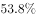
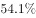

# 现期比重——混合平均（线段法-十字交叉）求城镇人口占比

考点：[[20-考点/资料分析/比重/现期比重——混合平均（线段法-十字交叉）求城镇人口占比|比重 / 现期比重——混合平均（线段法/十字交叉）求城镇人口占比]]
材料：[[15-材料/资料分析/270494 党的十八大以来我国居民收入与消费状况|270494 党的十八大以来我国居民收入与消费状况]]

**问法模型**：题干问'2019年城镇居民人口占总人口的比重约为'，且材料给出同口径的全国、城镇、农村三个人均消费支出 → 用混合平均公式28063x+13328(1−x)=21559反推城镇人口占比x。

## 推理链
1. 第1步：定位材料第二段：2019年全国居民人均消费支出21559元，城镇居民28063元，农村居民13328元，三者均为'人均消费支出'同口径，可按人口比重加权。
2. 第2步：设城镇人口占总人口比重为x，全国人均=城镇人均×x+农村人均×(1−x)，即28063x+13328(1−x)=21559。
3. 第3步：解得x=(21559−13328)/(28063−13328)=8231/14735；线段法表述即城镇人口:农村人口=(21559−13328):(28063−21559)=8231:6504（距离与量成反比）。
4. 第4步：截位直除8231/14735≈0.559，即城镇人口占比约55.9%（≈56%）；验证：8231>14735÷2=7367.5，且全国值21559距城镇值更近（6504<8231），占比应大于50%，方向正确。
5. 第5步：与选项对照，约55.9%与D项最接近，故选D。

**最快解法**：⚡ 线段法+截位直除：城镇占比=(全国人均−农村人均)/(城镇人均−农村人均)=8231/14735≈55.9%；先粗判全国值21559离城镇28063更近（差6504<8231），锁定答案大于50%，再直除得≈56%即可选D。

## 易错点
- ⚠ 权数用错：混合权数是人口比重，不是收入或消费总额比重，若误算28063/21559等金额比必然出错。
- ⚠ 线段法方向搞反：距离与量成反比，城镇占比对应'全国到农村的距离8231'，若误用6504会得6504/14735≈44.1%，方向颠倒错选。
- ⚠ 口径与基期干扰：三量必须同为'人均消费支出'才能加权；材料中2000/2002/2012多基期交错、纯文字无图表，取数须锁定2019年现期，勿被空缺数据带偏。

## 母题抽象
> 🧩 当题干给出整体人均量与两个组成部分各自的人均量（同口径）并求某部分所占比重时，用混合平均/线段法：所求占比=(整体人均−另一部分人均)/(该部分人均−另一部分人均)，并用'整体值离谁的值近，谁的占比就大'验证方向。

**同类特征**：现期比重、城镇居民人口占总人口的比重、全国人均消费支出21559元、城镇28063元、农村13328元、人均值加权、人口为权、线段法/十字交叉

## 相关题
- [[10-真题/资料分析/比重/4792819 现期比重计算（多部分比重依次求解）|4792819]]（新疆 2014，相关度1）
- [[10-真题/资料分析/比重/827355 现期比重比较（部分占比过半速判）|827355]]（政法干警 2014，相关度1）
- [[10-真题/资料分析/比重/2272297 现期比重比较|2272297]]（选调 2015，相关度1）
- [[10-真题/资料分析/比重/2032972 现期比重计算（多地区占比求和）|2032972]]（吉林 2015，相关度1）
- [[10-真题/资料分析/比重/2187857 现期比重计算（部分量需先由'总量−其中量'减法间接求得）|2187857]]（山东 2018，相关度1）

---

### 题干
2019年城镇居民人口占总人口的比重约为：

### 选项
- A. 

- B. 

- C. 

- D. 

　✅

### 官方解析
根据题干“2019年······占······的比重约为”，结合材料时间为2019年，可判定本题为现期比重问题。定位文字材料第二段可得：2019年，全国居民人均消费支出21559元，其中，城镇居民人均消费支出28063元，农村居民人均消费支出13328元。人均消费支出，故可利用混合比例解题，根据线段法，距离与量成反比，

即城镇人口：农村人口，根据公式：比重，与D项最接近。
故正确答案为D。

### 给定材料

        党的十八大以来，我国居民收入水平持续较快增长，消费水平稳步提高，消费结构优化升级，生活质量明显提升，人民生活正阔步迈向全面小康。

        2019年，全国居民人均可支配收入30733元，比2000年增长4.4倍。全国居民人均消费支出21559元，比2012年增长，年均增长。其中，城镇居民人均消费支出28063元，比2012年增长；农村居民人均消费支出13328元，比2012年增长。

        2019年全国居民恩格尔系数（人均食品支出占人均消费支出的比重）为，比2000年下降14.0个百分点。其中，城镇居民恩格尔系数为，农村居民恩格尔系数为，分别比2000年下降11.0和18.3个百分点。

        2019年，全国居民平均每百户拥有彩色电视机120.6台、洗衣机96.0台、电冰箱100.9台、空调115.6台、汽车35.3辆。城镇居民人均住房建筑面积为39.8平方米，比2002年增长；农村居民人均住房建筑面积为48.9平方米，比2000年增长。全国居民人均交通通信支出2862元，比2000年年均增长，占人均消费支出的比重较2000年提高6.1个百分点。全国居民人均医疗保健支出1902元，比2000年年均增长，占人均消费支出的比重较2000年提高2.9个百分点。

